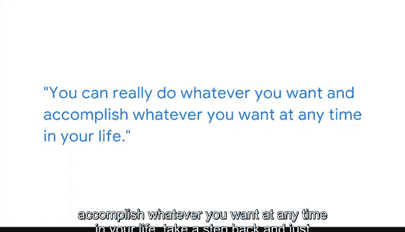

# 谷歌高阶数据分析3：《超越数字：将数据转化为洞察》go-beyond-the-numbers（中英双字） - P2：02_01_04_罗布-障碍与成就.zh_en - GPT中英字幕课程资源 - BV1Tz4y1t7PN

I'm Rob， I'm a product marketing manager at Google。

 I kind of grew up in the late 90s and the early 2000s in Boston and as an Asian American I was often really ridiculed for all the standard stereotypes of being an Asian and among those were being good or passionate about math or science。

When I got to high school， I really found myself rejecting。

Math and science and really trying to avoid those classes。

 trying to avoid studying them and leaning more into things like humanities or even sports。

 just because I just wanted to fit in so badly， I was lucky enough to be hired as essentially a literature review specialist at an economic healthcare consulting firm。

 What I found when I was first hired there was that there was this whole other arm of the company that was devoted to analyzing millions and millions of medical records data to really understand and help test the efficacy and safety of medications or pharmaceutical medications to help people with really severe issues。

 And they would do this again， by analyzing data for I think it was like over 30 million users。

 And when I heard about this， I was so excited。 I said wow。

 that is a really cool field to potentially get into。 So I had a chat with my manager。

who was really open to me taking on maybe some side projects， of course。

 after I finished my day to day job， and I remember I would spend time after work， after hours。

 I had this textbook that was reading up on just standard data analytics and statistics。

 but also something called SaS programming， which is a statistical analysis software that was used by the analyst at our company。

And so I dove straight and head on into that。 And eventually I became so fluent at it that I was able to transition to becoming a data analyst。

 And during my time as a data analyst， I was so passionate about understanding more and more about statistics and math in general。

 I actually ended up taking night courses at a local community college because it was my goal to really try to study more about statistics。

 and eventually I was lucky enough to apply to a lot of master's programs and statistics。

 and given my background， my experience， I was fortunate enough to get into one。

 I really wish that I hadn't maybe listened to the other people kind of making fun of me。

 and I just did what I wanted to do。 and I do to a degree regret that and I didn't have that foundation。

 But what makes me almost proud to a degree is that like。😊。

I was able as an adult to really transition into this field。 And like。

 it really just highlights in my mind that。😊，You can really do whatever you want and accomplish whatever you want at any time in your life。

 Take a step back and just realize that we're all different people on different paths at the end of the day。

Take your time each person learns in so many different ways。

 whether it be through these awesome online courses that we offer or enrolling in a university program or talking to their friends and working with them。

It's okay， whichever way you are best at learning。 You know， the， the point is。

 take your time and do what you need to do to learn。

 You shouldn't put yourself under pressure and compare yourself to anybody else。 You know。

 just be you。 and it's okay。