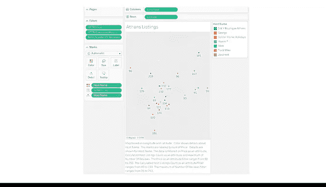

# 谷歌高阶数据分析3：《超越数字：将数据转化为洞察》go-beyond-the-numbers（中英双字） - P30：30_04_04_可视化生命周期.zh_en - GPT中英字幕课程资源 - BV1Tz4y1t7PN

Often， creating a data visualization is an iterative process。

 The first graph you design may not be the one you share with stakeholders。 The colors， text， labels。

 scale and areas of emphasis are all aspects of a graph that may change to meet different business needs。

But how do we get to that final product， What decision should we make along the way to create a successful visualization？

To answer these questions， we'll take a sample data set and create a data graphic then we'll discuss how to alter the visualization along the way This will illustrate the types of decisions data professionals make when creating graphs and charts for presentations Now let's get started。

Imagine you are working on a new app which will gather a list of the top rated rental homes and apartments in Europe in one easy to access place。

 Your company asks you to start by gathering the best rental listings in Athens， Greece。

 You want to know the locations of rental units where the owners have 40 or more property listings。

 You only want properties with many good reviews and a rental listing price between 90 and 250。

 This helps to clarify the type of visualization you need。

Since you want the locations of rental units where owners have 40 or more property listings。

 you need a geographic map， Additionally， you limit the count of listings based on the criteria of your analysis to create a map with the locations of rental properties。

 a program like Tableau will be the most effective。If you're familiar with Tableau。

 feel free to add this data set into the public Tableau and try it yourself。First。

 we'll start with a map of Athens。We'll plot all the rental listings on that map。

We'll use filters to remove rental properties that don't meet the analysis criteria。

 such as prices outside our defined range。Finally， we'll adjust the formatting to make our map easily understandable and accessible。

 Let's consider the dimensions of the graphic。 We know that the end result needs to be a map of listings in Athens。

 Greece。Let's input the latitude and the longitude from the data and plot those listings with the host name as the labeled spot on the map。

Now that we've added those data points to Tableau， let's see what it looks like。

 we have a map of grease， but we need to refine it so that it is easier to read Next。

 let's filter to the listings we don't want based on our analysis criteria。😡。

Narrow the results to only those owners who have more than 40 rental listings。

We can do that with the column in the data set called calculated host listings count。

 We limit the amount to only values over 40。This narrows the fields。 Next。

 we limit the entries by price。 Our criteria includes listings between 90 and 250。

 which gives us a much more manageable number of listings。

 We want to keep only the listings with a lot of reviews。 The word a lot， of course， is relative。

 So we'll use a percentile filter to just give us the top 50% of total reviews。This is the result。

Now we have a reasonable amount of data points， but what's next。

 we need to make it easier to comprehend to do so。 we add a title and add a color coding for the owners of each listing。

We also add the price for each listing， and this is the result。At this point。

 we have a workable visualization that meets our criteria。This is a successful first version。

 However， if we want to make this visualization part of a formal presentation。

 we need to make it accessible。 We do that by including a descriptive caption beneath it and making the marks slightly smaller。

 So more of the prices display。😊，We also want to be sure that colors are friendly to individuals who might have difficulty seeing color。

This is the result。

The goal with visualizations is to meet an audience's needs。

 You want to share the geolocation of rental property owners。

 You accomplish that with your map of Athen。But what if the app's business team decides they need different data display。

 or if you want to review property listings by neighborhood。

You would need to update the visualization。The main point here is that the resulting visualization may not always fit the business need。

Designing visualizations， as you'll remember， is a multistep process。

Even after you've completed a visualization， you will sometimes find you need to update it。

You may also get new information that requires you to change the original criteria。😡。

Making changes and fixing mistakes is all part of the process。

