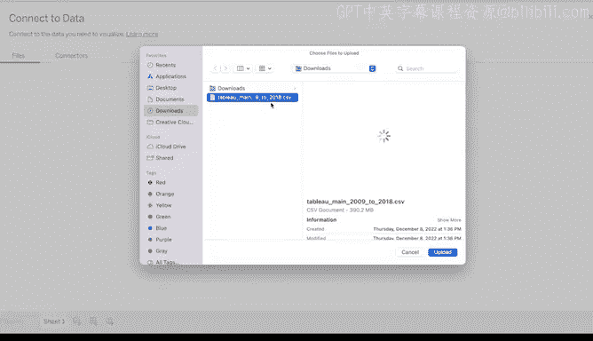
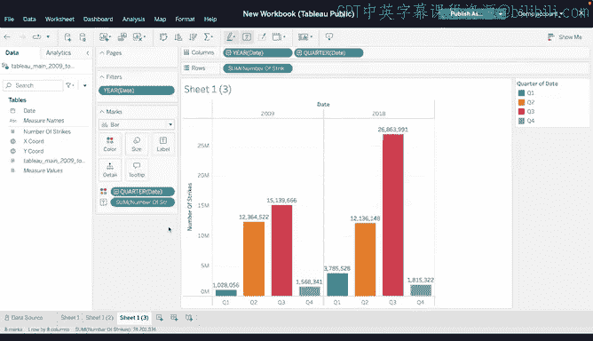

# 谷歌高阶数据分析3：《超越数字：将数据转化为洞察》go-beyond-the-numbers（中英双字） - P31：31_04_07_Tableau实操第一部分.zh_en - GPT中英字幕课程资源 - BV1Tz4y1t7PN

We talked a lot about the power and usefulness of Tau。 Are you ready to log in and try it out， great。

We'll discuss how to access a free online version of public Tau， build basic data visualizations。

 and understand when to use a variety of charts。You may remember some of these concepts from the Google Data Analytic certificate。

 and you can revisit that program for a quick refresher。When you access Tableau Public。

 it may appear different from this video。 Keep in mind that Tableau Public may have updated its user interface。

This should not be a problem because the steps you follow are almost the same。To begin。

 go to the Public Tableau website， which is the free online version of Tableau you can access from your browser。

Sign into your Tableau Public account。Next， you'll need to access a new data source in Tableau Public。

 We'll use the NoOAA Lightning strike dataset set again for this video。

On the Tableau Public homepage， select createate a Viz。

 upload your data source from your computer using the file provided for you。

 Once the data is uploaded， it will be redirected to Tableau's data source screen。

 The dataset set is divided into four columns。 D number of strikes， X coordinate and Y coordinate。

 There are symbols above or to the side of these fields names representing the types of data that are included in the data set。

There's a calendar icon for the date， a pound sign for the numeric column， number of strikes。

 and globe icons for the latitudes and longitudes or X and Y coordinates。

There are also tabs representing a new worksheet， new dashboard and new story。Create a new worksheet。

A worksheet in Tableau Public is a data page that contains a single view of a data visualization。

The new worksheet is blank other than the data column。

The data source field of the worksheet is preloaded with the column headers we identified on the data source page。

There is a thin line separating the list into two sections。

This indicates the data type and whether the data is discrete or continuous。

Tableau divides all the data fields into two broad data types， dimensions and measures。

You can tell them apart based on the icons tableableau assigns to each field。

Dimenssions are qualitative data values used to categorize and group data to reveal details about it。

 Measures are numeric values that can be aggregated or placed in calculations。

The green and blue colors in Tableau indicate another aspect of the list of dimensions and measures in the Tableau worksheet data tab。

Green indicates that the data field is continuous。 Blue indicates that the field is discrete。

The term continuous is a mathematical concept indicating that a measure or dimension has an infinite and uncountable number of outcomes。

Discrete is a mathematical concept indicating that a measure or dimension has a finite and countable number of outcomes。

With these definitions， we can learn about our list of data fields even before we plot them on a chart or graph。

😡，Keep in mind that Tableau may assign the wrong data type。

 you can always change data from measure to dimension or discrete to continuous by right clicking on the data field if the data type and its label do not match。

😡，Next， let's begin our visualization by plotting online graph。

Line graphs are useful for presenting time series data or tracking changes in data values over different periods of time。

To start， drag date into the column field。In the pop up that displays。

 you can select different segments of time。Select year for this chart。Next。

Drag and drop number of strikes into the row field。You now have a line graph。Now。

 you know how to create linegras。 Next， we'll create a bar chart。

Bar charts are useful when you want to compare things like data from two different time periods to get started。

 use the toolbar to duplicate your worksheet in the new sheet。

 open the dropdown menu in the marks field select bar changing data visualization types is really that simple。

😡，Next， let's create a bar chart to compare two data sets。

Go to the filterters tab and edit the filter。 Check 2009 and 2018。

Leave all the other years unchecked。You'll find a comparison of the total number of lightning strikes in the years 2009 and 2018。

Next， add a label to each bar by dragging number of strikes to the square in the markx field titled labelbel。

Now we know the exact difference between the number of lightning strikes in 2009 and 2018。30。

1 million and 44。6 million， respectively。For the last visualization。

 let's compare 2009 to 2018 by quarter。To start， duplicate the worksheet again。😡。

Drag date to the column field。Tableau will automatically add quarters to the stacked bars sectioning out Q1。

 Q2， Q3 and Q4 for both years。To make the side by side comparison of each quarter stand out。

 drag date to the color square in the marks field。The colors will adjust based on the year with 2009 in the original color and 2018 in a different color。

You can keep the chart like this or click the drop down arrow and select quarter instead。Now。

 the quarters are segmented by different colors to determine the color scheme。

 decide if you want to highlight the differences between quarters or between years。

You're starting to discover how useful Tableau can really be。Often。

 data professionals use Tableau for their EDA work because it helps them quickly create visuals of their data。

Soon， you'll be able to do that too。

