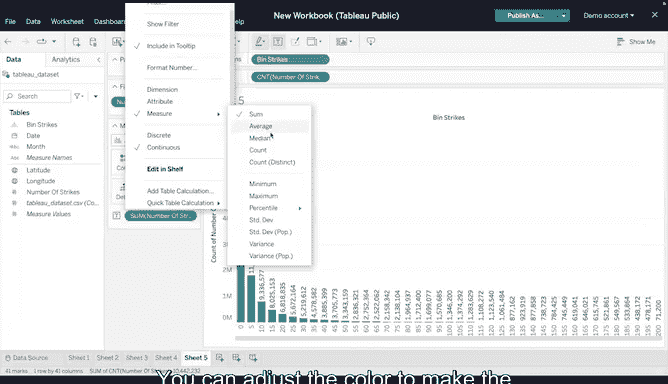

# 谷歌高阶数据分析3：《超越数字：将数据转化为洞察》go-beyond-the-numbers（中英双字） - P32：32_04_02_Tableau实操第二部分.zh_en - GPT中英字幕课程资源 - BV1Tz4y1t7PN

So far in this program， you've learned the basics of Tableau Public。

 like how to upload a data source and use discrete or continuous measures and dimensions to plot data visualizations。

Next， you'll design more complex visualizations including heat maps， box plots， and histograms。

You'll also learn how to input calculations and write code within the design elements of a visualization。

 Let's get started。Go to Tableau Public and create a new data visualization。

 We'll use another data set from the No OAA lightning strike data。😊。

Once you've uploaded the data source， you'll start your data visualization on the data source page with the No OAA Lightning strike data。

The date。Longitude， latitude and number of strike columns are all there。

Let's open a new worksheet so that we can create a geographic map。

This requires latitude and longitude data that Tableau can use to plot the points。First。

Drag longitude from the data list to our columns field。 Next， drag latitude into the rose field。

 Now we have a map。This is a great start。Next， filter the data so that you have fewer data points to work with。

😡，Drag date into the filters field and select year from the dropdown。

Then configure the filter to select only the year 2018。Next。

 use color gradients to help differentiate the denser locations on the map from the more scattered lightning strike locations。

Drag number of strikes to the box labeled color。In the drop down menu under marks。

 make sure that density is selected。Now that the map is much better。

The default color for this visualization is blue。The lighter blues indicate more scattered lightning strikes。

 and the darker blues are heavier lightning strike areas for the year of 2018 to change the color。

 click on the color square and change it from automatic to just something else。 Try one or two。

Consider which will make the map most accessible for yourself and for people who might have visual disabilities。

Next， let's create a heat map。As discussed in a previous video。

 a heat map is a type of data visualization that depicts the magnitude of an instance or set of values based on two colors。

To create a heat map in Tableau public， you need one or more dimensions or one or two measures to start。

 drag date to the row field and select year。Next， you need to create a calculation that derives the month from the date string。

In the date drop down menu， click createate and select Calulated field。A pop up will open。

 Let's give the calculator a title。For the calculated field name， input month。

Use the left function to pull the month names from the string in the column date。

Pull the first three letters from the month listed in the string type left。Pentheses。Date name。

 parentheses， month in single quotes， a comma date and brackets， parentheses， a comma。3。

Then add a closing parentheses。Click， okay。Now， there is a new field on the list of data on the left。

 drag month to the columns field， then drag number of strikes to the color square under the marks field。

Be sure that in the marks drop down， that square is selected。 Now you have a heat map。

 just like the density map， The default color for this heat map is blue。

You can adjust the heat map to a color range that fits your needs。

 Remember to consider accessibility as you create your visualizations。Now， let's create a box plot。

You'll recall from a previous video that a box plot is a data visualization that depicts the locality。

 spread， and skew of groups of values within quartiles。

You've already learned how to create a box plot chart in Python to create a box plot and tab below public。

 first drag date to the row field。Then drag number of strikes to the columns field and select year。

 If tableableau doesn't default to box plot， select circle from the drop down menu under the marks field and scroll to the show me tab to select box and whisker plot。

What you have so far is not much to look at。All you're seeing is a thin line of data points in a blank field of white background。

 However， once you drag date into the detail square under the marks field and select D。

 you'll see box plots appear in full strength with box plots。

 most data pros will include alleging or annotation of the exact numbers of median and mean for presentation。

You can of course， change the colors and size of the circle in this box plot using the color and size squares under the marks field。

Our last complex plot is a histogram。 A histogram is a data visualization that depicts an approximate representation of the distribution of values in a data set。

To create a histogram first， you need to create bins。

A bin is a tableau term that describes the custom segments of data that values can be grouped into。

Bins are an important part of histograms because the groupings in heat maps determine how the data is segmented and compare for a histogram of lightning strike data group the total number of lightning strikes into bins。

Do this by clicking on the number of strikes dropped down， select create， and then bins。

 You can give the bin a name and then determine the size。 If you select 50 for the size of bins。

 There would be one bin for every 50 lightning strikes。

 Any value between  one and 50 would be included in that bin。

 because there are millions of values of lightning strikes。

 you should select a number between 5 and 10。 This will display the distribution of values in much more detail。

Next， drag the new bin to the columns field， then drag number of strikes to the row field。

 make sure the number of strikes in rows is the count or C and T rather than sum or average。

This presents the actual count of each bin。To give us more detail。

 drag number of strikes to the filter field and limit the field numbers between 1 and 200。

 Dr number of strikes to the label square under the marks field。 Make sure it is set to count。

You can adjust the color to make the data visualization more accessible。

Coming up next， you'll learn how to create a series of data visualizations to use in a presentation。

 I'll meet you there。