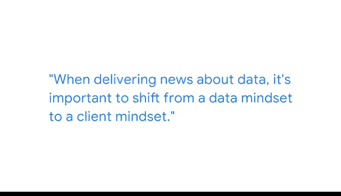

# 谷歌高阶数据分析3：《超越数字：将数据转化为洞察》go-beyond-the-numbers（中英双字） - P33：33_04_03_德鲁-探索数据的可能性.zh_en - GPT中英字幕课程资源 - BV1Tz4y1t7PN

。

Hi， my name is Drew and I am a predictive modeling specialist here at Google so originally I actually studied to be an accountant I worked as an accountant for about seven years most of what I did was working in finance so most people who work in finance become incredibly good at Excel and so I became better and better and better at Excel all the time and started working with different formulas formulas led me to figure out coding and then coding kind of led me towards data analytics Exploratory data analysis is everything you can't do anything without understanding the data first you need to first go in and you to really understand what every single variable is what the distributions look like what the initial correlations look like you could start to go deeper than that building explanatory models to start to look at longer correlations and multiplecorrelations between multiple variables together it's really it's everything that is data science。

I can remember a project where're working with a client who is spending tons of money on takeover media takeover media requires a large investment and it basically blocks out all other media spend from other people during a day so that you're concentrated on that day what we found is that there wasn't a reaction between takeover media and conversions on the other side so what we had to do when f it to the client is first figure out what are all the potential objections the client might have and once we got those inputs we're able to put together a story that wasn't so destructive to what they're doing currently but was constructive and showed them the way forward。

When delivering news about data it's important to shift from a data mindset to a client mindset so you need to marry the ideas that you learn during your data analysis to how it can actually be used by the client a lot of the ways that we do this is through visuals we try and incorporate visuals that are very simple yet communicative we use humor humor is a great way of engaging people and it makes it very memorable for people。

 you use personal stories， personal stories help get your point across to others very quickly I one side a professor who told them that you' have about 30 seconds to actually communicate with someone until they stop paying attention so you need to be able to get in there。

 make sure they remember it know what the takeaways are and have very succinct next steps of what to do with the data that you have presented to them。

