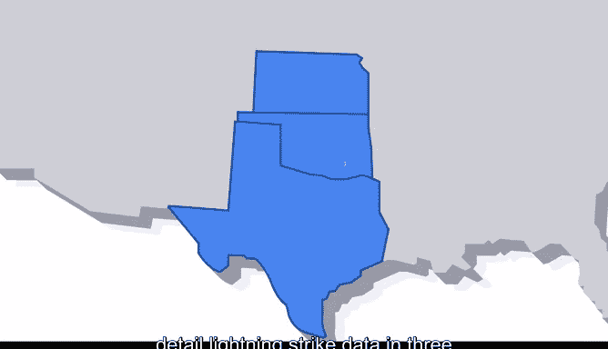
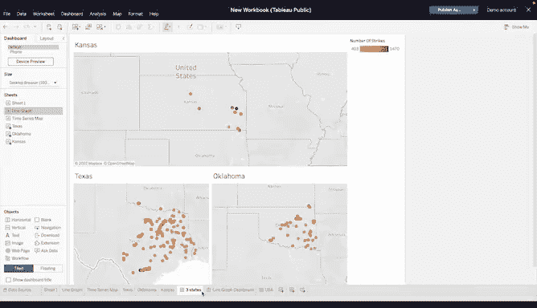
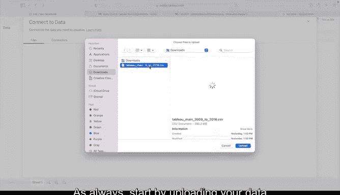
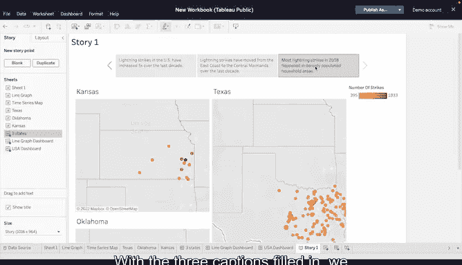

# 谷歌高阶数据分析3：《超越数字：将数据转化为洞察》go-beyond-the-numbers（中英双字） - P34：34_04_06_用Tableau打造引人入胜的故事.zh_en - GPT中英字幕课程资源 - BV1Tz4y1t7PN

Data professionals often need to present their data， creating。

 sharing and discussing data visualizations is an important part of telling data stories。

In this video， you will create a series of data visualizations that work together to tell a story。

This will allow you to lead an audience from one concept to the next and build additional context as you present each visualization。

But first， let's consider a scenario。Imagine you're working for an organization that wants to learn more about lightning strikes in the United States。

 They request a series of data visualizations that illustrate the increase in lightning strikes over time and detail lightning strike data in three states。

 Texas， Oklahoma and Kansas。

After you create your visualizations， you will need to share them with the organization's directors。

With the audience in mind， you can get started。You need to consider three strategies for organizing and presenting data visualizations in a series。

 chronological， generic to specific， and specific to generic。

 a chronological approach to data visualizations is useful for data that is best understood in a time series。

A generic to specific approach helps an audience consider an issue before describing how it affects them。

And a specific to generic approach is useful to highlight impacts that data can have on a broader scale。

Let's select an approach。A chronological approach or time series would be most helpful to consider data over time。

This does not address an important aspect of the request。

 visualizing strike data in three specific states。With a specific to generic approach。

 the climax of the presentation would focus on the United States as a whole rather than lightning strikes in Texas。

 Oklahoma and Kansas， this does not meet the needs of the organization。

A generic to specific approach would allow you to illustrate the country wide increase in lightning strikes followed by specific data on each state。

You can highlight national trend before targeting the lightning strike data in Texas， Oklahoma。

 and Kansas。This meets the organization's needs， so a generic to specific approach is the best choice。

 Before you design your visualizations， you need to create three different tableableau public worksheets。

 These will form a story in Tableau Public。 A story is a tableableau term for a group of dashboards or worksheets assembled into a presentation。

For the first worksheet， you will create a line graph showing an upward trend in lightning strikes starting with 2009 For the second worksheet。

 you'll show that the greatest amounts of lightning strikes have shifted from the east Coast of the United States to the south Central mainlands。

 and for the third worksheet you'll show the number of lightning strikes in Texas。

 Oklahoma and Kansas in 2018。The last year with complete data。

 these three sheets will form the generic to specific organization for the story。

 Let's open Tableau public and start designing。 As always， start by uploading your data source。

For the column field， drag in date， which is a discrete dimension and select year for it。

And for the row， add the number of strikes measure into that field。A line graph should appear。

If it doesn't， open the show me tab and find the lines discreteet selection。

You'll notice the line moves steadily upward from 2009 next we will make the data visualization easier to interpret。

 for example， add two annotations to the line graph， first add 30。

1 m strikes in 2009 to the beginning of the graph to give the audience a clear starting point。

Then add 45 m strikes in 2018 to its applicable position。 Next。

 let's create a geographic data visualization since we want to progress from generic to specific。

 it is important to show the trend of lightning strikes moving west over the decades to do that。

 we needed to create a time series map that shows the location of lightning strikes in the US for each year since 2009 in the new worksheet place the X coordinate in the column field and the Y coordinate in the row field。

 This will create a map focused on the Eastern and central US。If you're still seeing a line chart。

 make sure that both your X and Y coordinates are marked as continuous。

Once you have the geographic map， click on the drop down for both the X and Y coordinates and select measure。

 then average。This will give us a manageable view of the average number of lightning strikes in the US for each year Next。

 add the date discrete dimension to the filters and the pages fields。

Select year for the filter method。 The filter field allows us to create a dynamic filter which can be used to select just one year of lightning strikes。

The pages field can create a distinct snapshot or page of lightning strikes for each year。 Finally。

 add the number of strikes to the detail field。 The map showing lightning strike locations is comprehensive。

 We just need to add the interactive part to it。😊，With the year dimension in the pages and filters fields。

 you can format interactive legends to the side of the data visualization these allow users to self select the years they wish to see。

We have two of the three worksheets done that we need for our presentation。

The last thing to create is the most specific visualization of the three。

A snapshot of 2018 lightning strikes for Texas， Oklahoma。

 and Kansas to do this will create three new worksheets， one for each state。

Then we'll place the three snapshots into one dashboards。

We'll work together on the Texas visualization。 Then you can create the Oklahoma and Kansas visualizations all on your own。

Our map of lightning strikes in the state of Texas starts in almost the same way as the geographic chart we just made。

We put the x coordinate in the column field and the Y coordinate in the row field。

 We put the number of strikes measure in the detail field。This time。

 we add number of strikes to the color field and make the color coincide with the number of strikes。

Use red for most strikes and yellows for fewest。Because we will limit these state snapshots to just 2018。

 we drop the date into the filters field， select year， then uncheck all the years except 2018。

Finally， we need to create a set in Tableau Public A set is a tableau term for a custom field of data created from a larger data set based on custom conditions。

We can create a set by first selecting all the data points in Texas to do this。

 we'll use the Lasso tool。You will follow the state line as best as you can all the way around Texas Once complete。

 youll find a pop up window， select keep only then click。Create set。

Drag your newly created set to the filter field。Now。

 only the average lightning strikes for Texas will show up on our map。

We can now assemble them into one story。First。Add the two other state worksheets for Oklahoma and Kansas。

 which were created in the same way as the Texas worksheet。

Then create a dashboard for the three states illustrating the locations of lightning strikes in the US for the year 2018。

You should also create dashboards for the other two worksheets created earlier。

 the line chart and the interactive map of the US。 Now that we have three dashboards。

 we can create a story in Tableau On the first page of the story。

 insert the dashboard with the line chart。Fill in the caption to give details about what the chart is showing。

On pages2 and three of the story put the interactive map of the US followed by the dashboard that includes all three states。

 Texas， Oklahoma and Kansas。With the three captions filled in， we have a complete story。

Coming up， you'll learn how to create an interactive dashboard in Tableau， I'll meet you soon。

