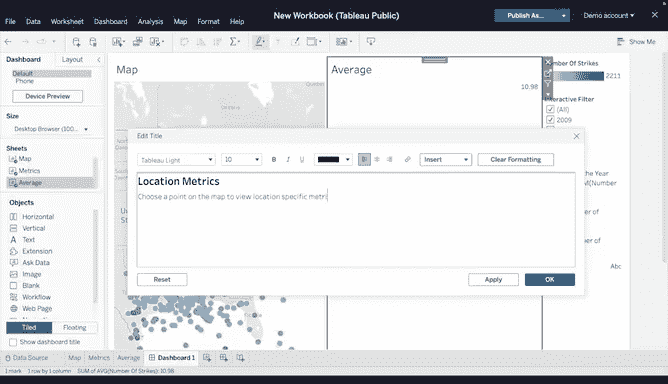

# 谷歌高阶数据分析3：《超越数字：将数据转化为洞察》go-beyond-the-numbers（中英双字） - P35：35_04_09_Tableau专业演示技巧.zh_en - GPT中英字幕课程资源 - BV1Tz4y1t7PN

So far in this program， you've been practicing essential tableableau skills。

Now you will learn how to put these skills together and create an interactive dashboard。

The interactive dashboard you create will display the quantity and the location of all lightning strikes in the United States from 2009 to 2018。

The dashboard will be color coded based on the quantity of lightning strikes。

 and it will allow viewers to select any year or location to learn the count of the strikes Let's get started。

Begin by opening Tableau public and uploading the data source provided。To build the dashboard。

 you will need to create three different worksheets。 First。

 you'll create an interactive US map with locations of lightning strikes for each year。

Then you'll create a dynamic stat sheets listing the metrics for each year。Finally。

 you'll design a way to pull and display the lightning strike metrics for the individual locations on each year's map。

Let's start with the interactive lightning strike map。To begin。

 add the X coordinate and the Y coordinate in the column and the row field。Next。

 drag date into the filters field and select year。Make sure the show filter option is checked。

For the last part of this map， drag number of strikes into both the color。

 square and detail square in the marks field。The color square will categorize the dots on the map with a color code based on the quantity of strikes。

The detail square will plot the locations for each of the lightning strikes for each year。

Make sure when you do this that both number of strikes variables are set to continuous。

For the next worksheet， you will create a list of three metrics that will change on the dashboard whenever a year selected。

The three metrics are total number of strikes， average number of strikes for each location for that year。

 and maximum number of strikes in any location。This worksheet will differ from our other visualizations。

 It will be text rather than a bar chart， or line graph。

It will sit to the side of the interactive map and update whenever a new year is selected。First。

 create a calculation from the number of strikes dimension。

And the blank field space type number of strikes and put it in bracket。Next。

 drag the new calculation into the tool tip square in the markx field。In the drop down。

 select measuresure and average。Repeat this process， but instead of selecting average。

 you should select sum and maximum。This creates dynamic fields for three metrics。

 the total number of strikes， the average number of strikes for each location for that year。

 and the maximum number of strikes in any location。Finally。

 create a place to display these calculations to keep it simple。

 go to worksheet and select show title。😊，Input the title metrics for the year。Under that。

 you will include the three calculations in the tooltip。To do this。

 put an asterisk followed by total colon， and then sum and number of strikes inside the left and right angle brackets。

Repeat this step for the maximum and average toolt you created。And there you have it。

For the last worksheet， drag number of strikes to the text square in the marks field。

In the drop down， select measure and average。 This creates a dynamic field for the dashboard we'll create next。

 Now， select new dashboard。You should find all your worksheets in the list on this page。

 drag over the worksheet with the interactive map in it， it may take a few seconds to load。😡，Next。

 drag your other two worksheets into the dashboard。Before we clean these up。

 we need to create an action for the dashboard。An action is a tableau tool to help a user interact with a visualization or dashboard by allowing control of a selection。

When a year is selected from the filter bar， all the other fields will update with it。

We will connect the three worksheets together with an action。Click on the map in the dashboard。

 select worksheet and actions in the actions pop up。

 select Add action and filter in the Add filterter action menu in the source worksheets section。

 select your dashboard from the dropdown。Check the box for your mat。And for the run action on list。

 click select。For target sheets， select your dashboard from the drop down。

Then select the map and the recently completed worksheet that will gather metrics for individual locations。

From the list of clearing the selection will select show the values。 Lastly。

 select all fields for the filter section click OK。And now you have an interactive dashboard。

Update the text and titles before you're done。Add a title to the filter legend。

 interactiveactive filter。You should also title the location average variable， location metrics。

 and write brief instructions to clarify what the tool does。For example。

 you might type choose a point on the map to view location specific metrics。

Take a few minutes to test your dashboard， select different years and locations on the map to make sure the tools function properly。

What a collection of tableau skills。The tools and techniques you've learned in this video will help you communicate and present ideas more effectively throughout your career as a data professional。

 Good luck and happy designing。😊。