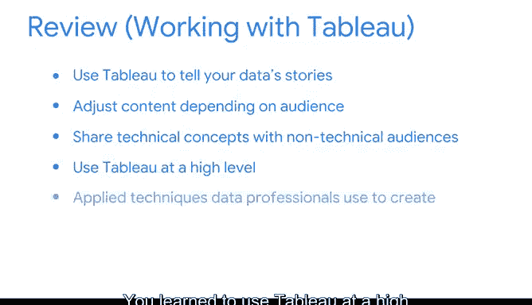

# 谷歌高阶数据分析3：《超越数字：将数据转化为洞察》go-beyond-the-numbers（中英双字） - P36：36_04_01_总结回顾_4.zh_en - GPT中英字幕课程资源 - BV1Tz4y1t7PN

If you were to design a data visualization of what you've learned in this program。

 what might it look like？Would you plot your engagement level over time on a line graph。

 or would you create a heat map showing the task you completed with different colors representing the task that took the least and most time？

No matter what visualization you choose， you've learned the skills you need to create an effective graphic or visualization that an audience can understand。

 You've learned to use Tableau public to tell your data stories。

 and to adjust the content depending on the audience。

 We also discuss the best ways to share technical concepts with non-technical audiences。

 you've learned to use tableableau at a high level。

 and you've applied the technique data professionals use to create visualizations。

 No data visualization discussion would be complete without considering ethics and accessibility。

 you learned that as a data professional， it is your responsibility to ensure visualizations accurately represent the data。

 you also learned how to make data visualizations accessible for people who have visual impairments。

 you learned a lot。

Congratulations on completing this section of the program and good luck on the rest of your journey。

