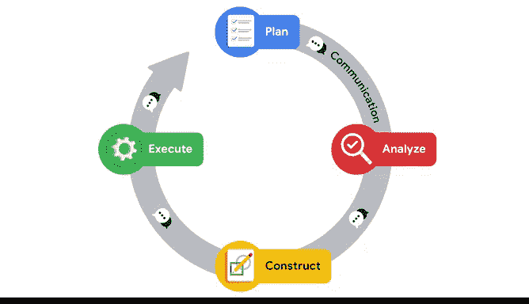

# 谷歌高阶数据分析3：《超越数字：将数据转化为洞察》go-beyond-the-numbers（中英双字） - P37：37_05_01_欢迎来到模块5.zh_en - GPT中英字幕课程资源 - BV1Tz4y1t7PN

Hi， I'm Tiffany， and it's great to be with you again。 You've made a lot of progress in the program。

 So I'm back to tell you more about your portfolio projects and how you can use them in your future job search。

 Remember， your portfolio will be a collection of materials you can use to showcase your approach to solving data oriented problems in the portfolio project for this course。

 you will demonstrate your knowledge of telling stories using data。

 It's an incredibly important skills for a data professional to know on the job。

 but it's also critical for success in an interview。

 as potential employers assess you as a candidate， they might ask you for specific examples of how you approach cleaning structuring and validating data in the past。

 You can use your portfolio as a way to discuss actual data challenges you have resolved and real stories you have presented。

😊，Additionally， some employers might ask you to create a presentation based on the data set they provide。

The skills you've learned in Python and Tableau to create data visualizations will help you feel more comfortable and prepared for those interviews。

 as well as build out your portfolio。You already learned about experiential learning。

 which is when people gain understanding through doing watching an instructor create visualization is one thing。

 C a visualization yourself to expand your understanding of the concepts and improve your skills at presenting to stakeholders is another。

 This portfolio project is also a great opportunity to discover how organizations are using data analytics every day and show off your knowledge of how to tell data driven stories to complete the portfolio project。

 you'll be working with a database and in accompanying business scenario。

 You'll use instructions to complete a Jupiter notebook showing your E D work and3 to5 visualizations in tableau in response to the scenario By the time you complete this project。

 you have a comprehensive presentation， you can add to your data professional portfolio。😊。

In your pay strategy document， you'll also have documentation of the steps you took along the way。

 which you can use to explain your work to future hiring managers。

 You're almost finished with this course， which means you' are advancing your understanding of what it means to be a data professional。

Now it's time to demonstrate what you've learned。 This portfolio project will help you practice and demonstrate the skills you've learned throughout the course。

 For example， you'll be able to show how to form the practices of E D A in Python。Uthing Table below。

 you'll demonstrate how to create data visualizations that accurately detail a data set story。

And you'll be able to demonstrate how to prepare and document a comprehensive workflow strategy using PAce。

Ready， let's go。