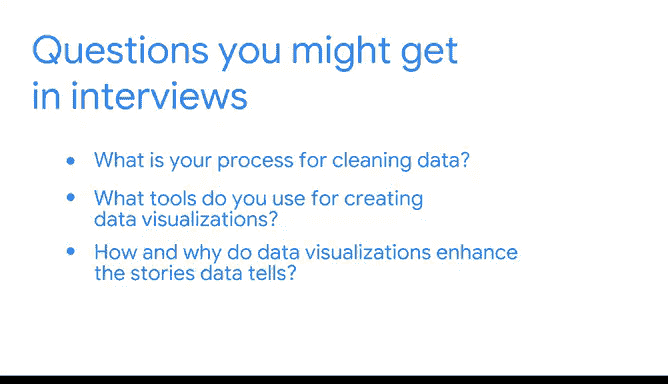

# 谷歌高阶数据分析3：《超越数字：将数据转化为洞察》go-beyond-the-numbers（中英双字） - P39：39_05_01_终期项目总结与职业发展建议.zh_en - GPT中英字幕课程资源 - BV1Tz4y1t7PN

At this point in the program， you've done a lot of work toward better understanding data and how it can be useful for enacting change in a business。

 You completed a Jupyter notebook， created visualizations to support your work and refine your presentation to meet the needs of your particular audience。

As you continue to make progress in this program， remember that documenting your learning。

 process and skills will help you communicate what you've done to potential employers and hiring managers in future interviews。

 You may recall from previous sections of this course that audience awareness is essential。

During the interview process， knowing how to talk about your work process。

 transferable skills and other achievements will lead to much greater success。In this course。

 you learn the importance of following the pay structure in a data career。

You practice using Python to manipulate data， and you demonstrated how to organize and analyze a set of data to tell a compelling story。

The portfolio projects were designed to help you thrive on the job market and the transferable skills you applied contributed to the tangible artifacts you created。

As you begin preparing for future interviews， you should be ready to answer questions like。

What is your process for cleaning data？What tool do you use for creating data visualizations。

 How and why do data visualizations enhance the stories data tells。

And what considerations are top of mind when sharing data stories with non technical stakeholders？

Of course， there may be many other questions that you are asked as you interview for a data professional role。

Each portfolio project will help you prepare responses。 for example。

 in the portfolio project you just completed。 you use the EDA process to clean。

 organize and analyze a data set。 Then you turned your data into a presentation full of visualizations that will help stakeholders understand insights from the data story you discovered。

 Don't forget that you recorded all of your considerations， Que。

 process notes and more in your pay strategy document as well。Coming up。

 you're going to learn all about the power of statistics in data driven work。

Then you'll have an opportunity to use statistical analysis to simulate an A B test。

 By the end of these courses， you will have lots of artifacts in your portfolio。

