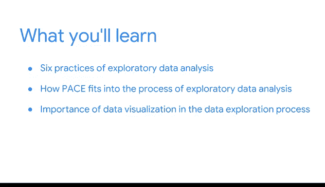

# 谷歌高阶数据分析3：《超越数字：将数据转化为洞察》go-beyond-the-numbers（中英双字） - P3：03_01_05_欢迎来到模块1.zh_en - GPT中英字幕课程资源 - BV1Tz4y1t7PN

Hello again， welcome to the first section of this course。😡，In the next few lessons。

 we'll be exploring the foundations of data analysis and how the six practices of exploratory data analysis help us find and tell stories using data。

 We'll begin by discussing each of the six practices of exploratory data analysis。

 You'll learn about what they are and why they're important。

Then we'll learn about how our data professional workflow， pace， or plan， analyze， construct。

 and execute fits into the process of exploratory data analysis。Finally。

 you'll learn the importance of data visualizations in the data exploration process。

 will' consider what data visualizations are and how data professionals use them to learn about and share data。

The next few lessons will lay the foundation for how to tell stories using data。

 I hope you're as excited as I am to get started。

