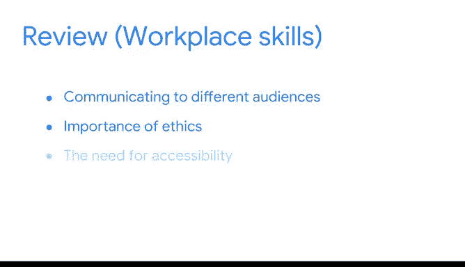

# 谷歌高阶数据分析3：《超越数字：将数据转化为洞察》go-beyond-the-numbers（中英双字） - P40：40_05_02_课程总结.zh_en - GPT中英字幕课程资源 - BV1Tz4y1t7PN

Do you remember imagining yourself as an archaeologist at the beginning of this course？

You stood in front of an ancient river bed at dawn。

 excited at the possibilities of what you might find under the rock。What stories would you uncover。

 What long lost mysteries might you reveal。After learning the content in this course。

 hopefully you've had the same level of excitement our archaeologist feels when it comes to EDA and visualizations。

As you've learned， the six practices of EDA help find the stories that need to be told from data sets。

As you're discovering， structuring and cleaning in your career。

 I hope that you are digging through the data with determination。

 gathering your major finds together， questioning your perspective。

 and researching more about your discoveries。Then I hope you remember the other three practices of joining。

 validating， and presenting to complete your EDA work。In this course。

 you've had the chance to explore how data professionals take care of the stories that have plot holes or puzzling scenes。

 or that is missing data and outliers。 You also learn how to change categorical data into numerical data。

 using the label encoding technique。And finally， you considered how to design visualizations and present your data in really impactful ways。

You learn the advanced concepts of visualizing， and you started using Tableau。

Throughout these lessons， you learn some workplace skills like communicating to different audiences。

 the importance of ethics， the need for accessibility。

 and the importance of following the pace workflow。

 These are the types of skills which will serve you throughout your career from entry level data professional to senior data professional and beyond。

In the upcoming courses， you'll be learning some integral concepts in statistics， regression。

 and machine learning。The knowledge you've gained in our course will be foundational to your progression through these next courses。

 as well as through your career as a professional in data analytics。

 It has been my pleasure instructing you。😊，The practices of EDA and data visualization are close to my heart。

 and I'm always excited to meet future data professionals learning these principles。

Great job on completing this course。 You have the makings of a solid storytelling data professional。

 May you always find excitement in exploring and telling stories using data。😊。

