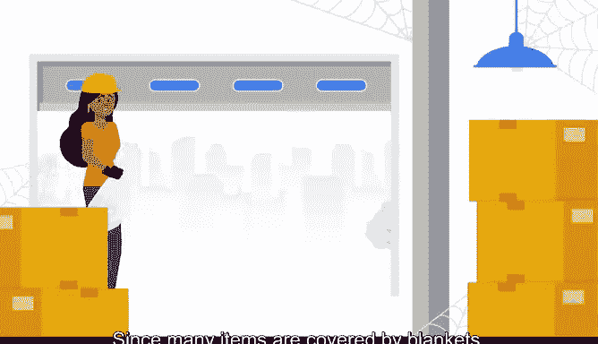
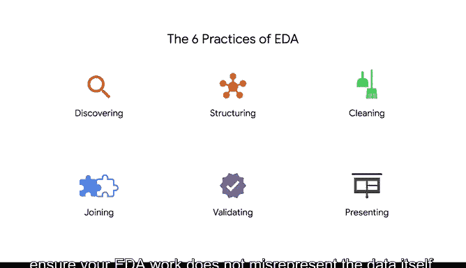

# 谷歌高阶数据分析3：《超越数字：将数据转化为洞察》go-beyond-the-numbers（中英双字） - P4：04_01_06_运用六大探索性数据分析实践寻找故事.zh_en - GPT中英字幕课程资源 - BV1Tz4y1t7PN

Imagine you work for a company that's been hired to clean out a very old one room warehouse full of antiques。

 your manager says no one has used the building for decades and doesn't know what the owners used it for for over the years you've been assigned to clean it out and create a detailed inventory of what you find inside so that the items can be sold at auction。

The manager suspects there'll be interesting antiques inside。

Since many items are covered by blankets， you don't know what the room contains。

 you start cleaning from one side of the room to the other and you keep a digital inventory of the items you find As you explore。

 you find a pile of metal gears， chains and connection parts of all different sizes and shapes。

 you count them in right metal parts 47。

You also find five large metal sheets， 12 large tricycles， and seven metal poles among other things。

 as you write these new items， you start to wonder if they're related or not。

This simple example demonstrates how data professionals explore data and learn more about the stories and trends along the way。

As you uncover and clean up what is in front of you。

 the individual parts and pieces within the data will start to tell a larger story。 Of course。

 data requires a few extra techniques and practices that in the warehouse example。

 but the general ideas the same you'll need to make sense of raw data content by reordering categorizing and reshaping it。

 you'll find a lot of different terms in the world of this process。 data wrangling， data remediation。

 data muing and data cleaning are all the most common。

 We combine all of these practices into a familiar term that most data professionals are familiar with Exploratory data analysis or EDA。

Expllororatory data analysis or EDA is the process of investigating。

 organizing and analyzing data sets and summarizing their main characteristics often employing data wrangling and visualization methods。

 the six main practices of EDA are discovering structuring。Cleaning。Joining。

Validating and presenting。These practices do not necessarily have to go in this order。

 and depending on the needs of the data team and the type of data they study。

 they may perform EDA in different ways。You'll also find that often the EDA process is iterative。

 which means you'll go through the six practices multiple times in no particular order to prepare the data for further use。

Let's spend time on each of the six practices so that you have a better idea of what I mean。

Discovering is typically EDA's first practice。During this practice。

 data professionals familiarize themselves with the data so they can start conceptualizing how to use it。

They review the data and ask questions about it。During this phase。

 data professionals may ask what are the column headers and what do they mean how many total data points are there in the example of the old warehouse at the beginning of the video。

 the discovering practice might involve walking through the room and removing coverings to get an idea the amount and types of items。

After some initial discovering， the next step is to start organizing this EDA practice is called structuring。

Structuring is the process of taking raw data and organizing or transforming it to be more easily visualized。

 explained， or modeled。Structuring refers to categorizing and organizing data columns based on the data already in the data。

😡，In terms of the calendar data， for example， it might look like categorizing data into months or quarters rather than years。

From the old warehouse analogy， structuring could be categorizing the items into metal and nonmetal categories and getting a total count for each type before we move to the next practice of EDA。

 let's take a moment to talk about bias。Bs in the context of data structuring is organizing data in groupings。

 categories or variables that don't accurately represent the whole data set。

Most experts would agree that eliminating all bias from how data is structured is almost impossible because each person's individual ideas。

 training， and experiences are different。As professionals， however。

 it's important to try to avoid bias while structuring data， For example。

 imagine you want to know what percent of the population has a college degree in the UK。

 but your model data only contains London residents。

The data would be considered bias until you add data from the rest of the UK。

In our warehouse example， trying to avoid bias might involve remaining flexible with the categories。

 potentially creating new categories as you uncover more and more items。

The next EDA practice is data cleaning。Cleaning is the process of removing errors that may distort your data or make it less useful。

Missing values， misspellings， duplicate entries， or extreme outliers are all fairly common issues that need to be addressed during the data cleaning In the warehouse example。

 you might decide to put broken or unusable items in a separate box away from other items。

We'll move to another practice called joiningin。Joining is the process of augmenting or adjusting data by adding values from other data sets。

 In other words， you might add more value or context to the data by adding more information from other data sources。

😡，For example， you might find during the discovering， structuring。

 or cleaning processes that the data doesn't have enough data for you to complete a specific project。

In that case， you should enrich the data by adding more to it as an example。

 remember when I talked about the UK and college degrees to help understand bias。In that instance。

 joining would be adding the data from the rest of the UK rather than just including data on London residents going back to our warehouse analogy。

 imagine a museum manager sorts through the items and gives you the dates of when each was made。

The information from the museum manager acts as a different group of data you can join with your own as you inventory the items。

Next on the list of EDA practices is validating validating refers to the process of verifying that the data is consistent and high quality validating data is the process for checking for misspellings and inconsistent number or date formats and checking that the data cleaning process didn't introduce more errors。

Data professionals typically use digital tools such as R， JavaScript。

 or Python to check for inconsistencies and errors in a data set。And its's data types。

As for a warehouse analogy， validating could be like using the museum manager's knowledge to get an idea of how old the items are。

The last EDA practice is presenting。Presenting involves making your cleaned data or data visualizations available to others for analysis or further modeling。

In other words， presenting practice is sharing what you've learned through EDA and asking for feedback。

 whether in the form of a clean data set or data visualization。

We will be using the term data visualization a lot。To be clear， a data visualization is a graph， Sha。

 diagram， or dashboard that is created as a representation of information。

You might think that presenting always comes at the end of the EDA process， however。

 presenting can come at any point in EDA。😡，Data visualizations aren't exclusive to the presenting practice。

 they should be used throughout EDA， they help you understand data and point out trends and insights to others。

In the warehouse analogy， presenting could mean showing your manager the progress on the warehouse and how many different items were found。

In the workplace as a data professional， presenting might look like preparing visuals and a slide presentation to share with your team。

As you begin to plan your presentation， you should consider people with visual or auditory impairments by providing robust descriptions of the data。

😡，You can use things like alt text， descriptive text。

 or captioned recording of the data so that your audience can explore the data themselves。

We will cover each of the EDA practices in detail later on。

 but one of the most important things to learn about the process is to ensure your EDA work does not misrepresent the data itself。

The story you uncover should come from the data， not from your mind or biases in the data。

It is your duty to convey your data in both an ethical and accessible way。

Consider the warehouse analogy to ensure you communicate your data ethically。

 you should give an accurate count of the materials and not overestimate the quantities of the antiques in the workplace。

 communicating data ethically would be presenting sales numbers in context year over year so that rises and falls don't appear exaggerated in data visualizations。

Once you complete the warehouse project， you realize you've uncovered a story you find a dusty pair of signs that advertise food for sale。

 Suddenly the items you found start to make sense as a whole these antiques appear to be a collection of supplies used by a group of traveling food vendors Now how about that for discovering a story Of course you should confirm this information using historical records before sharing。

