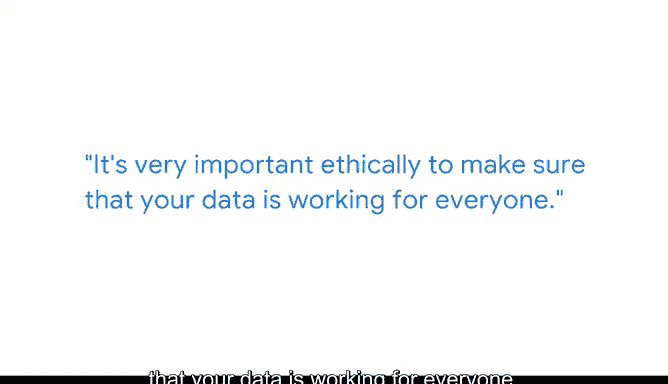

# 谷歌高阶数据分析3：《超越数字：将数据转化为洞察》go-beyond-the-numbers（中英双字） - P5：05_01_08_本杰-数据科学与叙事艺术.zh_en - GPT中英字幕课程资源 - BV1Tz4y1t7PN

Hi， I'm Benge， I'm a product analyst at Google I lead a team of analysts attempting to understand Google Chrome through real-wor usage and insights Exploratory data analysis is a key piece of my work and in particular when you get a new piece of data or when you have a new question the first thing you have to do is take a deep look through the data that's there and understand what's in front of you you have to understand who the data is from。

 you have to understand why it was created and what is and isn't there and what important caveats are sitting on top of it Sttelling is the way that your insights make it to other people and really make change It's oftentimes the case that will make reports that are tens of pages long but what really changes the way people think is when you can tell a short and clear story about what's going on a really good way to tell a story with data is to think about categories of users。

 categories of devices or categories of use。Cases when you can tell people that a lot of people are using Chrome on low end phones in India。

 it tells a story about who your user base is and what they're doing and knowing who they are and knowing what that looks like。

Allows them to think differently about who the audience is and what product they should build。

One thing I try to do to make sure that I'm really staying true to data is trying to check my own biases and make sure that I am giving back what I actually see one way that I attempt to make sure that my reporting isn't biased is to try to come into new analyses with as few preconceptions as I can you need to know some things to be true and to verify them against the data to make sure that you know users aren't spending 27 hours a day on their phone because there aren't 27 hours in a day。

 but to not assume that everyone is going to look the same。

 to not assume that all places in the world are going to act the same when it comes to new data It's very important ethically to make sure that your data is working for everyone to make sure that if you try to remove identifiers or if you try to take data and depersonalize it。

 that you've really done that well and effectively the simplest methods aren't always the best。

 it isn't enough to just say oh， I tried something。

Need to stop。You have to explore a little bit more and make sure you're really de identifyingifying data Curiosity is one of the most important traits for an analyst in general。

 and by trying to learn something new you're showing that curiosity already。

