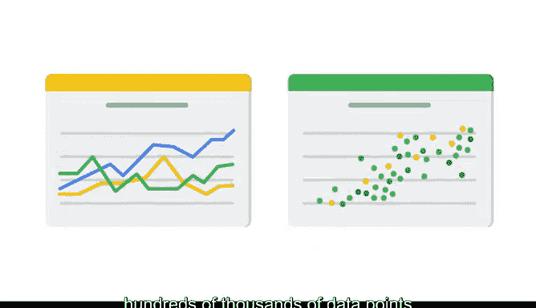
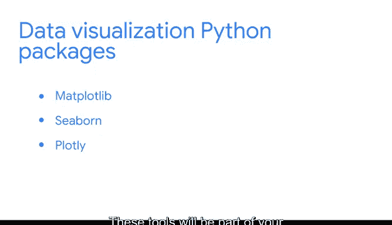

# 谷歌高阶数据分析3：《超越数字：将数据转化为洞察》go-beyond-the-numbers（中英双字） - P7：07_01_03_数据可视化中的节奏控制.zh_en - GPT中英字幕课程资源 - BV1Tz4y1t7PN

Let's review a scenario， shall we， You're given a giant table of numbers and a data visualization。

 which would you choose to most quickly communicate data insights。

 Data visualizations are far more effective at quickly communicating complex information than data tables。

Now， let's consider how this relates to EDA。Data visualizations are important tools that data professionals use to tell stories with data throughout their workflow。

 particularly the EDA practice of presenting。Plotting parts or all of your data set on a bar graph。

 a scatter plot， a pie chart， or a histogram will help you and others to understand the data no matter where you are in the EDA process。

As a data professional， you won't be working with simple。

 clean data sets that have only a few hundred lines of data you'll be working with data frames that have thousands or hundreds of thousands of data points spanning months。

 years or decades even。😡。

The more data you have， the more visualizations you'll need to create to understand how each variable impacts the other。

 When you start looking at new data， a popular and valuable tactic is to visualize it。

 like time series data on line charts to understand periodicity or scatter plots to get a good idea of data distribution。

Data visualization can also help you explain your data set to stakeholders and other data professionals。

 It is your job to discover the important points， trends。

 biases and stories that need to be shared then design data visualizations in an effective way for different audiences。

 For example， imagine you're a data professional who works for an appliance manufacturer。

 Let's say you perform an analysis for the manufacturing team。

During the analysis， you discover a delay in the manufacturing process。

 you need to communicate these findings to two different audiences。

 the manufacturing supervisors and the executive leadership team。When you share your findings。

 some stakeholders may not understand the data insights without the help of data visualizations。

The ways data visualizations are designed will communicate different messages to stakeholders with vested interests in different parts of the project。

For example， the manufacturing supervisors might need to review time series data plotted out over time to identify the manufacturing delays。

 Meanwhile， the executive leadership team would likely be more interested in financial impact analysis。

Those two data visualizations would need to be designed differently based on the needs of your audience。

We will go into detail on exactly how to do that in the upcoming videos， but in the meantime。

 understand that the balance of words and data visuals in a presentation impacts the business decisions made from data insights。

A carefully prepared data visualization can mean the difference between changing the mind of a stakeholder and the data being ignored。

 However， visualizations can also cause confusion or even misrepresent the data。For instance。

 imagine a dated professional develops a visualization and changes the scale of the axes or the ratio of the graph height and width to make the line chart look flat or steep。

This example of skewing is the opposite of what data analysis is about。

Because you will be the person most familiar with the data and its story。

 It is essential that your visualizations not mislead your audiences。

Returning again to the manufacturing equipment example。

 if you provide a data visualization showing a sharp increase in sales over the last six months。

 your audience might assume the company is doing very well。

 but if data from the last two years shows the six monthth increase comes right after a long 18 month decline。

 the last six months has a different context。Showing only the last six months。

 as opposed to the two years， is misrepresenting the sales data。

Your data driven storytelling is an opportunity to present facts and visualizations that are ethical。

 accessible， and representative of the data。Being an ethical presenter of the data you analyze means being honest and very clear about what is and isn't in the data。

Along with that， remember to design your data visualizations in a way that is accessible to everyone。

 For example， avoid pairing red and green in data visualizations as it can be difficult for people with color blinddness to read。

Generally， blue and orange are the better choice to use in data visualizations。

 We'll go into more detail on ethics and accessibility in upcoming videos。In other videos。

 we'll use digital visualization tools like Tableau and Python packages like Mattplloot Libb and Seaborn and P L Y to understand how to use your data and graphs and charts in ethical and accessible ways。

 These tools will be part of your everyday work as a data professional。 Remember。

 creating visualizations about your data sets will help you throughout the entire EDA process。

There is often no better tool for telling a good data driven story than a well made visualization。

