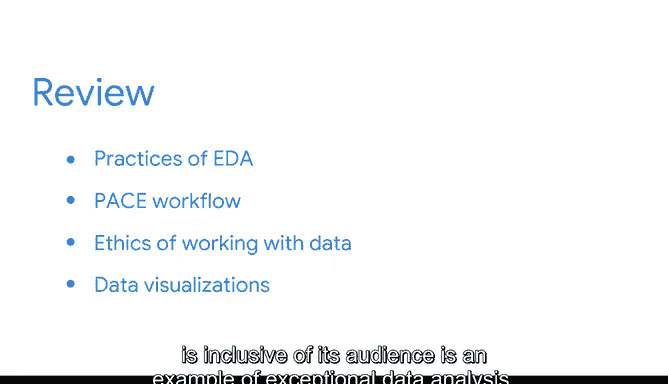

# 谷歌高阶数据分析3：《超越数字：将数据转化为洞察》go-beyond-the-numbers（中英双字） - P8：08_01_01_总结回顾_1.zh_en - GPT中英字幕课程资源 - BV1Tz4y1t7PN

We've talked a lot about finding stories within data and about how it is your job to tell those stories to the best of your ability There is。

 however， another story weaving its way through the readings。

 videos and quizzes and is still continuing to unfold as you've listened to this video and if it isn't clear it's the story of you coming this far in the program shows you are determined to become a data professional。

I hope you feel inspired by the idea of defining not only the stories of your data。

 but your own story as well。I'm sure you notice that this part of the course had very little coding instruction in it。

 that's by design。The job of data professionals is about more than coding and statistical modeling。

The first part of the course reflects that。It is also important to recognize how exploratory data analysis or EDA applies to finding。

 sculpting， and telling data driven stories。If you talk to data professionals in the career space。

 many will share how beneficial EDA is in day to day work。

So I took some time to talk about the practices of EDA。Discovering。Structuring， cleaning， joining。

Validating and presenting。And review the value of these practices。

We talked about the pace workflow and how it can apply to EDA in our search for stories within the data。

You also learned about the ethics of working with data and the importance of representing data accurately when we tell data stories。

Lastly， you learned how data visualizations are essential for understanding。

 forming and presenting datadven stories， you learned that telling a datadriven story that accurately represents the data and is inclusive of its audience is an example of exceptional data analysis。

The story doesn't end here though， we have many more concepts to learn in this course。

 including using Python tools and coding blocks to help you in your EDA practices of discovering。

 structuring and cleaning raw datas。In this program。

 you will work with data sets that represent the type of raw data you'll likely see every day in your career as a data professional。

Remember， all data has stories to tell， these stories are often hidden well and it will take an especially curious and determined professional to discover them。

The data driven stories you'll be discovering have the potential to change an entire company or even the world。

I am looking forward to continuing our journey together through the rest of this course as you discover questions。

 solve problems， and learn new concepts。I hope with each new concept you learn。

 you discover a little more about your own story as well。 I'll see you soon。

