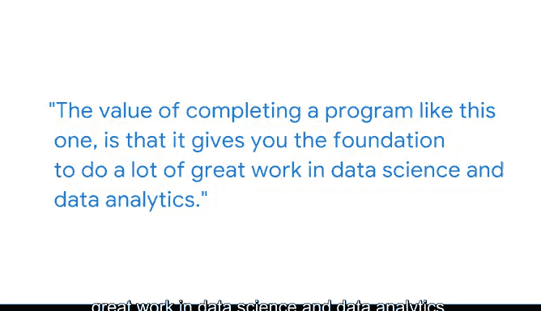

# 谷歌高阶数据分析4：《统计的力量》the-power-of-statistics（中英双字） - P10：10_01_07_Alok：统计学作为数据驱动解决方案的基础.zh_en - GPT中英字幕课程资源 - BV1yk4y1G7Qm

I'm Auk， I'm a data science developer advocate at Google Cloud What we do generally is talk to developers about how to use Google Cloud。

 The way I think about statistics is that it's a combination of mathematics and applying it to data It's important for data professionals to learn about statistics because I think it gives you a good foundation for sort of the math behind the techniques you're going to apply and to give sort of a breadth of information for how you might apply this math to different problems and my first job at Google where I was a data scientists on the search ads teams。

 we used statistical methods to generate insights that informed decisions all the time In fact it was essentially the core of the job one time where statistics helped influence decision makers from my experience was a project where we had two groups let's say on A and B and youre seeing we were seeing some big differences in the behavior of these two groups in a particular particular metric The executives were kind of worried about why were they different maybe it shouldn't be so different and statistical methods were crucial to this。

 we had to adjust for things like mix。Facts looking at different slices of our data。

 adding confidence intervals around the sort of mean difference we're seeing and what we found was that the difference was not as large as we had seen and it could be attributed to sort of these other things like mix among our users or things like that。

 And we presented this to the executives they were sort of relieve that the differences were not as big and there wasn't something necessarily to do to change the dynamic between group A and B it was sort of within the reasonable difference that they felt was okay The idea is essentially statistics will give you a set of tools and in this case it gave me a set of tools to kind of decompose this problem into various parts and start to explain why we were seeing the differences we were seeing。

 the value of completing a program like this one is that it gives you the foundation to do a lot of great work in data science and data analytics Having done some coursework and data as well as having some project experiences sets you up well to be able to analyze data and make an impact。

In whatever industry you end up working in。 the best thing I can tell those who are kind of in the middle of this。

 maybe struggling through is keep your end goal in mind， right。

 whether it's learning a new skill or opening up a whole new career path that that can really be a differentiator for you。

 Try to keep it step by step。 if you fall a little bit behind。

 Forive yourself and just keep that end goal in mind。 That's where you want to get。

