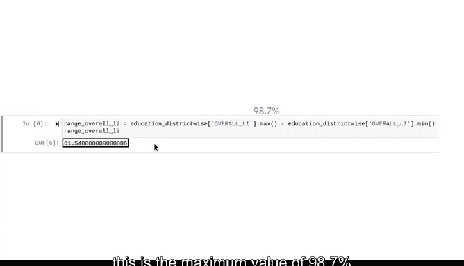

# 谷歌高阶数据分析4：《统计的力量》the-power-of-statistics（中英双字） - P11：11_01_01_使用Python计算描述性统计.zh_en - GPT中英字幕课程资源 - BV1yk4y1G7Qm

Recently， you learned how the descriptive statistics help you explore and summarize key features of your data。

We talked about three different types of descriptive stats， Measure of central tendency。

 like the mean refer to the center of your dataset set。 Measures of dispersion。

 like the standard deviation， describe the spread of your dataset set。

Measures of position like percentiles and quartiles show the relative location of your data values。

Earlier in the program， you learned about the process of exploratory data analysis or EDA from discovering to presenting your data。

Whenever a data professional works with a new data set。

 the first step is to understand the context of the data during the discovery stage Often。

 this is done by discussing the data with project stakeholders and reading documentation about the data and the data collection process。

After that， a data professional moves on to data cleaning and deals with issues like missing data and incorrect values。

 Comping descriptive stats is a common step to take after data cleaning。Now。

 you'll learn how to use Python to compute descriptive statistics and summarize the data set。

 The great thing about using Python for stats is that it does all the difficult work for you and takes care of all the complex calculations。

 with a single line of code and the push of a button。

 You have the mean median standard deviation and more using Python is like having a friendly math genius working right alongside you。

 A genius who never gets tired or distracted or needs a coffee break。😊，Also。

 you're well prepared to use Python for stats。You've already learned how to use Python to organize。

 clean， and visualize your data。In this course， we'll introduce some new functions specific to stats。

 but we'll continue to use the same syntax and coding concepts you're familiar with。

Now let's explore our example， imagine you're a data professional working for the government of a large nation。

The government's Department of Education is seeking to understand the current literacy rates across the country。

The literacy rate is defined by the percentage of the population of a given age group that can read and write。

You're asked to analyze data about the literacy rate among primary and secondary school students。

These are students who range in age from six to 18 years old。

There is data available for every state and district in the country。

 You'll use descriptive stats to get a basic understanding of the literacy rate data for each district。

So let's open a Jupiter notebook and get started。To start， import the Python packages you will use。

 nuumppyy and pandas。And the library you'll use Matplotlibb。pipeplot。You worked with nuy， pandas。

 and Matpllootlib。pplot when you learned about EA。They'll also help you compute descriptive stats to save time。

 rename each package and library with an abbreviation， NP， P D， and PLT。

We've provided a file to downloads so you can follow along for this example。

 we'll name our data education underscore district W。

This tells us that we're dealing with education data organized by district。As a best practice。

 choose names that clearly state the main content or purpose of the data。 This way。

 you can easily access and remember your data in the future。😊。

Start with the head function to get a quick overview of the first 10 rows of your data set。

 recall that head will return as many rows of data as you input into the variable field。

Before you start computing descriptive stats， review the contents of your data set to understand what the column headers mean。

Your data set has 7 columns and 680 rows。 The first five columns refer to different administrative units。

 district name， state name， B， villages and clusters。 In other words。

 this is the system the nation uses for organizing its population into different sized units or sections。

The nation is divided into states。 States are further divided into districts。

 A large state may have more than 40 districts。 A small state may have fewer than four districts。

Each district is further divided into blocks， clusters， and villages。

The total population column abbreviated T OT POP UL A refers to population。

The overall literacy rate column abbreviated O V E，RA A L L underscore L I refers to literacy rate。

To interpret this data correctly， it's important to understand that each row or observation refers to a different district and not。

 for example， to a state or a village。 So the village column shows how many villages are in each district。

 The total population column shows the population for each district。

 The overall literacy column shows the literacy rate for each district。

Now that you have a better understanding of your data， use Python to compute deive stats。

When competing descriptive stats in Python， the most useful function to know is describe。

Data professionals use the describe function as a convenient way to calculate many key stats all at once。

If you use this function for a column with numeric data。

 you get a count of all the observations in the column along with the following stats。

 the mean or average value， the median or middle value。

 the standard deviation or the value that measures the spread of the data。

 the minimum and maximum values， and the first and third quartiles。

Your main interest is the literacy rate。This data is contained in the overall literacy column。

 which shows the literacy rate for each district in the nation。

Use the Describe function to show key stats about literacy rate。

The output lists key stats for all districts， and the count category confirms there are 634 districts in your data set。

Note that the number of observations for the overall literacy column is 634。

 but the number of rows in the data set is 680。This is because the De function does not include missing values。

The summary of stats。Gives you valuable information about the overall literacy rate。 For example。

 the mean helps to clarify the center of your dataset set。

 You now know the average literacy rate is about 73% for all districts。

 This information is useful in itself， and also as a basis for comparison。

Knowing the mean literacy rate for all districts helps you understand which individual districts are significantly above or below the mean。

 This will help the department decide how to devote resources to improving literacy。

Note that the category is 25%， 50%， and 75% refer to Q1， Q2， and Q3 respectively。

 remember that Q2 is also the median of your data。You can also use the describe function for a column with categorical data like the state name column。

 In this case， you get account of all the observations in the column。

 along with the following information， the number of unique values， the most common value or mode。

 and the frequency of the most common value。Uses the De function to find out how many states are in your data and which state has the most districts。

The unique category shows you that there are 36 states in your data set。

 the top category shows you that state 21 is the most common value and contains the most districts。

The frequency category tells you that state 21 appears in 75 rows。

 which means it includes 75 different districts。This is the mode。

This information may be helpful in determining which states will need more educational resources based on their number of districts。

The describe function is so useful because it shows you a variety of key stats all at once。

 Python also has separate functions for stats， such as mean， median， standard deviation。

 minimum and maximum， and you use the mean and median functions earlier in the program to detect outliers。

These individual functions are also useful if you want to do further computations based on descriptive stats。

For example， you can use the mint and max functions together to compute the range of your data。

The range will show you the difference between the highest and lowest literacy rates among all districts。

To compute the range， use the max and min functions to subtract the highest literacy rate from the lowest literacy rate。

 First， name a new variable。 range， underscore overall， underscore L I。

Then use the max function on the overall literacy column， input a minus sign。

 and use the min function on the same column。Finally， display the value of your variable。

 The range in literacy rates for all districts is about 61。5 percentage points。

 This is the maximum value of 98。7% minus the minimum value of 37。2%。

The large difference tells you that some districts have much higher literacy rates than others In an upcoming video。

 you'll continue to analyze this data， and you can discover which districts have the lowest literacy rates。

 This will help the government better understand literacy rates nationally and build on their successful educational programs。

Using descriptive stats to summarize your data set is an important early step in the analysis process。

 giving you a basic understanding of your data。

