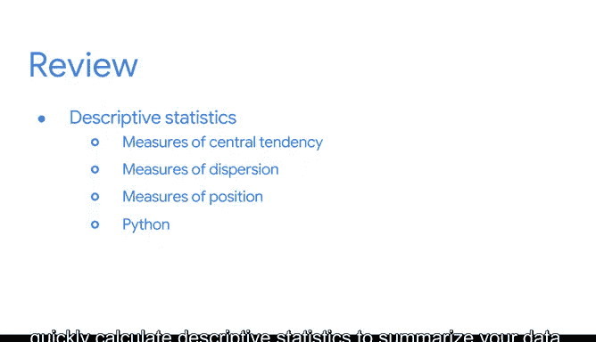

# 谷歌高阶数据分析4：《统计的力量》the-power-of-statistics（中英双字） - P12：12_01_01_总结_1.zh_en - GPT中英字幕课程资源 - BV1yk4y1G7Qm

We've come to the end of the first section of your statistics course。 Wow。

 you've learned a lot already。 along the way， we've explored how data professionals use statistics to gain insights from their data。

 This helps business leaders make decisions and solve complex problems。

 We begin with the two main types of statistics， descriptive and inferential Data professionals use descriptive stats to explore and summarize their data。

😊，They use inferential stats to draw conclusions and make predictions about their data。

 During your tour of descriptive stats， you learned about measures of central tendency。

 dispersion and position。Finally， you learn that Python is a powerful tool for statistical analysis。

 You use Python to explore a data set and quickly calculate descriptive statistics to summarize your data。

 You can use these skills to better understand any new data you may encounter in your future career Com up。

 you have a graded assessment to prepare。 Check out the reading that lists all the new terms you've learned and feel free to revisit videos。

 readings and other resources that cover key concepts。 Congrats on your progress so far。

 and I'll meet you again soon。😊。

