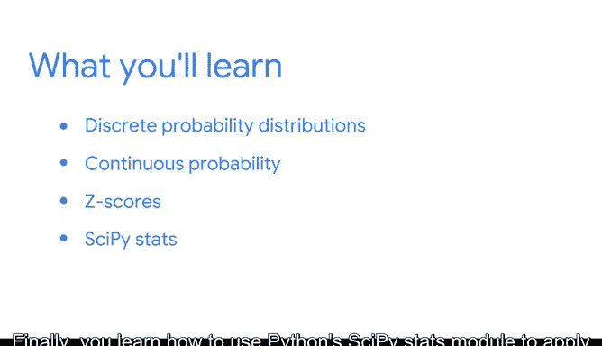

# 谷歌高阶数据分析4：《统计的力量》the-power-of-statistics（中英双字） - P13：13_02_01_欢迎来到模块二.zh_en - GPT中英字幕课程资源 - BV1yk4y1G7Qm

Hey there。 I really enjoyed exploring descriptive statistics with you。

 And I'm excited for what's next。 probability， probability is the branch of mathematics that deals with measuring and quantifying uncertainty。

 In other words， probability uses math to describe the likelihood of something happening。

 For example， the chance of rain to mor or of winning the lottery。😊。

Data professionals use probability to help business leaders make data driven decisions in situations of uncertainty。

No one can know the outcome of future events with complete certainty what data professionals can do is use all the available data to make reasonable predictions based on probability。

For instance， imagine you're working with the stakeholder at a large aerospace company。

 They need to decide whether or not to invest in a new technology to improve the production process for their jet engines。

As a data professional， you can estimate the probability that the new technology will have a positive impact and predict what its potential costs and benefits might be。

The stakeholder can use this information to make an informed decision about what's best for the organization。

We'll start by reviewing the two main types of probability， objective and subjective。

 We'll cover basic rules of probability like the complement rule， the addition rule。

 and the multiplication rule。Then we'll go over conditional probability and how to describe the relationship between dependent events。

We'll check out Bayes theorem， a key formula for conditional probability and the basis for more advanced Bayesian analysis。

 You'll also learn about probability distributions。

 Pro distributions describe the likelihood of the possible outcomes of a random event and can be discrete or continuous。

 We'll check out discrete probability distributions such as the binomial and Poson and find out how they can help you model specific kinds of data。

 Then we'll explore continuous probability distributions and focus on the normal distribution the most widely used distribution in all statistics。

 you'll discover its main features and how it applies to many different dataset sets。Next。

 we'll also discuss how Z scores can help you better understand the relationship between data values and a standard normal distribution。

Finally， you'll learn how to use Python's SipP stats module to apply probability distribution to your data。

When you're ready to start learning about probability， join me in the next video。

