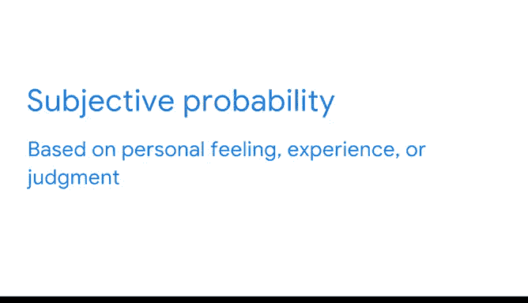

# 谷歌高阶数据分析4：《统计的力量》the-power-of-statistics（中英双字） - P14：14_02_02_客观概率与主观概率.zh_en - GPT中英字幕课程资源 - BV1yk4y1G7Qm

Probability helps you measure and quantify uncertainty and make informed decisions about uncertain outcomes。

For example， you might use probability to decide what to wear on a given day。

 Today's weather forecast says there's a 70% chance of snow based on this data。

 you decide to wear your hat， gloveves and snow boots。 When the snow falls， you stay warm and dry。

Data professionals might use probability to predict the chances that a company will sell a certain amount of product in a given time period。

 A financial investment will have a positive return。 A political candidate will win an election。

 or a medical test will be accurate。In this video， we'll explore the two main types of probability。

 objective and subjective objective probability is based on statistics。

 experiments and mathematical measurements。 subjectjective probability is based on personal feelings。

 experience or judgment。 Let's start with objective probability。

 Data professionals use objective probability to analyze and interpret data。

 There are two types of objective probability， Class and empirical Class probability is based on formal reasoning about events with equally likely outcomes To calculate classical probability for an event。

 you divide the number of desired outcomes by the total number of possible outcomes。For example。

 if you flip off a coin， the result will be either heads or tails heads and tails are terms commonly used to refer the two sides of a coin。

There are only two possible outcomes and both outcomes are equally likely。

 the chance that you get heads is one out of two or 50%， the same goes for tails。

Or take playing cards， there are 52 cards in a standard deck。

 choosing a card gives you a 1 in 52 chance or 1。9% of getting any card in the deck。

 whether it's the ACce of hearts， 10 of clubs or four of spades。

But most events are more complex and do not have equally likely outcomes。 Usually。

 the weather isn't a 50% chance of rain or snow。 There might be an 80% chance of rain tomorrow and a 20% chance of some other outcome。

 While classical probability applies to events with equally likely outcomes， data professionals news。

 empirical probability to describe more complex events。

 empiricalpir probability is based on experimental or historical data。

 It represents the likelihood of an event occurring based on the previous results of an experiment or past events。

To calculate empirical probability， you divide the number of times a specific event occurs by the total number of events。

 For example， say you conduct a taste test with 100 people to find out whether they prefer strawberry or mint chipped flavored ice cream。

You want to know the probability that a person prefers strawberry ice cream。

Your taste test reveals that 80 people prefer strawberry ice cream to calculate probability。

 you divide the number of times the event of preferring strawberry ice cream occurs 80 by the total number of events。

 10080 divided by 100 equals 0。8 or 80%。So the probability that a person prefers strawberry over mintchip is 80%。

Earlier， you learned about inferential statistics and how data professionals use sample data to make inferences or predictions about larger populations。

Inferential statistics uses probability， too。 For instance。

 a retail company might survey a representative sample of 100 customers to predict the shopping preferences of all their customers。

 Data professionals rely on empirical probability to help them make accurate predictions based on sample data。

 For example， in an A P test of a website。 you test a sample of users to make a prediction about the future behavior of all users。

 Sa the sample of users prefer a green a tocar button over a blue1。

 You may infer from this data that the larger population of future users will probably share their preference。

An AB test lets you make a reasonable prediction about future users based on empirical probability。

 and this probability can help an online business make smarter decisions and increase sales。

In contrast， the results of subjective probability are based on personal feeling。

 experience or judgment。 This type of probability does not involve formal calculations。

 statistical analysis or scientific experiments。 For instance。

 you may have an overwhelming feeling that a certain horse will win a horse race or that your favorite team will win the championship game。

 and you may have good reasons for your belief， but your reasons are personal or subjective。

Your belief is not based on statistical analysis or scientific experiments For this reason。

 the subjective probability of an event may differ widely from person to person。

 It's important to know the difference between subjective and objective probability when you evaluate a prediction or make a decision。

 For example， the CEO of an auto company might feel confident that using a new technology to manufacture their pickup truck will cut costs and increase profits。

But if their prediction is only based on personal feeling or subjective probability。

 it may not be reliable。Data science based on statistical analysis or objective probability can help accurately predict the potential impact of the new technology and help the CEO make an informed data driven decision about adopting the technology。

That's all for now， coming up we'll check out some fundamental concepts of probability。

