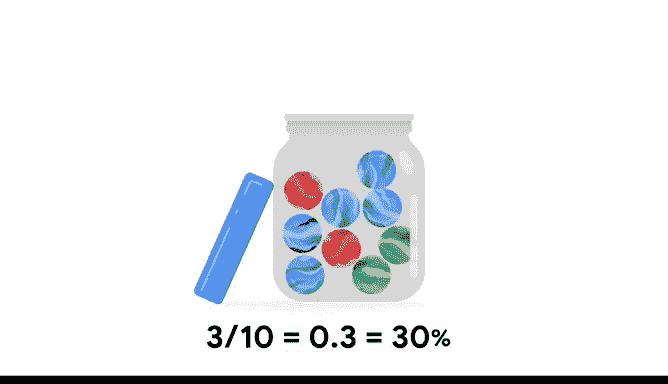

# 谷歌高阶数据分析4：《统计的力量》the-power-of-statistics（中英双字） - P15：15_02_03_概率原理.zh_en - GPT中英字幕课程资源 - BV1yk4y1G7Qm

Recently， you learn that probability uses math to deal with uncertainty or to determine how likely it is that an event will occur。

In this video， you'll learn some fundamental concepts of probability。

 We'll discuss the mathematical definition of probability and how to calculate probability for single random events。

 First， I want to give you some context about the types of examples we'll be using In this part of the course。

 we're going to continue to reference examples of events like flipping coins。

 rolling dice and drawing cards。There are a couple reasons for this。 One is historical。

 The modern theory of probability originates in the analysis of games of chance in the 16th and 17th centuries。

 Second， and more importantly， these are events with clearly defined outcomes that most people are familiar with。

They're just super useful examples of basic probability concepts。

 That's why they're used in stats classes around the world。Later on in the course。

 we'll explore probability for more complex events like the ones you'll encounter in your future work as a data professional。

 so let's talk about the fundamental concepts of probability。First。

 the probability that an event will occur is expressedes a number between 0 and1。

 If the probability an event equals 0， there is a 0% chance that the event will occur。

If the probability of an event equals one， there is a 100% chance the event will occur。

And there are lots of possibilities in between 0 and1， if the probability of an event equals 0。5。

 there is a 50% chance that the event will occur or not occur。

If the probability of an event is close to zero， there's a small chance that the event will occur。

If the probability of an event is close to one， there's a strong chance that the event will occur。

For example， if the chance of a stock price going up this year is 0。05 or 5% cent。

 then you probably don't want to buy it。 If it's 0。95 or 95%， then it's probably a good investment。

 Proability measures the likelihood of random events。

 The result of a random event cannot be predicted with certainty。

 Before flipping a coin or rolling a die， you do not know the outcome。

The coin could turn up heads or tails， and the dye could show any number one through6。

These are examples of what statisticians call a random experiment。

 also known as a statistical experiment。A random experiment is a process whose outcome cannot be predicted with certainty。

All random experiments have three things in common。

 The experiment can have more than one possible outcome。

 You can represent each possible outcome in advance。

 and the outcome of the experiment depends on chance。Let's take the example of flipping a coin。

 There is more than one possible outcome。 You can represent each possible outcome in advance heads or tails。

 and the outcome depends on chance。 until you actually toss the coin。

 you can't know whether it will be heads or tails。 Or think about rolling a six sided die。

 There' is more than one possible outcome。 And all outcomes can be represented in advance 1，2，3，4。

5 and 6。The outcome of any role depends on chance until you roll the die。

 you can't know which number will turn up to calculate the probability in of a random experiment。

 you divide the number of desired outcomes by the total number of possible outcomes。

You may recall that this is also the formula for classical probability。

So the probability of tossing a coin and getting heads is one chance in 2。

 This is one divided by  two equals 0。5 or 50%。The probability of rolling a die and getting two is one chance out of6。

 This is one divided by 6， equals 0。166 repeating or about 16。7%。Now。

 let's conduct a different random experiment。 Imagine a jar contains 10 marbles。 Two marbles are red。

3 are green and fiber blue。You decide to take one marble from the jar。

 You want to know the probability that the marble will be green。First。

 count the number of possible outcomes。 You have an equal chance of choosing any one of the 10 marbles。

Next， figure out how many of these outcomes refer to what you want to know。

 the chance of choosing a green mod。Of the 10 total marbles，3 are green。 Therefore。

 the probability of choosing a green marble is 3 out of 10 or 0。3。 In other words。

 you have a 30 per cent chance of choosing a green marble。 Now。

 you know how to calculate the probability of a single random event。

 This knowledge will be useful as a building block for more complex calculations of probability。

