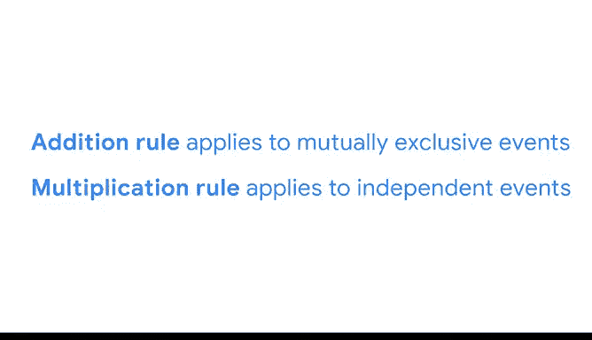

# 谷歌高阶数据分析4：《统计的力量》the-power-of-statistics（中英双字） - P16：16_02_05_概率与事件的基本规则.zh_en - GPT中英字幕课程资源 - BV1yk4y1G7Qm

So far， we've been focusing on calculating the probability of single events。

 Many situations both in everyday life and in data analytics。

 involve more than one event As a future data professional。

 you'll often deal with probability for multiple events。

 in this video we cover three basic rules of probability， the complement rule。

 the addition rule and the multiplication rule These rules help you better understand the probability of multiple events。

We'll also discuss two different types of events， mutually exclusive events and independent events。

Then you'll learn how to calculate probability for each of them。 First。

 let's discuss probability notation， which is the standard way to symbolize probability concepts。

 As we go along， I'll share some useful notations that will help us communicate more efficiently when it comes to basic probability。

 The letter P indicates the probability of an event。 For example， if you're dealing with two events。

 you can label one event A and the other event B。The notation for the probability of event A is the letter P followed by the letter A in parentheses。

For the probability of event B， it's the letter P followed by the letter B in parentheses。

 If you want to talk about the probability of event A not occurring。

 add an apostrophe after the letter A， you can also say this is the probability of not a。Now。

 let's check out our first basic rule。 The complement rule in stats。

 the complement of an event is the event not occurring。 For example。

 either it rains or it does not rain。 Either you win the lottery or you don't win the lottery。

 The complement of rain is no rain。 The complement of winning is not winning。

The important thing to know is that the two probabilities。

 the probability of an event happening and the probability of it not happening must add to one。

 recall that a probability of one is the same as saying there's 100% certainty of an event occurring。

 Another way to think about it is that there is a 100% chance of one event or the other event happening。

 There may be a 30% chance of rain tomorrow， but there is a 100% chance that it will either rain or not rain tomorrow。

 The complement rule says that the probability that event A does not occur is one minus the probability of event A。

For example， if the weather forecast says there is a 30% chance of rain tomorrow。

 there is a probability of 0。3， you can use the complement rule to calculate the probability that it does not rain tomorrow。

The probability of no rain equals 1 minus the probability of rain。 This is 1 minus-0。3 equals 0。

7 or 70%。Both the complement rule and our next rule， the addition rule。

 apply to events that are mutually exclusive。 Two events are mutually exclusive if they cannot occur at the same time。

 For example， you can't visit both Argentina and China at the same time or turn left and right at the same time。

 The addition rule says that if the events A and B are mutually exclusive。

 then the probability of A or B happening as the sum of the probabilities of A and B。

Let's check out an example using a six sided die， say you want to find out the probability of rov either a two or a four on a single roll of the die。

These two events are mutually exclusive， you can roll a two or a4， but not both at the same time。

 the addition rule says that to find the probability of either event happening。

 you should sum up their probabilities。The odds of rolling any single number on a six sided die are one out of 6。

 so the probability of rolling a2 is one over 6， and the probability of rolling a4 is one over 6。1。

 sixth plus16 equals one third。The probability of rolling either a two or a4 is one out of three or 33%。

The addition rule applies to mutually exclusive events。

 If you want to calculate probability for independent events， you can use a multiplication rule。

 Two events are independent If the occurrence of one event does not change the probability of the other event。

 This means that one event does not affect the outcome of the other event。For example。

 checking out a book from your local library does not affect tomorrow's weather。

Drinking coffee in the morning does not affect the delivery of your mail in the afternoon。

These events are separate and independent。The multiplication rule says that if of the events。

 A and B are independent， then the probability of both A and B happening is the probability of A multiplied by the probability of B。

 For instance， imagine two consecutive tosses。 say you want to know the probability of tails on the first toss and heads on the second toss。

First， figure out what kind of events you're dealing with and then apply the appropriate rule。

 Two coin tosses are independent events。 The first toss does not affect the outcome of the second toss for any toss。

 the probability of getting either heads or tails always remains one out of 2 or 50%。

So you would use the multiplication rule for this event。

 the probability of getting tails and heads is the probability of getting tails multipplied by the probability of getting heads。

The probability of each event is 0。5 or 50%。 Now， plug in the numbers，0。5 times 0。5 equals 0。

25 or 25%。 The probability of getting tails on the first toss and heads on the second toss is 25%。

So to recap， let's compare the addition and multiplication rules and list their differences。

 It will be helpful to keep these differences in mind so you know when to use the two rules。

The addition rule sums up the probabilities of events。

 and the multiplication rule multiplies the probabilities。

 The addition rule applies to events that are mutually exclusive。

 The multiplication rule applies to events that are independent。

 The basic rules of probability help you describe events that are mutually exclusive or independent。

In an upcoming video， we'll check out conditional probability， which applies to dependent events。

