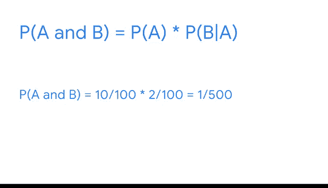

# 谷歌高阶数据分析4：《统计的力量》the-power-of-statistics（中英双字） - P17：17_02_01_条件概率.zh_en - GPT中英字幕课程资源 - BV1yk4y1G7Qm

So far， you've learned how to calculate probability for a single event and for two or more independent events。

 Remember， two events are independent if one event does not affect the outcome of the other event。

 like two coin flips。 In this video， youll learn how to calculate probability for two or more dependent events。

 This type of probability is known as conditional probability。

Conditional probability refers to the probability of an event occurring given that another event has already occurred。

Conditional probability is used in many different fields like finance， insurance， science。

 and machine learning。For example， an agency that sells life insurance might use conditional probability to decide how risky it is to ensure someone who skydives for a living data professionals like those who work on machine learning models。

 use conditional probability to make accurate predictions about complex data sets。

Before we get into calculating conditional probability， let's go over the concept of dependence。

2 events are dependent if the occurrence of one event changes the probability of the other event。

 This means that the first event affects the outcome of the second event。 For instance。

 if you want to visit a website， you first need Internet access。

 Visitsing a website depends on you having access to the Internet。

If you want to travel to another country， you first need to get a passport traveling to another country depends on you having a passport In each instance。

 we can say that the second event is dependent on or conditional on the first event。

Let's check out an example of dependence that's closer to probability theory。

 Imagine you have two events。 The first event is drawing an ace from a standard deck of playing cards。

 and the second event is drawing another ace from the same deck。

 There are 4 aces in a deck of 52 cards。 So for the first draw。

 the chance of getting an ace is 4 out of 52 or 7。8%。 But for the second draw。

 the probability of getting an ace changes because you've removed a card from the deck。 Now。

 there are three aces in a deck of 51 cards。 For the second draw。

 the chance of getting an ace is 3 out of 51 or about 5。8%。Getting an ace is now less likely。

 These two events are dependent because getting an ace on the first draw changes the probability of getting an ace on the second draw。

Now you have a better understanding of dependent events。

 let's return to conditional probability and check out the formula。

 You don't need to memorize the formula， but personally I find that reviewing the formula often helps me understand the concept better。

 That's why I'm sharing it with you。The formula says that for two dependent events。

 the probability of event A and event B occurring equals the probability of event A times the probability of event B given A。

You may notice that we have a new notation in this formula。

 The vertical bar between the letters B and A means that event B depends on event A happening。

 We say this as the probability of a B， given A。The formula can also be expressed as the probability of event B。

 given event A equals the probability that both A and B occur divided by the probability of A。

These are just two ways of representing the same equation。

 depending on the situation or what information you are given up front。

 it may be easier to use one or the other。 We can apply the conditional probability formula to our example of drawing an ace plan card。

The probability of event A or getting an ACce on the first draw is 4 out of 52。

The probability of event B， given event A， or of getting an ace on the second draw is 3 out of 51。

Let's enter these numbers into the formula。 The probability of event A and event B。

 or of getting two aces in a row is 4 over 52 multiplied by 3 over 51。 If you do the math。

 this equals 1 over 221。The probability of getting two aces in a row equals one out of 221。

 or about 0。5%。Let's check out another example， imagine you are applying for college。

 the college accepts 10 out of every 100 applicants or 10%。If youre accepted。

 you also hope to receive an academic scholarship， the college awards academic scholarships to two out of February 100 accepted students or 2%。

You want to calculate the probability that you get accepted and you get a scholarship。

Getting a scholarship depends on first getting accepted。

 So this is a conditional probability because it deals with two dependent events。

 Let's call getting accepted event A and getting a scholarship event B。

 You want to calculate the probability of event A and event B。

 according to the formula to find the probability of event A and event B。

 You can multiply the probability of event A by the probability of event B， given event A。

The probability of event A getting accepted is 10 out of 100， The probability of event B。

 given event A or getting a scholarship， given that you are first accepted is 2 out of 100。

10 divided by 100 times 2 divided by 100 equals 1 divided by 500。

So the probability of getting accepted and getting a scholarship is one out of 500 or 0。2%。

Conditional probability helps you better understand the relationship between dependent events As a data professional I often use conditional probability to predict how an event like an ad campaign will impact sales revenue。

Then I share my findings with stakeholders so they can make more informed business decisions。

