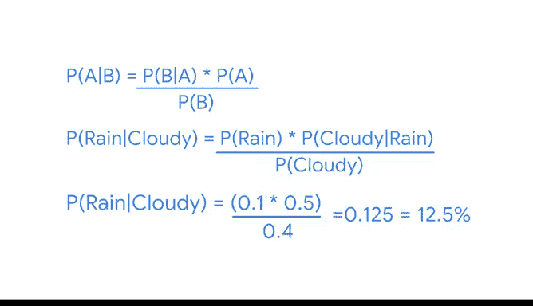

# 谷歌高阶数据分析4：《统计的力量》the-power-of-statistics（中英双字） - P18：18_02_03_探索贝叶斯定理.zh_en - GPT中英字幕课程资源 - BV1yk4y1G7Qm

Earlier， you learn that conditional probability refers to the probability of an event occurring。

 given that another event has already occurred。 For example。

 when you draw an ace from a deck of playing cards。

 this changes the probability of drawing a second ace from the same deck。 In this video。

 you'll learn how to calculate conditional probability using Bays theorem。

 Bayes theorem also known as Bay's rule is a math formula for determining conditional probability。

 It's named after Thomas Bays， an 18th century mathematician from London England。

B Theorem provides a way to update the probability of an event based on new information about the event。

In Bayesian statistics， prior probability refers to the probability of an event before new data is collected posterior probability is the updated probability of an event based on new data。

Poserior means occurring after。Poserior probability is calculated by updating the prior probability using Bayes theorem。

For example， let's say a medical condition is related to age。

 you can use base theorem to more accurately determine the probability that a person has the condition based on age。

The prior probability would be the probability of a person having the condition。

 The posterior or updated probability would be the probability of a person having the condition if they are in a certain age group。

Baase theem is the foundation for the field of Bayesian statistics， also known as Bayesian inference。

 which is a powerful method for analyzing and interpreting data in modern data analytics。

Data professionals apply base theorem in a wide variety of fields。

 from artificial intelligence to medical testing。For instance。

 financial institutions use Bayesian analysis to rate the risk of lending money to borrowers or to predict the success of an investment。

Online retailers use Bayesian algorithms to predict whether or not users will like certain products and services。

 Marketers rely on base theorem for identifying positive or negative responses in customer feedback。

 Let's check out the theorem itself。 As always， don't worry about memorizing it。

 Bayess theorem is a bit complicated。 And this is the basic version of it。

Base theorem says that for any two events， A and B， the probability of a。

 given B equals the probability of A multiplied by the probability of B， given A。

 divided by the probability of B。In math rooms， prior probability is the probability of event A。

 posterior probability， or what you're ultimately trying to figure out is the probability of event A。

 given event B。The key for base theorem is that it includes both the conditional probability of B given A and the conditional probability of A given B。

If you know one of these probabilities， base theorem can help you determine the other。

Let's check out an example， say you're planning a big outdoor event like a graduation party。

 the success of the event depends on good weather。On the day of the event。

 you notice that the morning is cloudy。 You want to find out the chance of rain。

 given that this day starts off cloudy。 If there's a high probability of rain。

 you may decide to move the event indoors or even cancel it。

You know the following information at this time of year， the overall chance of rain is 10%。However。

 cloudy mornings are common， about 40% of all days start off cloudy。

 and 50% of all rainy days start off cloudy。In this example。

 your prior probability is the overall probability of a rainy day。

 New data will update this probability In this case。

 the knowledge that the morning is cloudy and that rain may be coming。

Where you ultimately want to find out is the probability that it will rain， given that it's cloudy。

 This is your posterior probability。 You can use base theorem to update the prior probability that it rains based on the new data that the morning is cloudy。

When you work with Bays theorem， it's helpful to first figure out what event A is and what event B is。

 This makes it easier to understand the relationship between events and use the formula。

 Let's use the word rain to refer to event A， the probability of rain。

 This is your prior probability。 Even B is the probability that the day will be cloudy。

 Let's use the word cloudy to refer to event B。Now you can rewrite the probability of event B given event A as the probability that it's cloudy。

 given that it rains。 Finally， the probability of event A。

 given event B is the probability that it rains given that it's cloudy。

 This is your posterior probability or the updated probability that basethereem will help you calculate。

Finally， enter what you know into the formula， the probability of rain is 10%。

The probability that it's cloudy is 40%。The probability that it's cloudy， given that it rains is 50%。

The probability of rain， given that it's cloudy equals 0。1 times 0。5， divided by 0。4。This equals 0。

125 or 12。5%。So there is a 12。5% chance of rain today。

 This is your posterior probability or the updated probability based on the data that the morning is cloudy。

The odds are still in your favor， so you decide to proceed with your outdoor party。

 hope it's a fun one。

