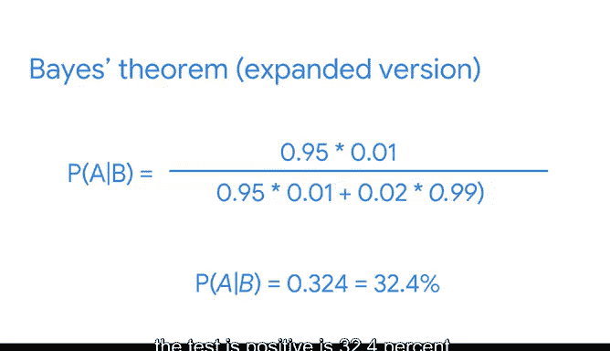

# 谷歌高阶数据分析4：《统计的力量》the-power-of-statistics（中英双字） - P19：19_02_04_贝叶斯定理的扩展版本.zh_en - GPT中英字幕课程资源 - BV1yk4y1G7Qm

You've already learned that Bay theorem tells you how to update the probability of an event based on new data about the event。

 but there are several different versions of Bays theorem。

They're written in different ways and used for different types of problems。 In this video。

 you'll learn about an expanded version of base theorem and how to use it to predict the accuracy of a test。

The expanded version of base theorem is long。 If you're not an experienced statistician。

 it may seem quite intimidating。 You don't need to worry about memorizing this formula。

 What's important to know is that the expanded version works better than the basic version in certain situations。

 The theorem goes like this。The probability of event A， given event B equals the probability of B。

 given A multiplied by the probability of a divided by the probability of B given A times the probability of a plus the probability of B。

 given not a multiplied by the probability of not a。Wow， how was a lot。

 You can use the two versions of base theorem to deal with different types of problems。 Sometimes。

 for instance， you don't know the probability of event B。

 which is in the denominator of the equation for the basic base theorem。 In that case。

 you can use the expanded version of base theorem because you don't need to know the probability of event B to use the expanded version。

 This longer version of base theorem is often used to evaluate tests such as medical diagnostic tests。

 Q control tests or software test such as spam filters。 When evaluating the accuracy of a test。

 base theorem can take into account the probability for testing errors known as false positives and false negatives。

 A false positive is a test result that indicate something is present when it really is not。

 For example， a spam filter may incorrectly identify a legitimate email as spam。

False positives often refer to medical testing， but they also apply to other areas like software testing。

 For instance， antivirus software may indicate that a computer file is a virus。

 even though the file is normal。 A false negative is a test result that indicate something is not present when it really is。

 For example， a spam filter may incorrectly identify a spammy email as a legitimate。

 False negatives also apply to all kinds of tests in manufacturing。 for instance。

 a quality control test may incorrectly identify a defective part as an acceptable part。Next。

 let's explore a detailed example of how to use the longer base theorem to evaluate the test。

 let's say you want to evaluate the accuracy of a diagnostic test that checks for the presence of a peanut allergy。

Suppose that 1% of the population is allergic to peanuts。Based on historical data。

 if a person has the allergy， there's a 95% chance that the test is positive。

If a person doesn't have the allergy， there's still a 2% chance that the test is positive。

This is a false positive because it's a positive result for a person who does not actually have the allergy。

 You want to know， given that a person tests positive。

 what are the chances that they actually have the allergy。

You can also think of the situation in terms of prior and posterior probability。

 which you learned about earlier in connection with the your basic version of base theorem。

 You start off with the prior probability that a person has the allergy。 This is 1%。

 Then you'll update this prior probability with new data based on testing the probability of getting true positive and false positive test results。

Finally， you want to figure out the posterior probability that the allergy is present given that the test is positive。

There are two main events in this situation。 First， actually having the allergy。 Second。

 testing positive。 Let's call having the allergy event A and testing positive event B。 Remember。

 these two events are different because you can test positive and not have the allergy。

 which is a false positive。Now， let's review what you know。 First。

 there is the probability that a person actually has the allergy， which is 1%。

 So the probability of event A equals 1%。 Next， there is a 95% chance that a test is positive if the person has the allergy。

 This is a conditional probability for two dependent events。 The probability of a positive test。

 given that the allergy is present。 So the probability of event B， given event A equals 95%。

 Then there's the false positive result， The 2% chance that the test is positive。

 given that the allergy is not present。 This is another conditional probability。

 the probability of event B， given not a equals 2%。Finally， if you use the complement rule。

 you can also figure out one more probability， the probability of not having the allergy。

 the complement rule says that the probability that event A does not occur is1 minus the probability of event A。

So if the probability of event A actually having the allergy is 1% or 0。01。

 then the probability of not having the allergy is 1 minus 0。01， this equals 0。99 or 99%。

 so the probability of not a equals 99%。These are the probabilities you know。

 what you don't know is the probability of event B。

 the probability that a person gets a positive test result。

This is where you'd have trouble using the basic version of base theorem because the probability of event B is part of the formula instead you can use the expanded version since you don't need to know the probability of event B for that formula。

Now， you can enter what you know into the formula。 The probability of a is 1% or 0。01。

 The probability of not a equals 99% or 0。99。 The probability of B given A equals 95% or 0。95。

 and the probability of B given not A equals 2% or 0。02。If you do the math， the result is 0。

324 or 32。4%， so the probability of event A， given event B。

 or the probability that the allergy is present， given that the test is positive is 32。4%。

If 32。4% seems low to you， it's because the allergy is rare to begin with。

 It's not very likely that a random person will both test positive and have the allergy。

 The expanded version of basetheem gives you a better understanding of the accuracy of the test by taking into account multiple probabilities。

 That's all for now。