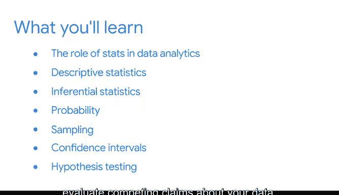

# 谷歌高阶数据分析4：《统计的力量》the-power-of-statistics（中英双字） - P1：01_01_01_课程四介绍.zh_en - GPT中英字幕课程资源 - BV1yk4y1G7Qm

Hey there， welcome to the next stage of your journey to learn advanced data analytics First congratulations on your progress you've learned how data professionals contribute to the success of an organization and the main tools and techniques they use on the job。

You're now familiar with the basic syntax and functions of the Python programming language。

 and you know how to use code for exploratory data analysis。

 You can use data wrangling to organize and clean your data and create data visualizations to share important information Well done。

 You already have quite a few tools in your analytic toolbox。 Have room for a few more。 Next up， Sta。

Statistics is a study of the collection， analysis and interpretation of data Staistics often abbreviated as stats。

 provides data professionals with powerful tools and methods for transforming data into useful knowledge。

You've already learned about exploratory data analysis and how it helps you summarize the main characteristics of your data。

Descriptive statistics does this too， and that's where we'll start。

But data professionals also use statistics to do something more based on a small sample of available data that can make informed predictions about uncertain events and make accurate estimates about unknown values。

This is known as inferential statistics， and you'll learn all about it in this course。For example。

 data professionals use statistics to predict future sales revenue， the success of a new ad campaign。

 the rate of return on a financial investment， or their number of downloads for a new app。

Statistical analysis can tell you which version of a website will attract more new customers for longer periods of time。

 or that new users will typically create an account after spending three minutes on the company's website。

The insights gained from statistical analysis help business leaders make decisions。

 solve complex problems， and improve the performance of the products and services。

This is why data professionals are in such high demand and why the data career space keeps growing。

Speaking of data professionals， allow me to introduce myself。 My name is Evan。

 I'm an economist and I consult with various teams across Google。

 This means that I use statistics and other tools to analyze and interpret data to help business leaders make informed decisions。

 This includes helping them quantify uncertainty and identify of their sufficient evidence to reject a hypothesis。

 both of which you'll learn more about later on。 I'm thrilled to be your instructor in this course。😊。

Before we begin， let me tell you about my own experience with statistics as an undergraduate I majored in economics and mathematics and then went on to get a PhD in economics。

 I focused on statistics and econometrics， a branch of economics that uses statistics to analyze economic problems。

During my graduate studies I interned at an online learning company and was a researcher at an online retail company across these roles and experiences I've used many different statistical tools to solve problems。

Often， I find that the problem I'm working on can be solved with a statistical method I'm unfamiliar with。

 I love constantly learning new methods and extending the range of problems I can work on。😊。

These advanced methods are built on a foundation of stats concepts。 In this course。

 we'll focus on these fundamentals to prepare you for your future career。 So if you're new to stats。

 welcome。This course does not assume you have any prior knowledge of statistics。

 willll begin from the beginning and work through each concept step by step。

But if you have some experience in statistics， that's great too we'll help you use what you already know in a new way so you can apply your stat's knowledge to data analytics specifically in this course。

 you'll discover how data professionals use statistical tools in their daily work。

You'll also learn strategies for interpreting findings and sharing them with stakeholders who may not be familiar with stats concepts or all the technical details。

 We'll start this course with an introduction to the role of stats in data analytics。

 and we'll discuss the differences between descriptive and inferential stats。

 You'll learn how descriptive stats such as mean， median and standard deviation。

 help you quickly summarize and better understand your data。

Then we'll explore how to use inferential statistics to draw conclusions and make predictions about data。

Next， we'll explore probability and discover useful ways to measure uncertainty。

 We'll discuss the basic rules of probability and how to interpret different types of probability distributions such as the normal。

 binomial and Poisson distributions。From there we'll move on to sampling。

 We'll discuss what makes a good sample， the benefits and drawbacks of different sampling methods and how to work with sampling distributions。

We'll also examine confidence intervals， which describe the uncertainty in an estimate。

 You'll learn how to construct different kinds of confidence intervals and interpret their meaning。

After that， we'll explore how to use hypothesis testing to compare and evaluate competing claims about your data。

 We'll go over the steps for applying different tests to specific data sets and we'll demonstrate how to interpret test results。

 Finally， you'll get a chance to apply your stat's knowledge in your next portfolio project。

 The portfolio project features a scenario based on AB testing。

 An important practical application of statistics。 In future job interviews。

 you can share your project as a demonstration of your skills and impress potential employers。

I'll be your guide every step of the way and remember you set the pace。

 feel free to go over the videos as many times as you like and review topics that are new to you。

 By the end of the course， you'll have a useful toolkit of stats concepts to carry with you on the rest of your learning journey and in your future career。

Let's get started。