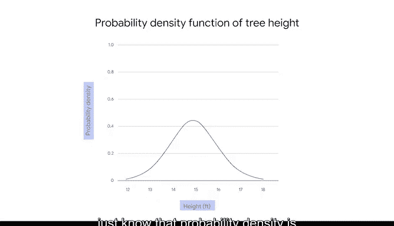

# 谷歌高阶数据分析4：《统计的力量》the-power-of-statistics（中英双字） - P20：20_02_01_概率分布介绍.zh_en - GPT中英字幕课程资源 - BV1yk4y1G7Qm

So far， we've covered a lot of key concepts in basic probability。

 What you've learned about basic probability will help you better understand probability distributions or main topic for this part of the course。

 In my job as a data professional， I use probability distributions to model different kinds of data sets and to identify significant patterns in my data。

 A probability distribution describes the likelihood of the possible outcomes of a random event。

 probability distributions can represent the possible outcomes of simple random events like tossing a coin or rolling a die。

They can also represent more complex events， like the probability of a new medication successfully treating a medical condition。

 A random variable represents the values for the possible outcomes of a random event。

 There are two types of random variables， discretere and continuous。

 A discretere random variable has a countable number of possible values。 Often。

 discretereet variables are whole numbers that can be counted。 For example。

 if you roll a die five times， you can count the number of times the die lands on two。

 If you toss a coin five times， you can count the number of times it lands on heads。

 A continuous random variable takes all the possible values in some range of numbers。

 When it comes to continuous variables， you're dealing with decimal values rather than whole numbers。

 For instance， all the decimals values between 1 and 2， such as 1。11。12，1。125 and so on。

 These values are not countable since there is no limit to the possible number of decimal values between 1 and 2。

Typically， these are decimal values that can be measured， such as height， weight。

 time or temperature。For example， if you measure the height of a person or object。

 you can keep on making your measurement more accurate。 The height of a person could be 70。2 inches。

 70。23 inches， 70。237 inches，70。2375 inches， and so on。

 There is no limit to the number of possible values。

It's not always immediately obvious if a variable is discrete or continuous to help choose between the two。

 you can use the following general guidelines。 If you can count the number of outcomes。

 you are working with a discrete random variable。 For example。

 counting the number of times a coin lands on heads。 If you can measure the outcome。

 you are working with a continuous random variable。 For example。

 measuring the time it takes for a person to run a marathon。Now that we've explored random variables。

 let's return to the topic of probability distributions。

 which describe the probability of each possible value of a random variable。

 Disreet distributions represent discrete random variables and continuous distributions represent continuous random variables。

 Once you know the sample space of a random variable。

 you can assign probabilities to each of the possible values。 In statistics。

 you can use the term sample space to describe the set of all possible values for a random variable。

 For example， a single cointass is a random variable with two possible values。 Heads en tails。

 So the sample spaces heads en tails。 If you roll a six sided die。

 you have a random variable with six possible values where a sample space of 1，2，3，4，5 and 6。

 Let's check out an example of a discrete probability distribution。

 Take the familiar random event of a single die roll。 The sample space for a single di roll is 1，2，3。

4，5 and 6。 The probability of each outcome is the same， one out of6。Or 16。7%。

 You can display a discrete probability distribution as a table or a graph。

 The distribution table summarizes the probability for each possible outcome。

 The top row lists each outcome of the die roll， and the bottom list， the corresponding probability。

 The bar graph where histogram shows the same probability distribution。

 but in a different form for a discrete probability distribution。

 The random variable is plotted along the x axis， and the corresponding probability is plotted along the y axis。

 In this case， the x axis represents each possible outcome of a single die roll  one through6。

 The y axis represents the probability of each outcome。

 Con probability distributions and their graphs work a little differently from discrete distributions。

This is due to the difference between discrete and continuous random variables。

 The probability distribution for a discrete random variable can tell you the exact probability for each possible value of the variable。

For instance， the probability of rolling a die and getting a3 is one out of 6， or about 16。7%。

 The probability distribution for a continuous random variable can only tell you the probability that the variable takes on a range of values。

 Let's check out an example to learn more。 A continuous random variable may have an an infinite number of possible values。

 Imagine you want to measure the height of an oak tree you picked at random from a nearby forest。

 In this example， the height of the tree is a continuous random variable。 The tree's height could be。

 say15 feet or 15。2 feet or 15。2187 feet and so on。

 You can keep on adding another decimal place to the measurement without limit。Now。

 say you want to know the probability that the height of the oak tree is exactly 15。2 feet。

 because the height of the tree could be any decimal value between the range of 15 feet and 16 feet。

 the probability that the tree is exactly any single value is essentially zero。In this example。

 you'll need to use a continuous probability distribution to tell you the probability that the height of the oak tree is in a certain range or interval。

 such as between 15 feet and 16 feet。 The probability of any specific value of0。

 so it only makes sense to talk about the probabilitybabilities of intervals。

 a convenient way to show the probabilitybabilities of a range or interval of values is with a curve on a graph。

 continuous distributions appear as curves。 you may have heard of the bell curve。

 which refers to the graph for continuous distribution called the normal distribution on the curve。

 the x axis refers to the value of the variable you're measuring In this case， oak tree height。

 The y axis refers to something called probability density。

 This is a math function that deals with the values of intervals。

 You don't need to focus on the math bar right now。

 Just know that probability density is not the same thing as probability。

 There's a lot more to learn about probability distributions and how they can help you model different kinds of data。

 These topics are complex。 so feel free to。

Revisit the video to grow over this part again。

