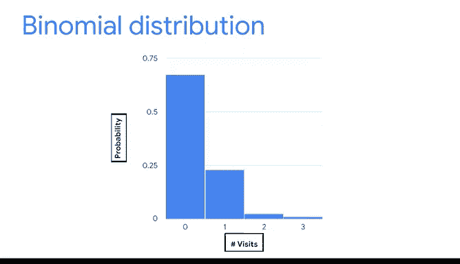

# 谷歌高阶数据分析4：《统计的力量》the-power-of-statistics（中英双字） - P21：21_02_02_二项分布.zh_en - GPT中英字幕课程资源 - BV1yk4y1G7Qm

Recently， you learned about discrete probability distributions。

 which represent discrete random events like tossing a coin or rolling a die。 Often。

 the outcomes of discrete events are expressed as whole numbers that can be counted。 For example。

 the number of times a coin lands on heads in 10 tosses。In this video。

 you'll learn about one of the most widely used discrete probability distributions。

 The binomial distribution。 The binomial distribution is a discrete distribution that models the probability of events with only two possible outcomes。

 Suess or failure。 This definition assumes that each event is independent。

 or it does not affect the probability of the others。

 and that the probability of success is the same for each event。 For example。

 the binomial distribution applies to an event like tossing the same coin 10 times in a row。

 Keep in mind that success and failure are labels used for convenience。 For example。

 each toss has only two possible outcomes， Heads or tails。

 You could choose to label either heads or tails is a successful outcome based on the needs of your analysis。

 Whatever label you apply to the outcomes， It's important to know that they must be mutually exclusive。

 As a quick refresher， Two outcomes are mutually exclusive if they cannot occur at the same time。

 You can't get both heads and tails in a single cointaus。 It's either one or。The other。

Data professionals use the binomial distribution to model data in different fields， such as medicine。

 banking， investing and machine learning。 For example。

 data professionals use binomial distribution to model the probability that a new medication generates side effects。

 A credit card transaction is fraudulent or a stock price rises or falls in value in machine learning。

 a binomial distribution is often used to classify data。 For example。

 a data professional may train an algorithm to recognize whether a digital image of an animal is or is not a cat。

The binomial distribution represents a type of random event called a binomial experiment。

A binomial experiment is a type of random experiment。

 You may recall that a random experiment is a process whose outcome cannot be predicted with certainty。

 All random experiments have three things in common。

 The experiment can have more than one possible outcome。

 you can represent each possible outcome in advance。

 and the outcome of the experiment depends on chance。 On the other hand。

 a binomial experiment has the following attributes。

 The experiment consists of a number of repeated trials。 Each trial has only two possible outcomes。

 The probability of success is the same for each trial， and each trial is independent。

 An example of a binomial experiment is tossing a coin 10 times in a row。

 This is a binomial experiment because it has the following features。

 The experiment consists of 10 repeated trials or cointasses。

 Each trial has only two possible outcomes， heads or tails。

 The probability of success is the same for each trial。 If you define success as heads。

 then the probability of success for each toss is the same 50%。 Each trial is independent。

 The outcome of one cointass does not effect。The outcome of any other coininass。

 Let's check out another example of a binomial experiment。

 Suppose you want to know how many customers return an item to a department store on a given day。

Say 100 customers visit the store each day。10% of all customers who visit the store make a return。

 You label a return as a success。 This is a binomial experiment because their 100 repeat trials or customer visits。

 Each trial only has two possible outcomes， return or not return。 If you label a return as success。

 The probability of success for each customer visit is the same 10%。 Each trial is independent。

 The outcome of one customer visit does not affect the outcome of any other customer visit。

 It's important to understand the features of a binomial experiment because a binomial distribution could only model data for this type of event。

If you're working with data for a different type of event。

 you need to use a different type of probability distribution like the Poson to model the data。

Once you've determined that your distribution is binomial。

 you can apply the binomial distribution formula to calculate the probability。No need to memorize it。

 You can use your computer to make the calculations。 If you want to learn more。

 feel free to check out the relevant reading。 In brief。

 the binomial distribution formula helps you determine the probability of getting a certain number of successful outcomes in a certain number of trials。

 For example， getting a certain number of heads in a certain number of coin flips。 In this formula。

 K refers to the number of successes。 N refers to the number of trials。

 P refers to the probability of success on a given trial。

 And N choose K refers to the number of ways to obtain K successes in N trials。

 Let's explore our department store example to better understand how the formula works。 This time。

 suppose 10% of all customers who visit the store make a return。😊。

Imagine that three customers visit the store。 You label a return as a success。

 You can use the formula to determine the probability of getting 0，1。

2 and three returns among the three customers In the calculation， x refers to the number of returns。

 I'll skip the calculations and go directly to the results。

 If you plug in for the probability that x equals 0 returns。 The result is 0。

729 for the probability that x equals  one return， the result is 0。

243 for the probability that x equals 2 returns， the result is 0。

027 for the probability that x equals 3 returns。 the result is 0。001。

 You can then use a histogram to visualize this probability distribution for a discrete probability distribution like the binomial distribution the random variable is plotted along the x axis and the corresponding probability is plotted along the y axis。

 In this case， the x axis shows the visits per hour，012 and 3。 The y axis shows the probability。

Of getting its result。The binomial distribution lets you model the probability of events with only two possible outcomes。

 success or failure。 identifyingdentifying the distribution of your data is a key step in any analysis and helps you make informed predictions about future outcomes。

