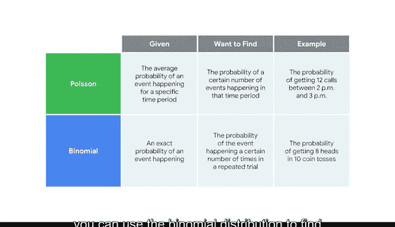

# 谷歌高阶数据分析4：《统计的力量》the-power-of-statistics（中英双字） - P22：22_02_03_泊松分布.zh_en - GPT中英字幕课程资源 - BV1yk4y1G7Qm

As a data professional， knowing about probability distributions is super useful because different types of distributions help you model different kinds of data。

Every time I work with a new data set， I try to understand if there is a pattern present in the distribution data。

Knowing the probability distribution of my data also helps me choose the machine learning model that works best。

This way， I'm able to get a better result in less time。

Data professionals work with many different types of probability distributions。

As you advance in your career and continue to learn。

 you can explore different distributions and discover how they apply to your work。

In this part of the course， we're focusing on two of the most common discrete probability distributions。

 the binomial and the Poisson。Earlier， you learned that the binomial distribution represents experiments with repeated trials that each have two possible outcomes。

 success or failure。In this video， you'll learn about the main features of the Poisson distribution。

 The Poisson distribution is a probability distribution that models the probability that a certain number of events will occur during a specific time period。

The Poisson distribution can also be used to represent the number of events that occur in a specific space。

 such as a distance， area or volume。 But in this course， we'll focus on time。 Baron Simeon Dennis。

 Poisson。A French mathematician originally derived the Poisson distribution in 1830。

 He developed the distribution to describe the number of times a gambler would when a difficult came of chance in a large number of tries。

Data professionals use the Poson distribution to model data。

 such as the expected number of calls per hour for a customer service call center。

Visitors per hour for a website。Customers per day at a restaurant and severe storms per month in a city。

The Poisson distribution represents a type of random experiment called a Poisson experiment。

 A Poisson experiment has the following attributes。

 The number of events in the experiment can be counted。

 The mean number of events that occurred during a specific time period is known。

 and each event is independent。Let's explore an example。

 Imagine you're a data professional working for a large restaurant chain that serves fast food。

You know that the drive through service at a restaurant receives an average of two orders per minute。

You want to determine the probability that a restaurant will receive a certain number of orders in a given minute。

This is a poisson experiment because the number of events in the experiment can be counted。

 You can count the number of orders。 The mean number of events that occur during a specific time period is known。

 There is an average of two orders per minute。 Each outcome is independent。

 The probability of one person placing an order does not affect the probability of another person placing an order。

Once you know that you're working with the Poisson distribution。

 you can apply the Poisson distribution formula to calculate the probability。In brief。

 the formula helps you determine the probability that a certain number of events occurring during a specific time period。

 In this formula， the Greek letter， Lambda refers to the mean number of events that occur during a specific time period。

 K refers to the number of events。 E is a constant equal to approximately 2。71828。

 The exclamation point stands for factorial。 A function that multiplies a number by every whole number below it down to 1。

 For example，2 factorial is 2 multiplied by one。Let's continue with our restaurant chain example to better understand how the formula works。

Recall that the drive through service at a restaurant receives an average of two orders per minute。

 You can use the Poisson formula to determine the probability of the restaurant receiving 0，1，2。

 or three orders in a given minute。Knowing this information may help the restaurant organize staffing for the drive through。

 I'll skip the calculations and go directly to the results。

 If you plug in for the probability that x equals 0 orders， the result is 0。1353。

For the probability that x equals one order， the result is 0。2707。

For the probability that x equals two orders， again， the result is 0。2707。

For the probability that x equals three orders， the result is 0。1805。

You can then use a histogram to visualize the probability and distribution。

The X axis shows the number of events， in this case， orders per minute。

The y axis shows the probability of occurrence。 For example。

 the probability of getting zero orders in a minute is about 0。1353 or 13。53%。

The probability of one order is 0。2707 or 27。07%。The probability of two orders is also 0。2707 or 27。

07%。The probability of three orders is 0。1805 or 18。05%。Before we finish up。

 let's compare the two discrete probability distributions you recently learned about the binomial and the Poisson。

 Sometimes it can be challenging to figure out if you should use a binomial distribution or a Poisson distribution to help you choose between the two。

 you can use the following general guidelines。 Use the Poisson distribution if you are given the average probability of an event happening for a specific time period。

And you want to find out the probability of a certain number of events happening in that time period。

 For example， if a call center averages 10 customer service calls per hour。

 you can use the Poisson distribution to find the probability of getting 12 calls between 2 PMm and 3 pm。

 use the binomial distribution， if you are given the exact probability of an event happening。

 and you want to find out the probability of the event happening。

 a certain number of times in a repeated trial。 For example。

 if the probability of getting heads for any coinntass as 50%。

 you can use the binomial distribution to find the probability of getting8 heads in 10 coinintas。

That's all for discrete probability distributions in your future career as a data professional you'll use discrete distributions like the binomial and the Poson to better understand your data and make informed predictions about future outcomes。

