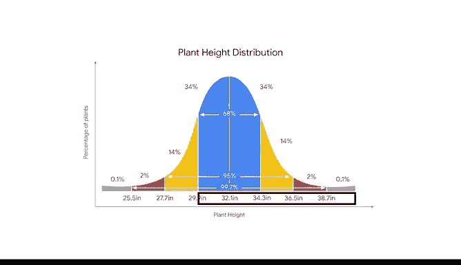

# 谷歌高阶数据分析4：《统计的力量》the-power-of-statistics（中英双字） - P23：23_02_01_正态分布.zh_en - GPT中英字幕课程资源 - BV1yk4y1G7Qm

So far， we've been talking about discrete probability distributions。

 where the outcomes of the experiments are represented by countable whole numbers。 For example。

 rolling a die can result in a two or a3， but not a decimal values such as 2。178 or 3。394。 Now。

 we'll move from discrete to continuous probability distributions。

 recall that continuous probability deals with outcomes that can take on all the values in a range of numbers。

 Typically， these are decimal values that can be measured， such as height， weight。

 time or temperature。For example， you can keep on measuring time with more accuracy， 1。1 seconds，1。

12 seconds， 1。1257 seconds， and so on。In this video。

 we'll explore the most widely used probability distribution and statistics， the normal distribution。

The normal distribution is a continuous probability distribution that is symmetrical on both sides of the mean and bell shaped。

The normal distribution is often called the bell curve because its graph has the shape of a bell with a peak at the center and two downward sloping sides。

 It is also known as the Gaussian distribution。 after the German mathematician Kar Gauss。

 who first described the formula for the distribution。While we're on the subject of formulas。

 if you want to learn more about this formula， please check out the relevant reading where it's discussed in more detail。

 The normal distribution is the most common probability distribution in statistics。

 because so many different kinds of dataset sets display a bell shaped curve。 For example。

 if you randomly sample 100 people， you will discover a normal distribution curve for continuous variables。

 such as height， weight， blood pressure， IQ scores， salaries and more。For example。

 think of the typical results of standardized tests。

 The majority of people will score close to the average score or mean。

Fewer numbers of people will score below or above the average， farther out from the mean。

 A very small percentage of people will score extremely high or extremely low。

 very far away from the mean。 This distribution of scores generates a bell curve。

 Most of the data values are relatively close to the mean。The further a value is away from the mean。

 the less likely it is to occur on a normal curve， the X axis refers to the value of the variable you're measuring。

 and the y axis refers to how likely you are to observe the value。In the case of test scores。

 the x axis is the raw score， and the y axis is the percentage of the population that gets that score。

Data professionals use the normal distribution to model all kinds of different data sets in the fields of business。

 science， government， machine learning， and others。

Understanding the normal distribution is also important for more advanced statistical methods such as hypothesis testing and regression analysis。

 which you'll learn more about later。Plus， many machine learning algorithms assume that data is normally distributed。

 All normal distributions have the following features。 The shape is a bell curve。

 The mean is located at the center of the curve。 The curve is symmetrical on both sides of the center。

 and the total area under the curve equals1。To clarify the features of the normal distribution。

 let's graph the weights of honey crisp apples。 Ass that the weights of honey crisp apples are approximately normally distributed with a mean of 100 G and a standard deviation of 15 G。

 First， find the mean at the center of the curve。 This is also the highest point or peak of the curve。

 This data point represents the most probable outcome in the data set。 meanan weight of 100 G。Second。

 notice that the curve is symmetrical on each side of the mean。

50% of the data is above the mean and 50 per cent is below the mean。 Third。

 the farther a point is away from the mean。 the lower the probability of those outcomes。

 The points farthest from the mean represent the least probable outcomes in the data set。

These are apples that have more extreme weights， either low or high。 Finally。

 the area under the curve is equal to one。This means that the area under the curve accounts for 100 per of the possible outcomes in the distribution on a normal distribution。

 the distance of a data point from the mean is often measured in standard deviations。 As a refresher。

 the standard deviation calculates the typical distance of a data point from the mean of your data sun。

While the mean refers to the center of your data， the standard deviation measures spread。

As standard deviations become larger。Data values become more spread out from the mean In our Apple example。

 the mean weight is 100 G， and the standard deviation is 15 G。 Sooppo。

 that is one standard deviation above the mean will weigh 115 g。

 or the mean weight of 100 G plus the standard deviation of 15 g。

An apple that is one standard deviation below the mean will weigh 85 G， or 100 G-15 g。

 An apple that's 2 standard deviations above the mean will weigh 130 G。

 and an apple that's  two standard deviations below the mean will weigh 70 G。

The values on a normal curve are distributed in a regular pattern based on their distance from the mean。

 This is known as the empirical rule。It states that for a given data set with a normal distribution。

68% of values fall within one standard deviation of the mean。

95% of values fall within two standard deviations of the mean， and the 99。

7% of values fall within three standard deviations of the mean。

The empirical rule can give you a clear idea of how the values in your data set are distributed。

 which helps you save time and better understand your data。Let's continue with our Apple example。

 The empirical rule tells you that most apples or 68% will fall within one standard deviation of the mean weight of 100 grams。

This means that 68% of apples will weigh between 85 grams。

 which is one standard deviation below the mean and 115 grams， one standard deviation above the mean。

95% of apples will weigh between 70 grams and 130 grams。

 or within two standard deviations from the mean。Almost all apples， or 99。

7% will weigh between 55 grams and 145 grams， or within three standard deviations of the mean。

The empirical rule is useful for estimating data， especially for large data sets like height and weight data for an entire population。

 You can use the empirical rule to get an initial estimate of the distribution of values in your dataset set。

 such as what percentage of values will fall within 1，2 or three standard deviations of the mean。

 This saves time and helps you better understand your data。Plus。

 knowing the location of your values on a normal distribution is useful for detecting outliers。

 recall that an outlier is a value that differs significantly from the rest of the data。 Typically。

 data professionals consider values that lie more than three standard deviationvis below or above the mean to be outliers。

 It's important to identify outliers because some extreme values may be due to errors in data collection or data processing。

 These false values may skew the results of your analysis。

Let's explore another example of how the empirical rule can help you better understand your data。

 Imaginem you have a garden。 The height of your plants is normally distributed with a mean of 32。

1 inches and a standard deviation of 2。2 inches。 Let's say you want to find out what percentage of plants are greater than 29。

9 inches tall。You want your plants to be at least this tall as part of your landscape design plan for your backyard。

 First， find out where the value 29。9 is located on the distribution。29。

9 is located one standard deviation below the mean。

The empirical rule tells you that 68% of values fall within one standard deviation of the mean。

 Half of these values or 34% fall below the mean。Now， you know that 34% of values are between 29。

9 and the mean， because 29。9 is one standard deviation below the mean。

 plus 50% of all values in a normal distribution fall above the mean or center of the curve。

The sum of these two percentages will tell you the overall percentage of values greater than 29。9。

34% plus 50% equals 84%， so 84% of your plants are greater than 29。9 inches tall。

The empirical rule helps you quickly understand the overall distribution of your data values。 Now。

 you know that most of your plants are tall enough for your landscape design plan。

 As a future data professional， you use the normal distribution to identify significant patterns in a wide variety of data sets。

