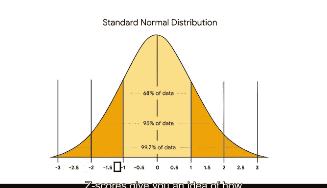

# 谷歌高阶数据分析4：《统计的力量》the-power-of-statistics（中英双字） - P24：24_02_03_使用Z分数标准化数据.zh_en - GPT中英字幕课程资源 - BV1yk4y1G7Qm

Recently， you learned about the normal distribution and how it applies to many different kinds of data sets in this video。

 you learn about Z scores and how they can help you compare values from different types of normally distributed data sets。

A z score is a measure of how many standard deviations below or above the population mean a data point is。

 A z score gives you an idea of how far from the mean a data point is。 For example。

 the z score is 0 if the value is equal to the mean。

The z score is positive if the value is greater than the mean。

The Z score is negative if the value is less than the mean。

 Z scores help you standardize your data In statisticsistic。

 standardization is the process of putting different variables on the same scale。

 There is a formula for this， which we'll check out a little later。

Z scores are also called standard scores because they are based on what's called the standard normal distribution。

A standard normal distribution is just a normal distribution with a mean of 0 and a standard deviation of  one。

Z scores typically range from negative 3 to positive 3。

 standardization is useful because it lets you compare scores from different data sets that may have different units。

 mean values， and standard deviations。Data professionals use Z scores to better understand the relationship between data values within a single data set and between different data sets。

 For example， data professionals often use Z scores for anomaly detection。

 which finds outliers and data sets。 applications of anomaly detection include finding fraud and financial transactions。

 flaws and manufacturing products， intrusions in computer networks and more。For example。

 different customer satisfaction surveys may have different rating scales。

 One survey could rate a product or service from 1 to 20， another from 500 to 1500。

 and a third from 130 to 180。 Let's say the same product got a score of 9 on the first survey。

850 on the second and 142 on the third。These numbers don't mean much by themselves。

 but if you know they all have a z score of1 or a one standard deviation above the mean。

 you can meaningfully compare ratings across surveys。

A z score for an individual value can be interpreted as follows。

 A z score of  one is one standard deviation above the mean。 A z score of 1。5 is 1。

5 standard deviations above the mean。A z score of negative 2。3 is 2。

3 standard deviations below the mean。You can use the following formula to calculate a z score z equals x minus mu divided by sigma In this formula。

 x refers to a single data value or raw score。The Greek letter mu refers to population mean。

The Greek letter sigma refers to the population's standard deviation。

So we can also say that z equals the raw score or data value minus the mean divided by the standard deviation。

For example， let's say you take a standardized test。 You have a test score of 133。

 The test has a mean score of 100 and a standard deviation of 15。Assuming a normal distribution。

 you can use the formula to calculate your Z score。

 Your Z score is your raw score 133 minus the mean score 100， divided by the standard deviation 15。

 This is 133，-100， divided by 15 equals 33， divided by 15 equals 2。2。Your Z score of 2。

2 tells you that your test score is 2。2 standard deviations above the mean or average score。

 That's a really good score。 Rell that the empirical rule tells you that 95% of values fall within two standard deviations of the mean。

Your score of 2。2 is more than two standard deviations above the main。

 Z scores are useful because they give us an idea of how an individual value compares to the rest of the distribution。

Let's take a different exam with a different grading scale。Say you score an 85。

 you want to find out if that's a good score relative to the rest of the class。

 whether or not it's a good score depends on the mean and standard deviation of all exam scores。

Suppose the exam scores are normally distributed with a mean score of 90 and a standard deviation of 4。

You can use the formula to calculate the z score of a raw score of 85。

 Your z score is your raw score 85 minus the mean score 90 divided by the standard deviation 4。

This is 85 minus90 divided by 4 equals negative 5 divided by 4 equals 1。25。

Your Z score of negative 1。25 tells you that your exam score of 85 is 1。

25 standard deviations below the mean or average exam score。

 Z scores give you an idea of how individual values compare to the mean。

As a data professional， you'll use Z scores to help you better understand the relationship between specific values in your data set。

 you'll most likely use a programming language like Python to calculate Z scores on your computer。

 as you will learn in an upcoming video。