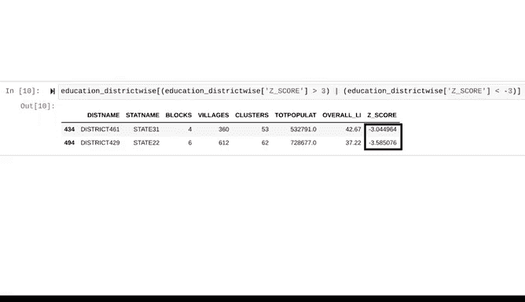

# 谷歌高阶数据分析4：《统计的力量》the-power-of-statistics（中英双字） - P25：25_02_01_在Python中使用概率分布.zh_en - GPT中英字幕课程资源 - BV1yk4y1G7Qm

When I deal with a new data set， I first go through the process of EDA and compute descriptive stats to get a basic understanding of my data。

After that， I tried to determine if my data fits a certain type of probability distribution。

 like the binomial， Poson and normal distributions you recently learned about。

 knowing the distribution of my data helps me decide what statistical test or machine learning model will work best for my analysis。

Python has a great selection of function libraries for data analysis。

 using Python to work with distributions saves time and improves the overall efficiency of my analysis。

In this video， you'll use Python to model your data with the normal distribution。

 Then you'll compute Z scores to find any outliers in your data。

 We'll continue with our previous scenario in which you're a data professional working for the Department of Education of a large nation。

Recall that you're analyzing data on the literacy rate for each district。

 and you've already computed descriptive statistics to summarize your data。

You will continue to use the data you worked with before if you need to access the data， do so now。

Along with pandas， numy and mapplotlib do Pi plot， you'll use two Python packages that may be new to you。

 sippi stats and stats models。Sippe is an open source software you can use for solving mathematical。

 scientific， engineering and technical problems。 It allows you to manipulate and visualize data with a wide range of Python commands。

 Sippi stats is a module designed specifically for statistics。

 Stats models is a Python package that lets you explore data。

 Work with statistical models and perform statistical tests。

 It includes an extensive list of stats functions for different types of data。

 Now that you know more about the packages you'll be working with。

 Let's open up a Jupyter notebook and load them up。To start， import the Python packages you will use。

 Numpy， Padas， and Statsmodels。 API。And the library you will use Matplotlibb。piloot to save time。

 rename each package and library with abbreviation， N， P D， PLT， and SMM。

To load the Sippi stats module right from Sippi import stats。For the next part of your analysis。

 you want to find out if the data on district literacy rate fits a specific type of probability distribution。

The first step in trying to model your data with the probability distribution is to plot a histogram。

This will help you visualize the shape of your data and determine if it resembles the shape of a specific distribution。

Use Maplloot Lib's histogram function to plot a histogram of the district literacy rate data。

 recall that the overall underscore LI column contains this data。

The X axis of your plot refers to the literacy rate of each district。

 and the Y axis refers to count or to the number of districts。

The histogram shows that the distribution of your literacy rate data is bell shaped and symmetric about the mean。

Recall that the normal distribution is a continuous probability distribution that is bell shaped and symmetrical on both sides of the mean。

The mean literacy rate， which is around 73%， is located in the center of the plot。

The shape of your histogram suggests that the normal distribution might be a good modeling option for your data。

To verify that your data is normally distributed， you can use Python to find out if your data follows the empirical rule。

 recall that the empirical rule says that for every normal distribution。

 about 68% of values fall within one standard deviation of the mean。

95% fall within two standard deviations of the mean， and 99。

7% fall within three standard deviations of the mean。

Since the normal distribution seems like a good fit for the district literacy rate data。

 you can expect the empirical rule to apply relatively well。 In other words。

 you can expect that about 68% of literacy rates will fall within one standard deviation of the mean。

95% will fall within two standard deviations and 99。7% will fall within three standard deviations。

First， name two new variables to store the values for the mean and standard deviation of the district literacy rate。

 Na your first variable。 mean， underscore overall， underscore L I and compute the mean。

 Display the value of your variable。 The mean district literacy rate is about 73。4%。

Name your second variable， ST TD underscore overall underscore L and compute the standard deviation and display the value of your variable。

 The standard deviation is about 10%。If your data follows the empirical rule。

 you can expect roughly 68% of your values to fall within one standard deviation of the mean district literacy rate of 73%。

One standard deviation below the mean is 63% or 73 minus 1 times 10。

One standard deviation above the mean is 83% or 73 plus 1 times 10。

 so you can expect roughly 68% of your values to fall within this range of 63 to 83%。

Now compute the actual percentage of district literacy rates that follow within one standard deviation of the mean。

To do this， first name two new variables， lower underscore limit and upper underscore limit。

The lower limit will be one standard deviation below the mean or the mean-1 times the standard deviation。

 The upper limit will be one standard deviation above the mean or the mean plus one times the standard deviation。

To write the code for the calculations， use your two previous variables。

 meanan underscore overall underscore LI， and STD underscore overall underscore LI for the mean and standard deviation。

Next， add a line of code that tells the computer to decide if each value in the overall literacy column is between the lower limit and upper limit。

 In other words， to decide if each value is greater than or equal to one standard deviation below the mean and less than or equal to one standard deviation above the mean。

To do this， use the relational operators greater than or equal to and less than or equal to and the bitwise operator and。

Finally， use the mean function to divide the number of values that are within one standard deviation of the mean by the total number of values and run the code。

The output shows you that about 0。664 or 66。4% of your district literacy rates fall within one standard deviation of the mean。

 This is very close to the roughly 68% that the empirical rule suggests。

You can use the same code structure to determine how many values of your literacy rate。

 values fall within two and three standard deviations of the mean。

 just multiply the standard deviation by two or three instead of one。About 0。954 or 95。

4% of your values fall within two standard deviations of the mean， and about 0。996 or 99。

6% of your values fall within three standard deviations of the mean。Your values of 66。4，95。4 and 99。

6% are very close to what the empirical rule suggests， roughly 68，95 and 99。7%。 At this point。

 it's safe to say your data follows a normal distribution。

Knowing that your data is normally distributed is useful for analysis because many statistical tests and machine learning models assume a normal distribution。

Plus， when your data follows a normal distribution。

 you can use z scores to measure the relative position of your values and find outliers in your data。

 Let's explore how to calculate z scores in Python now。

Recall that a Z score is a measure of how many standard deviations below or above the population mean a data point is。

 A Z score is useful because it tells you where a value lies in a distribution。For example。

 if I tell you a literacy rate is 80%， this doesn't give you much information about where the value lies in the distribution。

 However， if I tell you the literacy rate has a z score of 2。

Then you know that the value is two standard deviations above the mean。

 Data professionals often use Z scores for outlier detectionduction。 Typically。

 they consider observations with the Z scores smaller than negative 3 or larger than positive 3 as outliers。

These are values that lie more than three standard deviations below or above the mean to find outliers in your data。

 first create a new column called Z underscore score that includes the Z scores for each district literacy rate in your data set。

Then compute the Z scores with the function stats dot Z score。

Python takes care of all the calculations。Now， write some code to identify outliers or districts with Z scores that are greater than or less than three standard deviations from the mean。

Use the relational operators greater than and less than and the bitwise operator。

 or using Zus scores， you identify two outlying districts， District 461 and district 429。

 The literacy rates in these two districts are more than three standard deviations below the overall mean。

 which means they have unusually low rates。

Your analysis gives you important information to share。

 The Government may want to provide more funding and resources to these two districts in the hopes of significantly improving literacy。

Probability distributions are useful for modeling your data and help you determine which statistical tests to use for an analysis。

In addition to the normal distribution， Python can help you work with a wide range of probability distributions。

