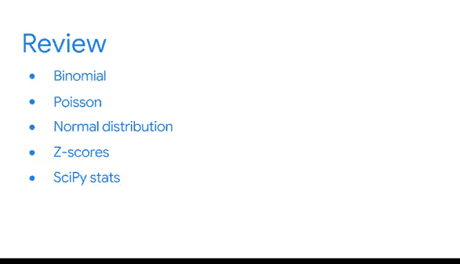

# 谷歌高阶数据分析4：《统计的力量》the-power-of-statistics（中英双字） - P26：26_02_01_总结_2.zh_en - GPT中英字幕课程资源 - BV1yk4y1G7Qm

You've come to the end of your introduction to probability。 Wow。

 you've learned a lot of important concepts。 Great work。 along the way。

 we've explored how data professionals use probability to make reasonable predictions about uncertain events and help people and organizations make data driven decisions。

😊，Basic probability is a foundational part of data science。

 and it also informs more advanced statistical methods such as hypothesis testing and regression analysis。

 which you'll explore later in the program。In your future career as a data professional。

 you'll use probability distributions to discover significant patterns in your data。 Plus。

 a working knowledge of probability distributions is key for machine learning。

 an essential tool in modern data science。 We started off this part of the course by reviewing the two main types of probability。

 objective and subject。 Data professionals use objective probability to analyze and interpret data。

From there， we reviewed the basic rules of probability， such as the complement， addition。

 and multiplication rules。Then you learned about conditional probability。

 which helps you better understand the relationship between dependent events。

 We also discussed Bayes theorem， which updates the probability of an event based on new data about the event。

 After that， we moved from basic probability to probability distributions。

 Pro distributions to describe the likelihood of the possible outcomes of a random event。

 and can be discrete or continuous。 Data professionals use probability distributions to find meaningful patterns in complex data sets。

Next， we explored discrete probability distributions such as the binomial and Poson and discovered how they can help you model different types of data。

Then we moved on to continuous probability distributions。

 We focused on the normal distribution or bell curve。

 the most widely used distribution in statistics。 We also discussed how Z scores can help you better understand the relationship between values and a standard normal distribution。

Finally， you learn that the Sip Pi Stats module is a powerful tool for working with probability distributions。

You use the normal distribution to model your data and gain useful insights。Coming up。

 you have a graded assessment to prepare， check out the reading that lists all the new terms you've learned。

And feel free to revisit videos， readings and other resources that cover key concepts until we meet again。

 good luck。