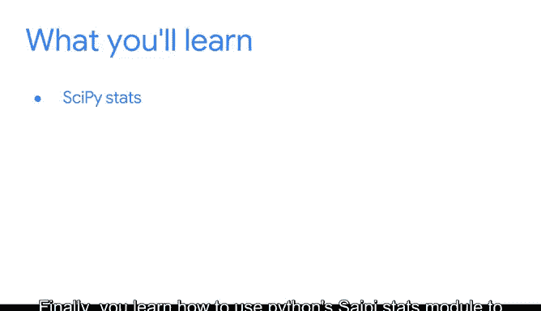

# 谷歌高阶数据分析4：《统计的力量》the-power-of-statistics（中英双字） - P27：27_03_01_欢迎来到模块三.zh_en - GPT中英字幕课程资源 - BV1yk4y1G7Qm

Hello again。 It's great to be back to continue our learning journey together。

 You've learned a lot so far。😊，You now have a better understanding of the essential role statistics plays in data science。

 you also have a solid foundation for using descriptive statistics and basic probability to describe。

 analyze and interpret data。Your knowledge of the fundamental concepts of statistics is the first step on a path that leads to more advanced methods like hypothesis testing and regression analysis。

 What's really exciting is that this learning journey will continue throughout your future career as a data professional。

 The amount of data in the world is always growing。

 and the data career space is constantly advancing。

 I often read about new machine learning methods to keep up with the changes in the field and develop new skills to use at work。

 The next stage of your journey is all about sampling or the process of selecting a subset of data from a population。

 For example， if you want to survey a population of 100000 people。

 You can select a representative sample of 100 people。😊。

Then you can draw conclusions about the population based on your sample data。Coming up。

 we'll go over how the sampling process works and how data professionals use sample data to better understand larger populations。

 Re that in statistics， a population can refer to any type of data， including people， objects。

 events， measurements and more。 We'll start with a review of inferential statistics and examine the concept of a representative sample。

 Next， we'll go over the different stages of the sampling process from choosing a target population to collecting data for your sample。

 Then we'll explore the two main types of sampling methods。

 probability sampling and non-probability sampling。

 We'll discuss the benefits and drawbacks of various sampling methods and describe how random sampling can help ensure that your sample is representative of the population。

 We'll also introduce different forms of bias and sampling。

 like undercoverage and non-response bias and how they can affect non-probability sampling methods。

After that， we'll explore sampling distributions， which are probability distributions for sample statistics。

 You'll learn about sampling distributions for both sample means and proportions and how to estimate the corresponding values for populations。

We'll also cover the central limit theorem and how it can help you estimate the population mean for different types of data sets。

 Finally， you'll learn how to use Python's sip Pi stats module to work with sampling distributions and make a point estimate of the population mean。

 When you're ready， I'll meet you in the next video。

