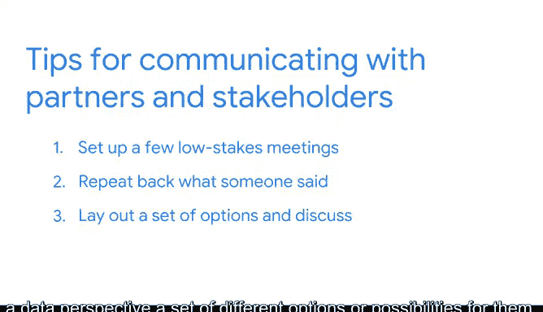

# 谷歌高阶数据分析4：《统计的力量》the-power-of-statistics（中英双字） - P28：28_03_02_Cliff：重视每个人的贡献.zh_en - GPT中英字幕课程资源 - BV1yk4y1G7Qm

My name is Cliff and I'm a workforce planningning and People analyticss lead at Google I use data to help our employees be more productive。

 more connected and just overall improve their well-being I also use data to improve our HR practices and focus on our hybrid work policies as well as our location strategy。

I've always been interested in issues of workforce development， people's strategy， human resources。

But I didn't anticipate what a central role analytics would play in my work。

How much would it come to love？Analytics， one of the things that has helped me develop a confident voice in this space has just been an understanding that no we work in teams who work cross functionally and I don't need to bring all of the solutions to a problem。

 I'll bring perspective on how we can use data to solve this problem。

 but I'm working with people who also bring a wealth of skills and looking at it really as a partnership where it's really about leveraging the best of everyone in the team。

 that's helped me bring a lot of confidence to the work。

 My goto strategy for communications when working with partners is to first set up a few low stakes meetings just to understand what their broader business goals are I'm not even thinking about the specific project we're working on。

 but more broadly how do they define success。 that helps me understand where the work that we're doing fits into the context of their bigger picture。

 The second thing I do from a communication standpoint is to try to play back what I think I heard somebody say。

So of to repeat it back to them， if whether it's my understanding of their question or the output that they're trying to see from the data。

 just to test if I actually really understand their goals。When I'm working with somebody and。

I feel we're not getting to the root of a question of a problem。 What I find is really helpful is。

Laying out from a data perspective， a set of different options or possibilities for them and engaging in a conversation around which of those really resonate for them。

And so it's finding a balance between。Like listening and telling。As a way to。

Unlock some ideas they might not have thought about themselves。

