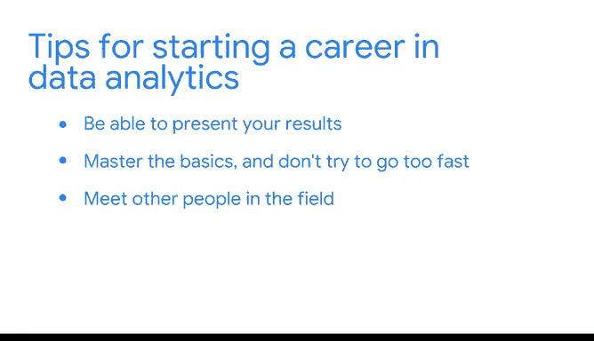

# 谷歌高阶数据分析4：《统计的力量》the-power-of-statistics（中英双字） - P2：02_01_03_Evan：参与与连接.zh_en - GPT中英字幕课程资源 - BV1yk4y1G7Qm

Hi， I'm Evan。 I'm an economist at Google。 When I was in high school。 I was pretty good at math。

 but wasn't overly interested in it。 And when I got to college。

 I took an economics course and was very interested in using that framework to view the world and solve problems。

 A typical day on the job involves me working with business leaders to understand their problems and then help them brainstorm solutions to their problems。

 Sometimes this is just talking and consulting on problems and helping them figure out solutions or other times I'll go and I'll gather data on my own from the from the company and I'll perform analyses and solve problems and help them identify interesting measures and results that could inform the decisions and solve the problems。

 I also like to devote time each day to doing my own research on topics that I'm unfamiliar with so that I'm always growing my skills and increasing my toolkit。

😊，Some of the soft skills that were most important in starting a career in data analytics was first being able to present your results so you can do tons of work in getting data mining through the data。

 trying to find some interesting pieces of information and you may find something but then being able to clearly communicate that to other people who may not be experts in what you're studying is actually quite difficult。

 make sure you master the basics and don't try to go too fast And if there's something you don't understand。

 rewatch it， do the reading， make sure you know the fundamentals it all builds on itself。

 if I can give myself some advice when I was starting my first data analytics role is to take time to meet other people in the field and to network with them and learn what they know I think a lot of data professionals in this field have built up lots of knowledge that's quite useful specific to their company specific to their role specific to certain types of problems and that knowledge lives inside their head it's not written in a book it's not in a manual but they have。

This knowledge and so the more you talk with people。

 the more you meet people and talk about these different problems that you have。

 the faster you can grow and the faster you can learn instead of having to learn these things on your own and kind of solve the problems bit by bit。

 you can work with other people and they can just help you to solve these so much quicker because they've already solved the problem and learn that information。

