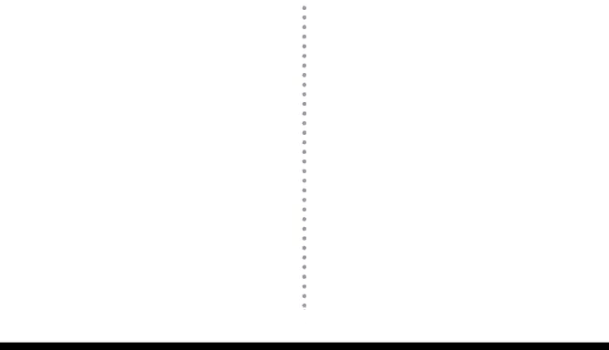

# 谷歌高阶数据分析4：《统计的力量》the-power-of-statistics（中英双字） - P30：30_03_05_抽样过程.zh_en - GPT中英字幕课程资源 - BV1yk4y1G7Qm

As a data professional， you'll work with sample data all the time。 Often。

 this will be sample data previously collected by other researchers。

 Sometimes your team may collect their own data。 Either way。

 it's important to know how the sampling process works because it directly affects the quality of your sample data。

 The sampling process helps determine whether your sample is representative of the population and whether your sample is unbiased。

If you estimate the mean height of a country's total adult population based on a sample of professional basketball players。

 your estimate will not be accurate。In this video， we'll go over the main stages of the typical sampling process。

 This will give you a useful framework for understanding how sampling is conducted and how the sampling process can affect your sample data。

To get a clear overview of the sampling process， let's divide it into five steps。 Step 1。

 identify the target population。 Step 2， select the sampling frame。 Step 3。

 chooseose the sampling method。 Step 4， determine the sample size and step 5。

 collect the sample data。 As an example， let's consider a public opinion poll。

 Imagine the city government of Vancouver， Canada wants to build a new subvoy system。

The public will vote on whether or not to move forward with the project。

 The city government wants to find out if there is public support for the project。

They ask you to take a poll and estimate the percentage of adult residents that support the project。

 Leal adults are 18 years or older。 The first stage in the sampling process is to identify your target population。

 The target population is the complete set of elements that you're interested in knowing more about。

 In this case， the target population includes every resident in the city who is 18 years or older and eligible to vote。

 Let's say that the city contains 100000 such residents。

 since it's too difficult and too expensive to survey everyone in the target population。

 you decide to take a sample。The next step in the sampling process is to create a sampling frame。

 A sampling frame is a list of all the items in your target population。 Basically。

 it's a complete list of everyone or everything you're interested in researching。

 The difference between a target population and a sampling frame is that the population is general and the frame is specific。

 So if your target population is 100000 city residents who are 18 years or older and eligible to vote。

 Your sampling frame could be a list of names for all these residents from Alana Aoki to Zoe Zpa。

 for practical reasons， your sampling frame may not accurately match your target population。

 because you may not have access to every member of the population。 For instance。

 the city may not have reliable contact information about each resident。

 or perhaps not all eligible voters are actually registered to vote。

 So their opinions about the potential subway system aren't relevant。

 Since the project will be decided by an election。For reasons like these。

 your sampling frame will not exactly overlap with your target population。

 Your sampling frame will include the list of residents 18 or over that you're able to obtain useful information about。

 So the sampling frame is the accessible part of your target population。Next。

 you need to choose a sampling method， which is step three of the sampling process。

One way to help ensure that your sample is representative is to choose the right sampling method。

There are two main types of sampling methods， probability sampling and non probability sampling。

 In later videos， we'll explore the specifics in more detail。For now。

 just know that probability sampling uses random selection to generate a sample。

 No probability sampling is often based on convenience or the personal preferences of the researcher rather than random selection。

Because probability sampling methods are based on random selection。

 Every person in the population has an equal chance of being included in the sample。

 This gives you the best chance to get a representative sample as your results are more likely to accurately reflect the overall population。

 So assuming you have the budget and the time， you can use a probability sampling method for your poll about the subway project。

Using random selection gives you the best chance of getting a sample that's representative of your population。

Step 4 of the sampling process is to determine the best size for your sample。

 since you don't have the resources to pull everyone in your sampling frame。In statistics。

 sample size refers to the number of individuals or items chosen for a study or experiment。

Sample size helps determine the accuracy of the predictions you make about the population in general。

 the larger the sample size， the more accurate your predictions。

Based on the desired level of accuracy for your survey。

 you can decide how many eligible voters to include in your sample Now you're ready to collect your sample data。

 This is the final step in the sampling process to pull the residence selected for your sample。

 you decide to conduct a survey。

Based on the survey responses， you determine the percentage of eligible voters 18 and over who favor the proposed sub project。

 Then you share this information with city leaders to help them make a more informed decision。

 Effective sampling ensures that your sample data is representative of your target population。

Then when you use sample data to make inferences about the population。

 you can be reasonably confident that your inferences are reliable。

Your poll will give Cedar leaders a better idea of public support for the new subway and help inform future decisions about the project。

The decisions you make at each step of the sampling process can affect the quality of your sample data。

 Understanding the sampling process will make you a better data professional。

 whether you're analyzing data collected by the researchers or conducting a survey on your own。

