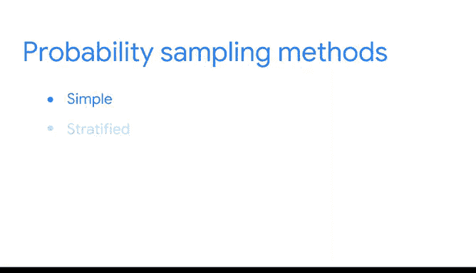

# 谷歌高阶数据分析4：《统计的力量》the-power-of-statistics（中英双字） - P31：31_03_07_比较抽样方法.zh_en - GPT中英字幕课程资源 - BV1yk4y1G7Qm

In a previous video， you learn the differences between probability and non probability sampling。

Then you conducted a survey using probability sampling。

 which is the third step of the sampling process In this video。

 you will learn more about the different methods of probability sampling。

 Then we'll discuss the benefits and drawbacks of each method。

There are four different probability sampling methods， simple random sampling。

 stratified random sampling。Cluster random sampling and systematic random sampling。

In a simple random sample， every member of a population is selected randomly and has an equal chance of being chosen。

You can randomly select members using a random number generator or by another method of random selection。

For example， say you want to survey the employees of a company about their work experience。

 The company employs 1000 people。 you can assign each employee in the company database a number from 1 to 1000 and then use a random number generator to select 100 people for your sample。

The main benefit of simple random samples is that they are usually fairly representative。

 since every member of the population has an equal chance of being chosen。

Random samples tend to avoid bias， and surveys like these give you more accurate results。However。

 in practice， it's often expensive and time consuming to conduct large， simple random samples。

And if your sample size is not large enough， a specific group of people in the population may be underrepresented it in your sample。

 If you use a larger sample size， your sample will more accurately reflect the population。

The next method of probability sampling is a stratified random sample， in a stratified random sample。

 you divide a population into groups。And randomly select some members from each group to be in the sample。

These groups are called strata。Sttrata can be organized by age， gender， income。

 or whatever category you're interested in studying。For example。

 say you want to survey high school students about how much time they spent studying on weekends。

You might divide the student population according to age， 14， 15， 16 and 17 year olds。

Then you can survey an equal number of students from each age group。

Sttraatified random samples help ensure that members from each group in the population are included in the survey。

 This method allows you to draw more accurate conclusions about the relevant groups。 For instance。

14 year olds and 17 year olds may have different perspectives about studying on the weekends。

Older students can drive and may have more social activities or work on the weekends。

 Stratified sampling will capture both perspectives。

 One main disadvantage of stratified sampling is that it can be difficult to identify appropriate strata for a study if you lack knowledge of a population。

For example， if you want to study median income among a population。

 you may want to stratify your sample by job type or industry or location or education level。

 If you don't know how relevant these categories are to median income。

 it will be difficult to choose the best one for your study。

The next method of probability sampling is a cluster random sample。

 When you're conducting a cluster random sample， you divide a population into clusters。

 randomly select certain clusters and include all members from the chosen clusters in the sample。

Cluster sampling is similar to stratified random sampling。But in stratified sampling。

 you randomly choose some members from each group to be in the sample in cluster sampling。

 you choose all members from a group to be in the sample。

Clus are divided using identifying details such as age， gender， location。

 or whatever you want to study。For example， imagine you want to conduct a survey of employees at a global company using cluster sampling。

 The company has 10 offices in different cities around the world。

 Each office has about the same number of employees and similar job rules。

 You randomly select three offices in three different cities as clusters。

You include all the employees at the three offices in your sample。

 One advantage of this method is that a cluster sample gets every member from a particular cluster。

 which is useful when each cluster reflects the population as a whole。

This method is helpful when dealing with large and diverse populations that have clearly defined subgroups。

 If researchers want to learn about the preferences of primary school students in Oslo， Norway。

 they can use one school as a representative sample of all schools in the city。

A main disadvantage of cluster sampling is that it may be difficult to create clusters that accurately reflect the overall population。

For example， for practical reasons， you may only have access to the offices in the United States when your company has locations all over the world。

And employees in the United States may have different characteristics and values than employees in other countries。

The final method of probability sampling is a systematic random sample。In systematic random samples。

 you put every member of a population into an ordered sequence。

Then you choose a random starting point in the sequence and select members for your sample at regular intervals。

Let's assume you want to survey students at a community college。For a systematic random sample。

 youd put the student' names in alphabetical order。

 randomly choose a starting point and pick every fifth name to be in the sample。

Systematic random samples are often representative of the population since every member has an equal chance of being included in the sample。

 Whether the student's last name startss with B or R isn't going to affect their characteristics。

 Systemmatic sampling is also quick and convenient when you have a complete list of the members of your population。

One disadvantage of systematic sampling is that you need to know the size of the population that you want to study before you begin。

 If you don't have this information， it's difficult to choose consistent intervals。

 The four methods of probability sampling we've covered， simple， stratified， cluster and systematic。

 are all based on random selection， which is the preferred method of sampling for most data professionals。

These methods can help you create a sample that is representative of the population in an upcoming video。

 we'll check out some methods of non probability sampling and why they're not considered representative。

