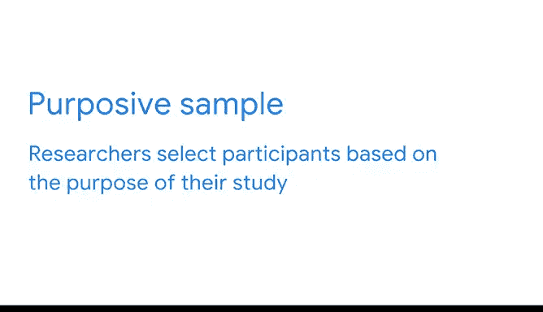
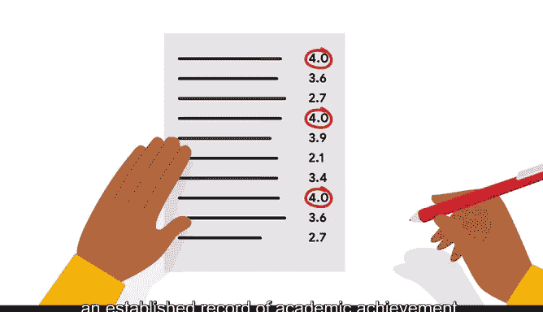

# 谷歌高阶数据分析4：《统计的力量》the-power-of-statistics（中英双字） - P32：32_03_09_抽样中偏差的影响.zh_en - GPT中英字幕课程资源 - BV1yk4y1G7Qm

In my work as a data professional， I often use sample data to help build machine learning models。

Today， a machine learning model may help determine if a person gets an approval for a loan。

 an interview for a job， or an accurate medical diagnosis。

 models based on representative samples are much more likely to make fair and unbiased decisions about who gets a loan or a job interview。

Using samples that are representative of the different types of people in the population helps ensure that each person receives the treatment that is best for them。

Unfortunately， bias can affect sample data。 Saming bias occurs when a sample is not representative of the population as a whole to eliminate bias。

 I try to use samples that are representative of the overall population。

The consequences of drawing conclusions from a non representative sample can be serious。Recently。

 you learned that probability sampling methods use random selection， which helps avoid sampling bias。

 A randomly chosen sample means that all members of the population have an equal chance of being included。

 In contrast， non probability sampling methods do not use random selection。

 So they do not typically generate representative samples。 In fact。

 they often result in biased samples。However， non probability sampling is often less expensive and more convenient for researchers to conduct。

Sometimes due to budget， time or other reasons， it's just not possible to use probability sampling。

Plus， nonpro methods can be useful for exploratory studies which seek to develop an initial understanding of a population。

 not draw conclusions or make predictions about the population as a whole。In this video。

 we'll discuss four methods of non probability sampling and learn how sampling bias can affect each method。

These four methods are convenient sampling， voluntary response sampling。

 snowball sampling and purpose of sampling。Let's start with convenient sampling。 In this method。

 you choose members of a population that are easy to contact or reach， as the name suggests。

 conducting a convenient sample involves collecting a sample from somewhere more convenient to you。

 such as your workplace， a local school or public park。For example， to conduct an opinion poll。

 a researcher might stand in front of a local high school during the day and poll people that happen to walk by。

Because these samples are based on convenience to the researcher and not a broader sample of the population。

 Connient samples often show under coverage bias。 Under coverage bias occurs when some members of a population are inadequately represented in the sample。

 For instance， people who don't work at or attend the school will not be represented as much in the sample。

The next method of non probability sampling is voluntary response sampling。

This type of sample consists of members of a population who volunteer to participate in a study。

For example， the owners of a restaurant want to know how people feel about their dinner options。

They asked their regular customers to take an online survey about the quality of the restaurant's food。

Voluntary response samples tend to suffer from non response bias。

 which occurs when certain groups of people are less likely to provide responses。

People who voluntarily respond will likely have stronger opinions。

 either positive or negative than the rest of the population。

This makes the volunteer customers at the restaurant an unrepresentative sample。

The next non probability sampling method is snowball sampling In a snowball sample。

 researchers recruit initial participants to be in a study and then ask them to recruit other people to participate in the study Like a snowball。

 the sample size gets bigger and bigger as more participants join in。For example。

 if a study was investigating cheating among college students。

 potential participants might not want to come forward。

 but if a researcher can find a couple of students willing to participate。

 these two students may know others who have also cheated on exams。

 The initial participants could then recruit others by sharing the benefits of the study and reassuring them of confidentiality。

 although it may seem convenient that study participants help build the sample。

 this type of recruiting can lead to sampling bias。

 because initial participants recruit additional participants on their own。

 It's likely that most of them will share similar characteristics。

 and these characteristics might be unrepresentative of the total population under study。

In purpose of sampling， researchers select participants based on the purpose of their study。

 because participants are selected for the sample according to the needs of the study。

 applicants who do not fit the profile are rejected。 For example。

 a researcher wants to survey students on the effectiveness of certain teaching methods at their university。

 The researcher only wants to include students who regularly attend class and have an established record of academic achievement。

 so they select the students with the highest grade point averages to participate in the study。

 In purpose of sampling， the researcher often intentionally exclude certain groups from the sample to focus on a specific group they think is most relevant to their study。

In this case， the researcher excludes students who don't have high grade point averages。

 This could lead to biased outcomes because the students in the sample are not likely to be representative of the overall student population。

As a data professional， you have to think about bias and fairness from the moment you start collecting sample data to the time you present your conclusions。

Once you become aware of some common forms of bias， you can remain on the alert for bias in any form。

