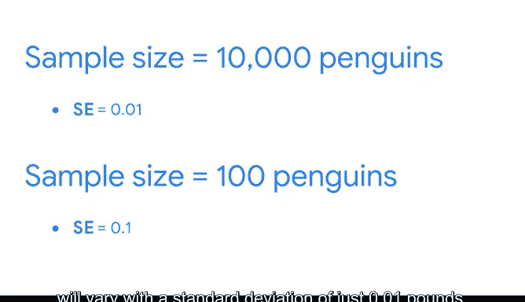

# 谷歌高阶数据分析4：《统计的力量》the-power-of-statistics（中英双字） - P33：33_03_01_抽样如何影响数据.zh_en - GPT中英字幕课程资源 - BV1yk4y1G7Qm

In previous videos， you learned how the sampling process works and the benefits and drawbacks of various sampling methods As a data professional。

 I often work with sample data to make informed predictions about future sales revenue or product performance。

Understanding how sampling affects your data， both positively and negatively will be important in your future career in data analytics。

For instance， one way data professionals use sample statistics is to estimate population parameters。

 as you may recall， a statistic is a characteristic of a sample and a parameter is a characteristic of a population。

For example， the mean weight of a random sample of 100 penguins is a statistic。

 The mean weight of the total populations of 10000 penguins is a parameter。

 A data professional might use the mean weight of the sample of 100 penguins to estimate the mean weight of the population。

 This type of estimate is called a point estimate。 A point estimate uses a single value to estimate a population parameter。

 In this video we'll discuss the concept of sampling distribution。

 and how it can help you represent the possible outcomes of a random sample。

 You'll also learn how the sampling distribution of the sample mean can help you make a point estimate of the population mean。

 A sampling distribution is a probability distribution of a sample statistic。

Recall that a probability distribution represents the possible outcomes of a random variable。

 such as a coinintass or a di roll。 In the same way。

 a sampling distribution represents the possible outcomes for a sample statistic， like the mean。

 Imagine you take repeated， simple random samples of the same size from a population。

Since each sample is random， the mean value will vary from sample to sample in a way that cannot be predicted with certainty Right now。

 this may seem a bit abstract to get a better idea of the sampling distribution of the mean。

 Let's continue with our penguin example。 Imaginem your studying a population of 10000 blue penguins。

 which are the smallest of all known penguin species。

You want to find out the mean way of a blue penguin in this population。

Since it would take too long to locate and wait every single penguin。

 you instead collect sample data from the population。Let's say you take repeated， simple。

 random samples of 10 penguins each from the population。In other words。

 you randomly choose 10 penguins from the group， weigh them。

 and then repeat this process with a different set of 10 penguins。 For your first sample。

 you find the mean weight of the 10 penguins is 3。1 For your second sample。

 the mean weight of the 10 penguins is 2。9 for your third sample， the mean weight is 2。8 and so on。

Imagine that the true mean weight of a penguin in this population is 3， although in practice。

 you wouldn't know this unless you weigh every single penguin。

Each time you take a sample of 10 penguins， it's likely that the mean weight of the penguins in your sample will be close to the population mean of 3。

 but not exactly 3。 Every once in a while， you may get a sample full of smaller than average penguins。

 with a mean weight of 2。5 or less， or you might get a sample full of larger than average penguins with a mean weight of 3。

5 or more。 The mean weight will vary randomly from sample to sample。

 Saming variability refers to how much an estimate varies between samples。

You can use a sampling distribution to represent the frequency of all your different sample means。

I find that it helps to visualize these samples as a histogram。

 Let's plot 10 simple random samples of 10 penguins each。

 The most frequently occurring sample means will be around 3。

 the least frequent sample means will be the more extreme weights， such as 2。3 or 3。7。

 as you increase the size of a sample， the mean weight of your sample data will get closer to the mean weight of the population。

 if you sampled the entire population， In other words， if you actually weigh all 10000 penguins。

 your sample mean would be the same as your population mean。

 But to get an accurate estimate of the population mean， you don't have to weigh 10000 penguins。

 If you take a large enough sample size from a population， say 100 penguins。

 your sample mean will be an accurate estimate of the population mean。

This point is based on the central limit theorem， which we'll explore in more detail later on in the course。

For now， just know that if your sample is large enough。

 your sample mean will roughly equal the population mean。 For instance。

 imagine you collect a sample of 100 penguins and find that the mean weight of your sample is 3。

 This means that your best estimate for the mean weight of the entire penguin population is also 3。

You can also use your sample data to estimate how accurately the mean weight of any given sample represents the population mean weight。

 this is useful to know because the mean varies from sample to sample and any given sample is not necessarily an exact reflection of the population mean。

For example， the true main weight for the penguin population might be3 pounds。

 the mean weight for any given sample of penguins might be 3。3 pounds， 2。8 pounds， 2。4 pounds。

 and so on。The more variability in your sample data。

 the less likely it is that the sample mean is an accurate estimate of the population mean。

Data professionals use the standard deviation of the sample means to measure this variability。

 recall that the standard deviation measures the variability of your data or how spread out your data values are。

 The more spread between the data values， the larger the standard deviation In statistics。

 the standard deviation of a sample statistic is called the standard error。

 The standard error of the mean measures variability among all your sample means。

 A larger standard error indicates that the sample means are more spread out or that there's more variability。

 A smaller standard error indicates that the sample means are closer together。

 or that there's less variability。The less standard error。

 the more likely it is that your sample mean is an accurate estimate of the population mean。

 For example， say you take three random samples of 10 penguins each。

 The mean weight of the first sample is 3。3。 The second is 3。1， and the third is 2。9。

 There is not much variability among these 3 sample means。 The values are all close together。

 The standard error will be relatively small。 Now， say you take another3 random samples of 10 penguins each。

 The mean weight of the first sample is 2。2。 The second is 3。2， and the third is 4。2。

 There's more variability among these 3 sample means。 The values are more spread out。

 The standard error will be relatively large。Note that the concept of standard error is based on the practice of repeated sampling。

 in reality， researchers usually work with a single sample， it's often too complicated。

 expensive or time consuming to take repeated samples of a population。Instead。

 statisticians have derived a formula for calculating the standard error based on the mathematical assumption of repeated sampling。

You can use the following formula to calculate the standard error of the sample mean S divided by the square root of n。

 where S is the standard deviation and n is the sample size。For example。

 in your study of penguin weights， imagine that a sample of 100 penguins has a mean weight of 3 and a standard deviation of 1。

 You can calculate the standard error by dividing the sample standard deviation 1 by the square root of the sample size 100。

1 divided by the square root of 100 equals 0。1。This means that your best estimate for the true population mean weight of all penguins is 3 pounds。

But you should expect that the mean weight from one sample to the next will vary with a standard deviation of about 0。

1 as your sample size gets larger， your standard error gets smaller。

 This is because standard error measures the difference between your sample mean and the actual population mean as your sample gets larger。

 your sample mean gets closer to the actual population mean。

 The more accurate the estimate of the population mean， the smaller the standard error。

Say you collect a sample of 10，000 penguins instead of 100 penguins。

You find that the sample mean weight is three pounds and the sample standard deviation is  one pound。

The standard error is one divided by the square root of 10000， which equals 0。01。

 Your best estimate for the sample mean will still be 3。

 But now you can expect that the mean weight from one sample of penguins to the next will vary with a standard deviation of just 0。

01。

In general， you can have more confidence in your estimates as the sample size gets larger and the standard error gets smaller。

 This is because the mean of your sampling distribution gets closer to the population mean。Coming up。

 we'll explore this idea further when we talk about the central limit theorem。

