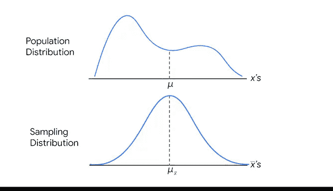

# 谷歌高阶数据分析4：《统计的力量》the-power-of-statistics（中英双字） - P34：34_03_02_中心极限定理.zh_en - GPT中英字幕课程资源 - BV1yk4y1G7Qm

Recently， we talked briefly about the central limit theorem and the relationship between sample size and the sample mean Data professionals use the central limit theorem to estimate population parameters for data in economics。

 science， business and other fields。 For example， they may use the theorem to estimate the mean annual household income for an entire city or country。

 They mean height and weight for an entire animal or plant population。

 or the mean commute time for all the employees of a large corporation。In this video。

 you'll learn more about the central limit theorem and how it can help you estimate the population mean for different types of data。

 The central limit theorem states that the sampling distribution of the mean approaches a normal distribution as the sample size increases。

In other words， as your sample increases， your sampling distribution assumes the shape of a bell curve。

 And if you take a large enough sample of the population。

 the sample mean will be roughly equal to the population mean。For example。

 say you want to estimate the average height for a university student in South Africa。

Instead of measuring millions of students， you can get data on a representative sample of students。

If your sample size is large enough， the mean height of your sample will be roughly equal to the mean height of the population。

There is no exact rule for how large a sample size needs to be in order for the central limit theorem to apply。

In general， a sample size of 30 or more is considered sufficient。

Exploratory data analysis can help you determine how large of a sample is necessary for a given data set。

What's really powerful about the central limit theorem is that it holds true for any population。

You don't need to know the shape of your population distribution in advance to apply the theorem。

 If you collect a large enough sample， the shape of your sampling distribution will follow a normal distribution。

This pattern is true， even if your population has a skewed distribution。 For example。

 here's a graph for annual household income in the US for the year 2010。

The X axis represents annual income and the Y axis represents the percent of households that have that income。

 you may notice how the data is skewed to the right and the shape of the distribution is far from normal。

The distribution for annual income is skewed because of the extraordinarily high incomes of the wealthiest households。

 However， if you sample incomes at random among all households and take a large enough sample。

 your sampling distribution will follow a normal distribution。 This is true。

 even though the population distribution。 Every US household is not normal。

And the mean income of your sampling distribution will give you an accurate estimate of the mean income of the entire population。

Let's check out another example。 Imagine you studying the population of coffee drinkers in the United States。

 You want to know the average amount of coffee each person drinks per day。

 but you don't have the time or money to survey every single coffee drinker in the US， which。

 by the way， is around 150 million people。Instead of surveying the entire population。

 you collect repeated random samples of 100 coffee drinkers using this data。

 you calculate the mean amount of coffee consumed per day for your first sample，22。5 ounces。

For your second sample， the mean amount is 28。2 ounces。 You take a third sample。

 The mean amount is 25。4 ounces and so on。In theory， you could take 10。

50 or 100 samples and keep increasing the sample size until you've surveyed all 150 million people about their coffee consumption。

The central limit theorem says that as your sample size increases。

 the shape of your sampling distribution will increasingly resemble a bell curve。 In practice。

 the specific sample size you choose will depend on factors like budget， time。

 resources and the desired level of confidence for your estimate。

If you take a large enough sample from the population。

 the mean of your sampling distribution will equal the population mean from this sample of the population。

 you can accurately estimate the average amount of coffee consumed per day for the entire population。

 In case you're wondering， the average American drinks around 24 ounces or 3 cups of coffee per day。

 Based on what I've noticed if we took a sample of only data professionals。

 The mean value might be even higher。 Whether you're measuring coffee consumption or household income。

 The central limit theorem is a useful method for better understanding the distribution of your data。

