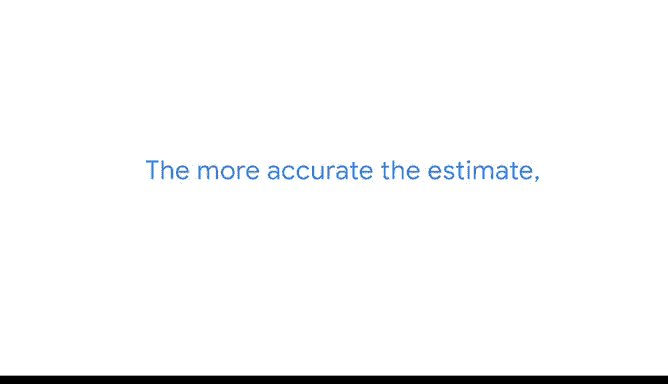

# 谷歌高阶数据分析4：《统计的力量》the-power-of-statistics（中英双字） - P35：35_03_04_比例的抽样分布.zh_en - GPT中英字幕课程资源 - BV1yk4y1G7Qm

In this part of the course， we've been talking about how data professionals use sample statistics to estimate population parameters recently。

 you learned how to use the sampling distribution of the mean to estimate the actual population mean。

For example， you might estimate the mean way of an animal population or the mean salary of all the people who work in the hospitality industry。

 Data professionals also use sampling distributions to estimate population proportions In statistics。

 A population proportion refers to the percentage of individuals or elements in a population that share a certain characteristic proportions measure percentages or parts of a whole。

For example， you might survey 100 employees at a large company to estimate what percentage of all employees like the food at the office cafeteria。

 Data professionals might also use the sampling distribution of the proportion to estimate the proportion of all visitors to a website who make a purchase before leaving assembly line products that meet quality control standards or votersers who support a candidate in an upcoming election。

 In this video， you'll learn about the sampling distribution of the sample proportion and how it can help you estimate the population proportion。

Imagine you work for a market research firm。 Your client is a company that manufactures sneakers and wants to make sure their sneakers appeal to the largest audience。

 You're asked to research sneaker preferences among residents of Santiago， Chile。

Who are between 16 and 19 years old。There are 100，000 teenagers in that age group。

 You might want to find out what proportion of this population prefers slip on sneakers over sneakers with shoelaces。

Since it would take too long to locate and survey all 100000 teens。

 you instead collect sample data from the population。 Let's say you take repeated， simple。

 random samples of 100 teenagers from the overall population。 In your first sample。

 you find that 12% of teenagers prefer slip on sneakers。 In your second sample。

 you find that 8% prefer slip on sneakers。You take a third sample， and the proportion is 11 per cent。

 Earl， we talked about sampling variability for the sample means or how the value of the mean varies from one sample to the next。

 The same holds true for proportions。 Let's assume we know that 10% cent of teenagers in the total population prefer slip on sneakers。

 In most of the samples， The proportion of teenagers who prefer slip on sneakers will be close to the true population proportion of 10 per cent。

 but not exactly 10 per cent。 Occasion， a sample may turn out to have a proportion that's very small or very large。

You can use a sampling distribution to represent the frequency of all your different sample proportions。

 For instance， if you take 10 simple random samples of 100 teenagers from this population。

 you can show the sampling distribution of the proportion in histogram。

 The most frequently occurring values in your sample data will be around 10%。

 The values that occur least frequently will be the more extreme proportions， such as 5% or 15%。

As with the sample means， the central limit theorem also applies to sample proportions。

As your sample size increases， the distribution of the sample proportion will be approximately normal。

 The overall average or mean proportion is located in the center of the curve。

If you take a sufficiently large enough sample of teenagers。

 the sample proportion will be an accurate estimate of the true population proportion。

If you survey 1，000 teenagers and find that 10% prefer slip on sneakers。

 this means that your best estimate for the proportion of all teenagers who prefer slip ones is also 10%。

As with the sample mean， you can use the standard error of the proportion to measure sampling variability。

 This tells you how much a particular sample proportion is likely to differ from the two population proportion。

This is useful to know because the proportion varies from sample to sample。

 and any given sample proportion probably won't be exactly equal to the true population proportion。

The true proportion of teenagers who prefer slip on sneakers might be 10%。

 but the proportion of any given sample might be 12%，9%，7% and so on。

 The more variability in your sample data， the less likely it is that the sample proportion is an accurate estimate of the population proportion。

It's important to understand the accuracy of your estimate。

 because stakeholder decisions are often based on the estimates you provide。

 You can use the following formula to calculate the standard error of the proportion。

 The square root of P hat， open parentheses，1 minus P hat close parentheses divided by N。

P hat refers to the population proportion and n refers to the sample size in statistics。

 you say hat when you refer to the carrot symbol above the letter P。

The formula is the square root of P hat multiplied by one minus P hat divided by n。For example。

 suppose you survey 100 teenagers about their sneaker preferences and find that your estimate for the population proportion of teens who prefer slip on sneakers is 10% or 0。

1。 In this case， P hat is 0。1 and n is 100。 When you plug in the numbers into the formula for standard error of the proportion。

 it equals 0。03。As your sample size gets larger， your standard error gets smaller because standard error measures the difference between your sample proportion and the true population proportion。

As your sample gets larger， your sample proportion gets closer to the true population proportion。

The more accurate the estimate of the population proportion， the smaller the standard air。

 Your estimate will help stakeholders at the sneaker company make decisions about product development Based on results。

 they may want to put less money into developing slip on sneakers。

Typically， the next step for a data professional would be to use the standard error to construct a confidence interval。

 This describes the uncertainty of your estimate and gives your stakeholders more detailed information about your results。

Later on in this course， you'll learn how to calculate and integrate confidence intervals to more accurately predict preferences of a population。

