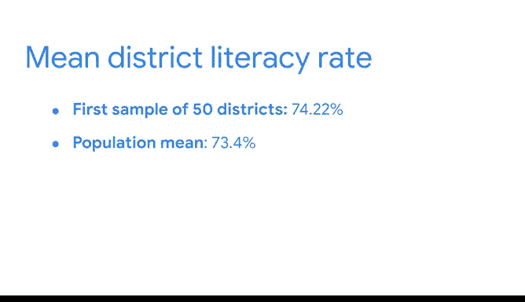

# 谷歌高阶数据分析4：《统计的力量》the-power-of-statistics（中英双字） - P36：36_03_01_使用Python处理抽样分布.zh_en - GPT中英字幕课程资源 - BV1yk4y1G7Qm

Earlier， we talked about how data professionals use sample data to make point estimates about population parameters。

For instance， if you want to know the average age of registered voters in Japan。

 you could take a survey of 100 registered voters。Then you could use the average age of the survey respondents as a point estimate of the average age of all registered voters。

If your sample size is large enough， your sample mean will give you a pretty good estimate of the population mean。

In this video you'll use Python to simulate random sampling， then based on your sample data。

 you'll make a point estimate of a population mean。

Well continue with our previous scenario in which you're a data professional working for the Department of Education of a large nation。

 recall that you're analyzing data on the literacy rate for each district。

You'll continue to use the data set you worked with before。 if you need to access the data。

 do so now for this video， we'll make a slight change to our story。

 Imagine that you are asked to collect the data on district literacy rates and that you have limited time to do so。

You can only survey 50 randomly chosen districts instead of 634 districts included in your original data。

The goal of your research study is to estimate the mean literacy rate for all 634 districts based on your sample of 50 districts。

You can use Python to simulate taking a random sample of 50 districts from your data。Now。

 let's open up a Jupiter notebook and get to work to start， import the Python packages you will use。

 Nmppyy， Padas and stats modelss do API， and the library you will use Maplotlib do Pyloot to save time。

 rename each package in library with an abbreviation， N， P D， PLT and S M。

To load the sippi stats module right from it， Sipi import stats。First。

 you will want to get a random sample of 50 districts。

 a cool feature of Python is that you can use code to simulate random sampling and choose the desired sample size to do this。

 use the sample function in pandas。Before you write the code。

 let's review the function and its arguments。To simulate random sampling。

 use the following arguments in the sample function， N， replace， and random state。

And refers to the desired sample size replace indicates whether you are sampling with or without replacement。

Random underscore state refers to the seed of the random number。

Let's explore each argument in more detail。 First， sample size or the number or items in your sample。

In this case， you want to take a random sample of 50 district literacy rates from the overall literacy column。

 Second， replacement。 in general， you can sample with or without replacement when a population element can be selected more than one time you are sampling with replacement。

 When a population element can be selected only one time you are sampling without replacement。

For example， suppose you have a jar that contains 100 unique numbers from 1 to 100。

 You want to select a random sample of numbers from the jar。 After you pick a number from the jar。

 you can put the number aside or you can put it back in the jar。

 If you put the number back in the jar， It may be selected more than once。

 This is sampling with replacement。If you put the number aside， it can be selected only one time。

 This is sampling without replacement for the purpose of our example。

 you will sample with replacement。The final part of the code is random underscore state or the seed of the random number。

A random seed is a starting point for generating random numbers。

 You can use any arbitrary number to fix the random seed and give the random number generator a starting point。

 Also， going forward， you can use the same random seed to generate the same set of numbers。

 In a later video， you'll work with this sample again。Now you're ready to write your code。

 first name a new variable， sampled underscore data。

Then set the arguments for the sample function and sample size equals 50 replace equals true because you're sampling with replacement。

For random state， choose an arbitrary number for your random seed。 How about 31208。Now。

 display the value of your variable。 The output shows 50 districts selected randomly from your dataset set。

 Each has a different literacy rate。 Now that you have your random sample。

 use the mean function to compute the sample mean。 First， name a new variable， estimate 1。Next。

 use the mean function to compute the mean for your sample data。

The sample mean for district literacy rate is about 74。22%。

This is a point estimate of the population mean based on your random sample of 50 districts。

Remember that the population mean is the literacy rate for all districts due to sampling variability。

 the sample mean is usually not exactly the same as the population mean。Next。

 let's find out what will happen if you compute the sample mean based on another random sample of 50 districts to generate another random sample。

 name a new variable estimate 2， then set the arguments for the sample function once again。

 and is 50 and replace is true。This time， choose a different number for your random seed to generate different sample。

How about 568 hundred1n。Finally， add the mean function at the end of your line of code to compute the sample mean。

Display the value of your variable for your second estimate。

 the sample mean for your district literacy rate is about 74。24%。Due to sampling variability。

 this sample mean is different from the sample mean of your previous estimate，74。22%。

 but they're really close。 Re that the central limit theorem tells you that when the sample size is large enough。

 the sample mean approaches a normal distribution。And as you sample more observations from a population。

 the sample mean gets closer to the population mean， the larger your sample size。

 the more accurate your estimate of the population mean is likely to be。In this case。

 the population mean is the overall literacy rate for all districts in the nation In a previous video。

 you found that the population mean literacy rate is 73。39%。Based on sampling。

 your first estimated sample mean was 74。22% and your second estimate was 74。24%。

Each estimate is relatively close to the population mean。Now。

 imagine you repeated the study 10000 times and obtained 10000 point estimates of the mean。

 In other words， you take 10000 random samples of 50 districts and compute the mean for each sample。

 According to the central limit theorem， The mean of your sampling distribution will be roughly equal to the population mean。

 You can use Python to compute the mean of the sampling distribution with 10000 samples。

Let's go over the code， step by step。First， create an empty list to store the sample mean from each sample。

Name this estimate underscore list， second， set up a for loop with the range function。

The loop will run 10，000 times and iterate over each number in the sequence。Third。

 specify what you want to do in each iteration of the loop。

The sample function tells the computer to take a random sample of 50 districts with replacement。

 the argument n equals 50， and the argument replace equals true。

The append function adds a single item to an existing list。 In this case。

 it appends the value of the sample mean to each item in the list。Your code generates a list of 10。

000 values， each of which is the sample mean from a random sample。Next。

 create a new data frame for your list of 10，000 estimates。Name a new variable estimate。

 underscore DF to store your data frame。Now， name a new variable， mean underscore sample。

 underscore means。Then compute the mean for your sampling and distribution of 10，000 random samples。

Display the value of your variable。 The mean of your sampling distribution is about 73。41%。

This is essentially identical to the population mean of your complete data set， which is about 73。4%。

To visualize the relationship between your sampling distribution of 10000 estimates and the normal distribution。

 we can plot both at the same time。 For now， don't worry about the code as it's beyond the scope of this course。

 I want to share three takeaways from this graph。 First， as the central limit theorem predicts。

 the histogram of the sampling distribution is well approximated by the normal distribution。

 The outline of the histogram closely follows the normal curve。Second。

 the mean of the sampling distribution， the blue dotted line， overlaps with the population mean。

 the green solid line。 This shows that the two means are essentially equal to each other。Third。

 the sample mean of your first estimate of 50 districts。

 the red dashed line is farther away from the center。 This is due to sampling variability。

The central limit theorem shows that as you increase the sample size。

 your estimate becomes more accurate。For a large enough sample。

 the sample mean closely follows a normal distribution。

Your first sample of 50 districts estimated the mean district literacy rate as 74。22%。

 which is relatively close to the population mean of 73。4%。

To ensure your estimate will be useful to the Government。

 you can compare the nation's literacy rate to other benchmarks。

 such as the global literacy rate or the literacy rate of peer nations。

 If the nation's literacy rate is below these benchmarks。

 this may help convince the government to devote more resources to improving literacy across the country。

Estimating population parameters through sampling is a powerful form of statistical inference。

When you're dealing with large numbers and complex calculations。

 Python helps you quickly make accurate estimates。