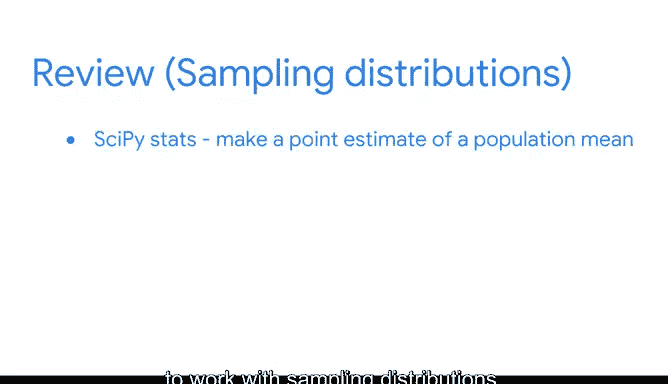

# 谷歌高阶数据分析4：《统计的力量》the-power-of-statistics（中英双字） - P37：37_03_01_总结_3.zh_en - GPT中英字幕课程资源 - BV1yk4y1G7Qm

You now have a solid foundation in sampling， which will serve you well in your future role as a data professional。

In the data career space， you'll be working with sample data all the time。

Throughout this part of the course， we've explored how data professionals use sample data to make inferences。

 predictions， and estimates about populations。Sampling is so useful because it's often too expensive。

 time consuming， or complicated to collect data for an entire population。

And sometimes a complete data set may be too large to process， even for a computer。

Effective sampling is especially important in modern data analytics because data professionals often manage extremely large data sets。

 for example， you might work with economic data that has tens of millions of data points and need to use a sample of 10。

000。As a working data professional， it's important to understand the sampling process used to generate your sample data and whether or not your sample is representative of your population plus。

 as you now know， different types of bias affect different sampling methods。Early on。

 we reviewed the different stages of the sampling process from choosing a target population to collecting data for your sample。

 Then we discussed the two main types of sampling methods。

 probability sampling and non probabilitybability sampling。

 We went over the benefits and drawbacks of each method and how random sampling can help ensure that your sample is high quality and representative of your population。

 We also discussed different forms of bias and sampling and how bias affects non probability sampling methods。

 You learned that any insights you draw from bias data may not be accurate or useful to your stakeholders。

After that， you learned about sampling distributions for both sample means and proportions and how to estimate the corresponding population parameters。

We also covered the central limit theorem and how it helps you estimate the population mean for many different types of data sets。

 Finally， you learned how to use Python Sip P Stats module to work with sampling distributions and make a point estimate of a population mean。

Coming up， you'll take a grade assessment to prepare。

 check out the reading that lists all the new terms you've learned and feel free to revisit videos。

 readings and other resources that cover key concepts congratulations on your progress let's keep it going。

