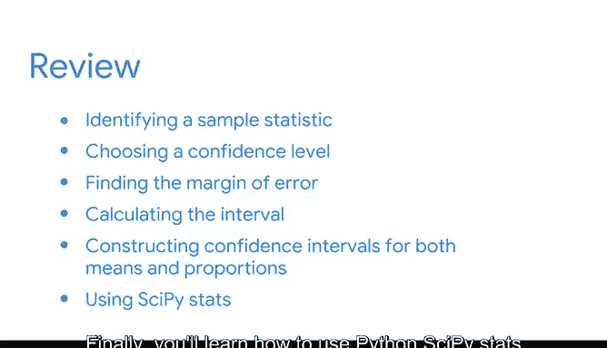

# 谷歌高阶数据分析4：《统计的力量》the-power-of-statistics（中英双字） - P38：38_04_01_欢迎来到模块四.zh_en - GPT中英字幕课程资源 - BV1yk4y1G7Qm

Welcome back。 Wow， you've come so far on your learning journey。

 And you've picked up a lot of new stats knowledge along the way。 So far in this course。

 you've learned how data professionals use descriptive statistics to summarize and explore their data and how they use inferential statistics to draw conclusions about their data。

 You're familiar with basic rules of probability like the addition and multiplication rules and how they describe the likelihood of random events。

😊，You also know how probability distributions like the binomial， Poson。

 and normal distributions can help you model different types of data。Recently。

 you also learned about the main stageses of the sampling process and the benefits and drawbacks of using different sampling methods。

Finally， you've learned how data professionals use sampling distributions to estimate means and proportions。

In this part of the course， we'll explore how to construct and interpret a confidence interval。

 A confidence interval is a range of values that describes the uncertainty surrounding an estimate。

In stats and data science， there are different ways to describe the uncertainty of an estimate。

Two of the main ways are confidence intervals and credible intervals。

 These concepts correspond to two different ways of thinking about statistics。

 frequententist and Bayesian。Confidence intervals are a frequentous concept。

 Credible intervals are a Bayesian concept。 While the goal of confidence and credible intervals is similar。

 They have different statistical definitions and technical procedures。

Right now you don't need to worry about the details。

 I just want you to be aware of the broader context of different stats methods and the tools data professionals use to analyze and interpret data。

Today， there is a lively debate among statisticians。

 researchers and data professionals about how to apply and interpret confidence intervals。

 While the nuances of this debate are beyond the scope of this course。

 you may want to learn more about confidence intervals as you pursue your career in data analytics。

 whether or not you join this ongoing conversation。

 It's important to know how to construct and interpret a confidence interval for at least two reasons。

 First， many data professionals use confidence intervals regularly as part of their job。

 and it may soon be a part of yours。 Second， there's a good chance you may be asked about confidence intervals in a future job interview。

 So it's essential to have a foundation in the topic。😊，Coming up。

 we'll discuss the importance of confidence intervals in data driven work and how they can help you describe the uncertainty of an estimate。

For example， data professionals might use a confidence interval to describe the uncertainty of an estimate for the average return on investment for a stock portfolio。

 the average maintenance costs for factory machinery。

 the percentage of customers who will register for rewards program and the percentage of website visitors who will click on an ad。

However， confidence intervals are often misinterpreted。

 which can lead to false conclusions in a study， so you'll also learn how to correctly interpret confidence intervals and how to avoid common mistakes。

We'll go over the procedure for constructing a confidence interval from identifying a sample statistics and choosing a confidence level。

 defining the margin of error and calculating the interval。

Then you'll learn how to construct confidence intervals from both means and proportions。Finally。

 you'll learn how to use Python's sipi stats module to construct a confidence interval for a point estimate of a population mean When you're ready to learn more。

 I'll meet you in the next video。

