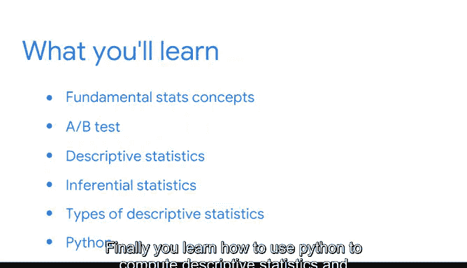

# 谷歌高阶数据分析4：《统计的力量》the-power-of-statistics（中英双字） - P3：03_01_05_欢迎来到模块一.zh_en - GPT中英字幕课程资源 - BV1yk4y1G7Qm

Hi there， I can't wait to explore statistics with you During our journey together。

 you'll learn how data professionals use statistics to gain insights from data and help organizations solve complex problems Staistics is the study of the collection。

 analysis and interpretation of data。We'll start off by discussing the foundational role of statistics in data driven work and the importance of fundamental stats concepts。

 Next， you'll have an opportunity to observe stats in action。

 We'll explore an example of how data professionals use statistical methods to conduct an AB test。

 Then we'll discuss the two main types of statistics， descriptive and inferential。

Data professionals use descriptive stats to explore and summarize data。

 They use inferential stats to draw conclusions and make predictions about data。 Next。

 we'll consider three different types of descriptive statistics and how they can help you a better understand different aspects of data。

 Measure of central tendency， such as the mean allow you to describe the center of a data。

 Measure of dispersion like standard deviation。 Let you describe the spread of data。

 Measures of position such as percentiles help you determine the relative position of the values in a dataset set。

 Finally， you learn how to use Python to compute descriptive statistics and summarize a data。

 When you're ready， join me in the next video。

