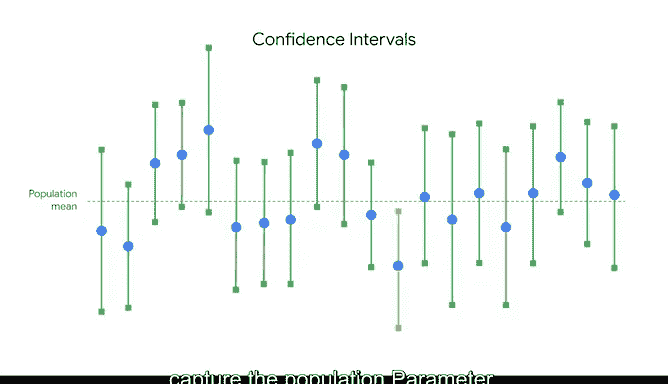

# 谷歌高阶数据分析4：《统计的力量》the-power-of-statistics（中英双字） - P40：40_04_03_解读置信区间.zh_en - GPT中英字幕课程资源 - BV1yk4y1G7Qm

Recently， you learn that data professionals use confidence intervals to express the uncertainty in their results to better understand your results and effectively communicate them to stakeholders。

 it's important to know how to properly interpret a confidence interval。

 Confi intervals are one of the most misunderstood concepts in statistics。

 because it's a complicated topic， both new students and experience researchers。

 sometimes make inaccurate statements about confidence intervals。

 So if you don't get the concept right away。 don't worry， you're not alone。By the end of this video。

 you'll have a better understanding of how to interpret a confidence interval。

You'll also learn some common forms of misinterpretation and how to avoid them。

 Let's explore an example。Imagine you're a data professional who works for an urban planning company in a large city。

The city government asked your team to design new parks and walkways that feature red maple trees。

For planning purposes， your manager asks you to estimate the mean height of all the red maple trees in the city that's approximately 10。

000 trees。 instead of measuring every single tree you collect a sample of 50 trees。

The mean height of the sample is 50 feet with a standard deviation of 7。5 feet。

 Based on a 95% confidence level， you calculate a confidence interval for mean height that stretches between 48 feet and 52 feet。

This interval estimate will help your team design new parks and walkways that meet city ordinances for landscaping。

At this point， you may be wondering， what does it mean to choose a 95% confidence level and to say that you are 95% confident in an interval estimate？

Earlier， you learned that the confidence level expresses the uncertainty of the estimation process。

Let's talk about what this means from a more technical perspective。

 95% confidence means that if you take repeated random samples from a population and construct a confidence interval for each sample using the same method。

 you can expect that 95% of these intervals will capture the population mean。

You can also expect that 5% of the total will not capture the population meat。In practice。

 data professionals usually select one random sample and generate one confidence interval。

 which may or may not contain the actual mean， This is because repeated random sampling is often difficult。

 expensive and time consuming。Confidence intervals give data professionals a way to quantify the uncertainty due to random sampling。

In our example， you have a 95% confidence interval that the mean height is between 48 and 52 feet For the purpose of this example。

 let's say the actual mean height of all 10，000 red maples is 51 feet。In practice。

 you would have no way of knowing this unless you measured every single tree in the city。

This means that if you were to take 20 random samples of 50 trees and calculate a confidence interval for each sample。

 you can expect 19 out of your 20 intervals or 95% of the total will capture the population mean of 51 feet。

One such interval will be the range of values between 48 and 52 feet。 Let's pause for a moment。

 I know that's a lot of new info to digest。 Confidence intervals can be a bit tricky。

 That's why they're misinterpreted so often。To better understand what it means to say you have 95% confidence in your estimate。

 let's explore our urban planning example in more detail。

Imagine you take another 20 random samples of 50 trees using the same sampling method。

Because each sample is randomly selected from a large population。

 the mean will vary from one sample to the next。 remember， this is called sampling variability。

For your first sample of 50 trees， the mean height is 50 feet。 For your second sample of 50 trees。

 The mean height turns out to be 49。5 feet。 For your third sample， you get a mean height of 51。

5 feet and so on。 because of sampling variability。 the mean height for any given sample will not necessarily be equal to the actual population mean。

Confidence intervals help express this uncertainty。

The confidence intervals you calculate based on each sample mean will also vary from one sample to the next。

 and any given interval will not necessarily contain the population mean of 51 feet。For example。

 your first sample has a mean height of 50 feet and a confidence interval between 48 feet and 52 feet。

This interval captures the population mean of 51 feet。 Your second sample has a mean height of 49。

5 feet and a confidence interval between 47。5 to 50。5 feet。

 This interval does not capture the population mean of 51 feet。However。

 a 95% confidence level means that you can expect that 19 out of your 20 intervals or 95% of the total will capture the population mean。

 In other words， this method will produce an interval that contains the population mean with a success rate of 95%。

 and that's a pretty good success rate。Now that you have a better understanding of how to interpret a confidence interval。

 let's review three common misinterpretations of this concept。

 being aware of these misinterpretations will help you avoid them in the future。

The first common misinterpretation of confidence intervals is that a 95% confidence interval means that 95% of all the data values in your data set fall within the interval。

 This is not necessarily true。 For example， your 95% confidence interval for tree heights is between 48 feet and 52 feet。

 It may not be accurate to say that 95% of all the values in your dataset set fall in this interval。

 It's possible that over 5% of the tree heights in your dataset set are outside the interval。

 either shorter than 48 feet or taller than 52 feet。

The second common misinterpretation is that a 95 per confidence interval implies that 95% of all possible sample means fall within the range of the interval。

 This is not necessarily true。 For example， your 95% cent confidence interval for tree height is between 48 feet and 52 feet。

Imagine you take repeated samples using the same sampling method。

 It's possible that over 5% of your sample means will be less than 48 feet or greater than 52 feet。

A third common misinterpretation is to assume that a confidence interval refers to the only possible source of error in your results。

While every confidence interval includes a margin of error。

 many other kinds of errors can enter into statistical analysis， for example。

 the questions in a survey may be poorly designed or sampling bias may affect the sample data。

The margin of error is a useful measure of uncertainty and makes your estimate more reliable。

 but it's not the only possible source of error in your analysis。

So when you're interpreting a confidence interval， remember that the uncertainty lies in an estimation process based on random sampling。

A 95% confidence level refers to the success rate of that process， in other words。

 you can expect 95% of the random intervals you generate to capture the population parameter。

Knowing how to properly interpret confidence intervals will give you a better understanding of your estimate and help you share useful and accurate information with stakeholders。

You may need to explain the common misinterpretations too and why they're incorrect。

 you don't want your stakeholders to get the wrong idea or base their decisions on a misinterpretation。

Understanding how to effectively communicate your results to stakeholders is an important part of being a data professional。

