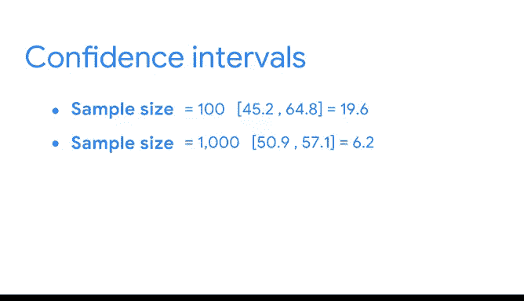

# 谷歌高阶数据分析4：《统计的力量》the-power-of-statistics（中英双字） - P41：41_04_01_构建比例的置信区间.zh_en - GPT中英字幕课程资源 - BV1yk4y1G7Qm

Recently， you learn that data professionals use confidence intervals to describe the uncertainty of an estimate for population mean or proportion。

In this video， you'll learn how to construct a confidence interval for a proportion。

 willll go step by step through an example involving election polling， later on we'll cover means。

Imagine you are a data professional working for a polling agency。

There is an upcoming election for a governor between two candidates， Tiffany Davis and Maya Cruz。

Your agency represents the Davis campaign。Election Day is four weeks away。

The Davis team asks you to conduct a poll to find out how their candidate is doing。

 You collect a random sample of 100 voters from the total population of 100000 voters。

 You ask them which candidate they plan on voting for。

The results show that 55% of voters prefer Davis and 45% of voters prefer crews。

The poll phases your candidate。 If Davis gets over 50% of the vote on Ele Day， it's a win。

 So 55% is a good result。 Great news， right， But you also know that this is only a one random sample of 100 voters out of a large population。

 If you took another random sample of 100 voters， you might get different results。

 If you took a third sample， the results might differ again and so on。😊，In other words。

 your single sample may not provide the actual population proportion or percentage of all voters that will vote for Davis on Election Day。

 For example， on Election Day， Davis may get 52%， which is good enough to win， or 49%， which is not。

So instead of relying on a point estimate as proof that your candidate will win the election。

 you can use your sample data to construct a confidence interval。

 This will give the campaign team a better idea of the uncertainty of your estimate and of the possible election results。

 So let's construct a confidence interval now。Let's review the steps for constructing a confidence interval。

 First， identify a sample statistic。 Second， choose a confidence level， third。

 Find the margin of error and fourth， calculate the interval。First。

 identify your sample statistic your poll represents the percentage of voters who prefer your candidate。

 which is 55%。 This is a sample proportion。Next， choose a confidence level for your poll。

 Most election polls report a 95% confidence level。

 The Davis campaign also requests that you use a 95% confidence level in your calculations。

Your third step is to find the margin of error。 The margin of error refers to the range of values above and below your sample statistic。

 If you're working with a normal distribution and a large sample size。

 one way to calculate the margin of error is by multiplying the Z score by the standard error。

 Let's break that down To review a Z score measures the distance of a data point from the population mean in a standard normal distribution。

 For example， a z score of1 is one standard deviation above the mean。 A z score of negative 1。5 is 1。

5 standard deviations below the mean。This table shows the Z scores that correspond to popular confidence levels。

 1。645 for 90%， 1。96 for 95%， and 2。58 for 99%。If you choose a 95% confidence level。

 use a z score of 1。96 to calculate the margin of error。Now。

 you need to calculate your standard error。 You may recall that the standard error measures the variability of your sample statistic。

 It shows how much your sample proportion is likely to differ from the actual population proportion。

 The larger the standard error， the more variability in your sample。

The formula for the standard error of the proportion is the square root of the sample proportion times 1 minus the sample proportion divided by the sample size。

Your sample proportion is 0。55， and your sample size is 100。

 If you enter the numbers into the formula， you get a standard error of about 0。05。

 So let's put that all together。 The margin of error is your z score of 1。

96 multiplied by your standard error of 0。05。This equals 0。98。 Finally。

 the last step in the process to construct a confidence interval is to calculate the interval。

 The upper limit of your interval is the sample proportion plus the margin of error or 0。55 plus 0。

098。This equals 0。648 or 64。8%。The lower limit is the sample proportion minus the margin of error。

 This is 0。55-0。098 equals 0。452， or 45。2%。 Therefore。

 you have a 95% confidence interval that stretches from 45。2% to 64。8%。

While your confidence interval mostly lies above 50%。

 this isn't necessarily a reason to be optimistic about the upcoming election since the lower limit of 45。

2% falls below 50%。Based on the confidence interval， losing the election is still a possibility。

 the campaign team may want to invest more in TV or social media advertising to ensure victory。

Or if the campaign team wants a more accurate estimate of the election results。

 they may request another poll with a larger sample size。

 this will give a more accurate estimate because it includes more voters。

Let's say you conduct another poll with a sample size of 1000 voters。

 The new poll reports that 54% of voters prefer candidate Davis。

 If you calculate a 95% confidence interval using these numbers， your interval will stretch from 50。

9% to 57。1%。 The lower limit of your interval is now above 50%。

 This should give the Davis de more confidence about the upcoming election。 Of course。

 there's still a chance their candidate may lose the election。 Since the confidence level is 95%。

 not 100%。You may notice that as the sample size gets larger。

 the confidence interval gets narrower with a sample of 100， the interval covers 19。

6 percentage points。 With the sample size of 1000， The interval covers 6。2 percentage points。

 This is because as your sample size increases， your margin of error decreases。

If you could sample every member of the population， the margin of error would be0。But of course。

 it's often too expensive and time consuming to sample an entire population or to take repeated samples。

Data professionals typically work with a single random sample of a large population。

Confidence intervals help data professionals give more reliable estimates based on the available data。

 and based on your data， your candidate will likely win the election。

