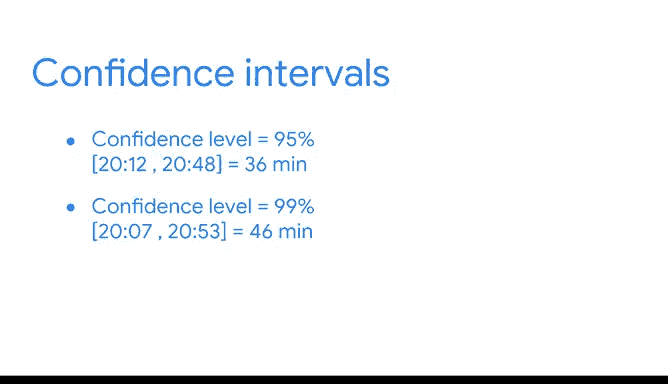

# 谷歌高阶数据分析4：《统计的力量》the-power-of-statistics（中英双字） - P42：42_04_02_构建均值的置信区间.zh_en - GPT中英字幕课程资源 - BV1yk4y1G7Qm

Previously， you learned that data professionals use competence intervals to express the uncertainty of an estimate。

Then you constructed a confidence interval for the proportion of votes in an upcoming election。

In this video， you'll construct another confidence interval， but this time for a mean。

The basic process is the same as the one you use for a proportion， but requires new calculations。

 will go step by step through an example involving the marketing of a new cell phone。

 Imagine you're a data professional working for a company that produces cell phones。Recently。

 the company developed a phone with an extended battery life。

 It's designed to operate for at least 20 hours without recharging。

 This is a big upgrade in battery life and will boost sales。

 The marketing team is planning an ad campaign about the new battery to help sell the phone。

Management wants to make sure the claim about 20 hours of battery life is accurate before the ads go public。

They ask you to analyze the data and make a reliable estimate for battery life of the new phone。

The company has produced 100，000 new phones。 The product engineering team tests a random sample of 100 phones and records the data about battery life。

Based on the data， you know that the sampled mean duration for battery life is 20。

5 hours and the sample standard deviation is 1。7 hours。

 and based on the campaign's data about the standard manufacturing process of the batteries。

 you also know that the population's standard deviation is 1。5 hours。

The sample mean is over 20 hours for this test。 However。

 you know that this is only one random sample of 100 phones out of a large population。

 If you took another random sample of 100 phones， you might get different results。

 If you took a third random sample， the results might differ again and so on。

Your single sample may not provide the actual mean battery life for all the phones。

 The population mean for battery life could be 19 hours，21 hours or something else。

You can use your sample data to construct a confidence interval that likely includes the population mean for the phone's battery life。

This will give the marketing team a better idea of the uncertainty in your estimate。

It will also help them decide how to advertise the phone and whether they can claim that its battery lasts 20 hours or more。

Let's review the steps for constructing a confidence interval。 First， identify a sample statistic。

 Second， choose a confidence level， third， from the margin of error and fourth。

 calculate the interval。First， identify your sample statistic。

Your sample represents the average duration of battery life for 100 cell phones。 in this example。

 you're working with the sample mean Next， choose a confidence level。

Management requests that you choose a 95% confidence level。

 This is the company standard for new products。Your third step is to find the margin of error。

 which refers to the range of values above and below your sample statistic。

You can calculate the margin error by multiplying the z score by the standard error。

You may recall that the Z score you use depends on your confidence level。

 This table shows the z scores that correspond to popular confidence levels such as 9095 and 99%。

 The Z score for a 95% confidence level is 1。96。Now， you can calculate the standard error。

 which measures the variability of your sample statistic。

 It shows how much your sample mean is likely to differ from the actual population mean。

The larger the standard error， the more variability。

The formula for the standard error of the mean is the population standard deviation divided by the square root of the sample size。

 Your population standard deviation is 1。5， and your sample size is 100。

If you enter the numbers into the formula， you get a standard error of 0。15。

 The margin of error is your z score，1。96 multiplied by your standard error，0。15。 This equals 0。294。

Finally， calculate your confidence interval， the upper limit of your interval is the sample mean plus the margin of error。

This is 20。5 plus 0。294 equals 20。794 hours or about 20 hours and 48 minutes。

The lower limit is the sample mean minus the margin of error， this is 20。5 minus 0。294 equals 20。

206 or about 20 hours and 12 minutes。So you have a 95% confidence interval for the battery life of the phone that stretches from 20 hours and 12 minutes to 20 hours and 48 minutes。

The confidence interval gives company management important information。

The lower limit of your interval，20 hours and 12 minutes。Is above the company's goal of 20 hours。

This helps the marketing team feel confident about advertising the battery life of the cell phone to be at least 20 hours。

You present your findings to the company's stakeholders and the results satisfy everyone except the head of marketing。

The marketing director has put a lot of time and effort into developing the ad campaign and wants to be even more confident。

The director requests that you analyze the data using a 99% confidence level。

To make the marketing director happy， you rec calculateculate your results， use the same sample data。

 but is a 99% confidence level instead of 95%。Your confidence interval now stretches from 20 hours and7 minutes to 20 hours and 53 minutes。

The lower limit of your interval is still above 20 hours。

 This result should give company management even more confidence about the battery life and hopefully satisfy the marketing director。

You may notice that as the confidence level gets higher， the confidence interval gets wider。

With a confidence level of 95%， the interval covers 36 minutes， with a confidence level of 99%。

 the interval covers 46 minutes， this is because a wider confidence interval is more likely to include the actual population parameter。

Note that in this example we know that the population standard deviation is 1。5 hours， however。

 in practice， the population standard deviation is often unknown and has to be estimated based on the sample standard deviation。

This is because it's difficult to get complete data on a large population。

If you don't know the population standard of deviationviation。

 this changes the calculations for the confidence interval to learn more。

 feel free to check out the relevant reading。As a data professional。

 you can use confidence intervals to help stakeholders make informed decisions based on accurate estimates。

Your analysis of the data will help shape the company's strategy for the new product launch。

 As a data professional， you play a key role in the future success of the new product。

